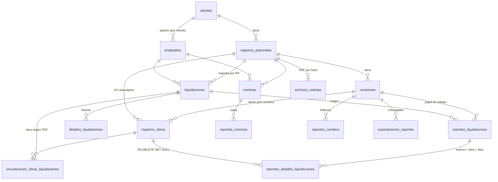

# Análisis Integral para Cambios — Correcciones Patronales IMSS / SIROC (`docu_ffacd`)

> **Propósito:** servir como documento base para planear y ejecutar los cambios del proyecto contra las 8 reglas de negocio vigentes.
> **Fuentes:** `documentacion_reglas_negocio.md` (descripción funcional, anterior al plan de mejora), `plan_mejora_cedulas_liquidaciones.md` (plan de 6 fases ya implementado en la rama `mejora_cedulas_liquidaciones`) y una inspección del código fuente hecha el **2026-11-12** sobre el commit `f7376f8`.
> **Estado base:** `cargo test --offline` → **262 pruebas OK, 38 ignoradas** (las de integración con PostgreSQL).

---

## Índice

0. [Convenciones](#0-convenciones)
1. [Vigencia de las fuentes](#1-vigencia-de-las-fuentes)
2. [Mapa real de la arquitectura](#2-mapa-real-de-la-arquitectura)
3. [Reglas de negocio objetivo (RN-1 … RN-8)](#3-reglas-de-negocio-objetivo)
4. [Auditoría punto por punto](#4-auditoría-punto-por-punto)
5. [Hallazgos transversales críticos](#5-hallazgos-transversales-críticos)
6. [Catálogo de cambios](#6-catálogo-de-cambios)
7. [Decisiones de negocio pendientes](#7-decisiones-de-negocio-pendientes)
8. [Fases de implementación](#8-fases-de-implementación)
9. [Estrategia de pruebas](#9-estrategia-de-pruebas)
10. [Riesgos y migración de datos](#10-riesgos-y-migración-de-datos)
11. [Anexos](#11-anexos)

---

## 0. Convenciones

| Símbolo | Significado |
|---|---|
| 🔴 | Crítico: pérdida de datos, dato incorrecto ante el IMSS o regla de negocio incumplida en su núcleo |
| 🟠 | Alto: regla incumplida parcialmente, validación ausente en backend, integridad débil |
| 🟡 | Medio: UX, coherencia, rendimiento |
| ⚪ | Menor: cosmético, limpieza |
| ✅ / 🟡 / ❌ | Cumple / parcial / no cumple (en la auditoría por regla) |
| **[V]** | Verificado leyendo el código en esta inspección |
| **[D]** | Tomado de `documentacion_reglas_negocio.md` y no reverificado |
| **[P]** | Tomado de `plan_mejora_cedulas_liquidaciones.md` §11 (estado de implementación) |

- **IDs de hallazgo:** `H-xx`. **IDs de cambio:** `FIX-xx` (arreglar), `ADD-xx` (agregar), `MOD-xx` (modificar), `DEL-xx` (eliminar). **IDs de decisión:** `D-x`.
- "Backend" = la capa `src/db/*` y la lógica Rust que escribe en PostgreSQL. La aplicación es de **escritorio**: no hay API HTTP; la UI (Slint) llama a funciones Rust que hablan con la BD.
- Rutas citadas como `archivo:línea` (líneas del commit `f7376f8`).

---

## 1. Vigencia de las fuentes

### 1.1 `documentacion_reglas_negocio.md`

Describe las 11 vistas **antes** del plan de mejora. Varias afirmaciones ya no son ciertas:

| Afirmación del documento | Estado actual |
|---|---|
| Excel con fallbacks fijos (`"15/04/2026 AL 30/06/2026"`, representante legal fijo) — §7.5 | **Corregido** (Fase 0/5) [P]. El entregable usa `ReporteFinalHeaderMeta` sin valores fijos. |
| Atajos de teclado decorativos en Vista 7 — §7.6.3 | **Corregido** parcialmente (`ea59e2c`, KeyBinding) [P]. |
| Universos distintos KPIs / pie / Excel — §7.6.4 | **Corregido** para el entregable (usa todas las filas `ACTIVO`); el **borrador** sigue usando la vista filtrada [V] (`reporte_view_logic.rs:1905,1962`). |
| Sincronización destructiva al abrir Vista 7 | **Corregido**: ahora solo con solicitud explícita (`reporte_view_logic.rs:1462-1464`) y es no destructiva (`FUERA_PERIODO`) [V]. |
| CP `"64000"` fijo en `2_AFIL` — §7.5 | **Corregido** (`dfe5df7`) [P]. |
| Bug `need_combos` — §Infra | **Sigue presente** (`main.rs:1004`) [V parcial: existe la línea; el pre-poblado de `models.slint` no se reverificó]. |
| `delete_all_nominas` global — §9.7.1 | **Sigue presente** [V] (`nominas.rs:1048`: `DELETE FROM public.reportes_nominas`, `public.detalles_nominas`, `public.nominas` sin `WHERE`). |
| Filtro de nóminas por obras de usuario — §9.1 | Descripción **incompleta**: el SQL real tiene comodines y un error de sintaxis (ver H-01, H-02). |

### 1.2 `plan_mejora_cedulas_liquidaciones.md`

Plan de 6 fases **ya implementado** (commits `e3a4045` … `f7376f8`). Sus decisiones vigentes (§11.2) se respetan en este análisis:

- Duplicados del mismo mes: **gana la carga más reciente** y conserva las obras si la nueva no las trae.
- **Sin obra = importe completo (factor 1).**
- RustFS por revisión con hash en el nombre.
- `Decimal` solo en el prorrateo (`src/db/prorrateo.rs`); columnas en `double precision`.
- UNIQUE de empleados **solo por NSS**.
- `reportes_vinculaciones_obras_liquidaciones` (rvol) se **regenera** desde `reportes_detalles_liquidaciones` (rdl) al cerrar cada edición; rdl es la fuente de verdad.

Pendientes del plan que siguen abiertos (§11.6): representante legal sin capturar, periodo de la revisión HERAS, reparar la tabla maestra de vinculaciones desde RustFS, pruebas con PDF reales, backfill de `archivos_cedulas`, CURP con entidad "CL".

---

## 2. Mapa real de la arquitectura

### 2.1 Stack

| Capa | Tecnología | Evidencia |
|---|---|---|
| Lenguaje | Rust 2024 | `Cargo.toml` |
| UI | Slint 1.18 (`ui/*.slint`, compilado en `build.rs`) | `Cargo.toml`, `ui/` |
| BD | PostgreSQL vía `postgres` 0.19 + pool `r2d2` | `src/db/client.rs` |
| Archivos | RustFS (S3) vía `rust-s3` | `src/rustfs.rs` |
| PDF | MuPDF (`mupdf-rs`) | `src/cedulas/pdf_extractor.rs` |
| Excel | `rust_xlsxwriter` (escritura), `calamine` (lectura) | `Cargo.toml` |
| Concurrencia | `rayon`, hilos `std::thread`, `slint::invoke_from_event_loop` | `main.rs` |
| Decimal | `rust_decimal` (solo prorrateo) | `src/db/prorrateo.rs` |

### 2.2 Módulos (tamaño = líneas)

| Área | Archivos clave | Notas |
|---|---|---|
| Arranque y cableado UI | `src/main.rs` (8158) | Monolito: callbacks de casi todas las vistas. |
| Esquema y migraciones | `src/db/schema.rs` (2366) | `ensure_schema` idempotente; DDL de fases en constantes `SQL_FASE*`. |
| Catálogos (clientes, RP, empleados) | `src/db/catalogos.rs` (1349) | |
| Revisiones y obras | `src/db/revisiones.rs` (876) | CRUD individual. |
| Cédulas: extracción | `src/cedulas/*` | SUA/EMA, validación de pertenencia. |
| Cédulas: ingesta | `src/db/ingesta.rs`, `src/db/cedulas.rs` | Idempotente por SHA-256 (`archivos_cedulas`). |
| Liquidaciones (reporte) | `src/db/reporte_liquidaciones.rs` (7359), `src/reporte_view_logic.rs` (7887) | Sync, topes, prorrateo, Excel. |
| Asignación | `src/asignacion_view_logic.rs`, `src/asignacion_obra_logic.rs`, `src/asistente_asignacion.rs`, `src/db/asignacion_ops.rs` | Matriz empleado × mes, por obra, asistente masivo. |
| Bitácora / deshacer | `src/db/bitacora_reportes.rs` | Lotes con foto antes/después. |
| Entregable IMSS | `src/entregable_logic.rs`, `src/db/entregables.rs`, `src/sua_export.rs` | Lista de verificación, versiones, SUA TXT. |
| Nóminas | `src/nominas/*`, `src/db/nominas.rs`, `src/db/nominas_reporte.rs`, `src/nominas_view_logic.rs`, `src/nominas_upload_view_logic.rs` | CFDI 4.0 / Nómina 1.2. |
| Validación de identificadores | `src/validation.rs` | RFC, CURP, NSS, RP, obra. |
| Pruebas de integración | `src/db/pruebas_integracion_*.rs`, `src/pruebas_golden_excel.rs` | `#[ignore]`, requieren BD. |

### 2.3 Modelo de datos (relevante)



| Tabla | Clave / restricciones relevantes | Evidencia |
|---|---|---|
| `clientes` | `nombre UNIQUE`, `rfc UNIQUE`, `representante_legal` (Fase 0) | `schema.rs:376-384` |
| `registros_patronales` | `UNIQUE (id_cliente, registro)`; **sin** `creado_usuario` | `schema.rs:413-432` |
| `revisiones` | `UNIQUE (rp, nombre)`, `UNIQUE (rp, folio)`; `periodo_inicio/fin` (Fase 3) | `schema.rs:455-475` |
| `registros_obras` | `UNIQUE (id_revision, numero)`; `fecha_inicio/fin NOT NULL`; `monto` nullable; `creado_usuario DEFAULT false`; **sin CHECK `inicio ≤ fin`**; `id_registro_patronal` **no validado** contra el RP de la revisión | `schema.rs:477-494` |
| `empleados` | Por cliente; `esta_activo DEFAULT true`; UNIQUE parcial `(id_cliente, nss)` (Fase 1) | `schema.rs:496-507` |
| `nominas` | `id_revision uuid` **sin FK** | `schema.rs:569-598` (línea 573) |
| `liquidaciones` | UNIQUE `(rp, empleado, año, mes)` (Fase 1) | `schema.rs:612-621` |
| `reportes_liquidaciones` | `estado ∈ {ACTIVO, FUERA_PERIODO, EXCLUIDO}`, `editado_usuario`, `cedula_actualizada`; UNIQUE `(rev, emp, año, mes)` | `schema.rs:95-101, 702-713` |
| `reportes_detalles_liquidaciones` | `id_registro_obra … ON DELETE SET NULL`; `tiene_inconsistencia`, `observacion_validacion` | `schema.rs:715-744` (línea 739) |
| `reportes_cambios` | `usuario varchar(100)` (se llena con `current_user`), `deshecho_por` | `schema.rs:103-117`, `bitacora_reportes.rs:131` |
| Usuarios / analistas | **No existe tabla** | — |

### 2.4 Flujos principales

1. **Carga de cédulas (Vista 6):** selección → hash → clasificación (idéntico / mes repetido) → staging RustFS → transacción PG (`ingesta.rs`, `cedulas.rs`) → `sync_reportes_liquidaciones_for_revision_tx` → COMMIT PG → promoción RustFS [P][V parcial].
2. **Sincronización a reportes:** `sync_reportes_liquidaciones_for_revision_tx` (`reporte_liquidaciones.rs:722+`). Inserta lo que falta y marca `FUERA_PERIODO` / `ACTIVO` según `sql_en_universo` (`:694-715`). No toca reportes `editado_usuario = true` [V].
3. **Edición del analista:** `iniciar_edicion` → cambios en rdl → `cerrar_edicion` (prorrateo canónico + regenerar rvol + `editado_usuario = true`) (`bitacora_reportes.rs`) [V].
4. **Entregable:** `evaluar_lista_verificacion` (`entregable_logic.rs:94+`) → borrador (vista filtrada, sin versión) o entregable vN (todas las filas `ACTIVO`, RustFS + `exportaciones_reportes`) [V].
5. **Nóminas:** carga CFDI (Vista 10) → `copy_nominas_a_reportes` / `sync_reportes_nominas_for_target` → Vista 9 [V].

### 2.5 Cálculo de topes de días (estado actual)

`calculate_max_dias_obra_for_employee_movements` (`reporte_liquidaciones.rs:6315-6377`) [V]:

```
dias_efectivos = max(0, round(dias_cedula − lic − inc − aus))
intervalos_activos = intervalos del mes según ALTA/REING/BAJA del empleado
dias_vigencia = |intervalos_activos ∩ [obra_inicio, obra_fin] ∩ mes|
tope_obra = min(dias_efectivos, dias_vigencia)
```

- **No** resta los días ya asignados a otras obras del mismo mes. Eso se valida aparte en la UI del modal unificado (`reporte_view_logic.rs:3381-3395`) y en el trigger (condición "suma de días de obra > días de cédula").
- LIC / INC / AUS se restan como cantidad, sin fecha: no se sabe si caen dentro o fuera de la vigencia de la obra.

Trigger `trg_check_reportes_detalles_liquidaciones_tope` (`schema.rs:~1840-2030`) [V]: **no bloquea**, solo marca `tiene_inconsistencia` y `observacion_validacion`.

---

## 3. Reglas de negocio objetivo

Redacción normalizada de las 8 reglas, con criterios de aceptación verificables (CA).

### RN-1 — Cédulas en tres escenarios
Las cédulas pueden traer obra para **todos**, **algunos** o **ningún** empleado.
- **CA-1.1** Cargar una cédula de cada escenario no produce errores ni cálculos rotos.
- **CA-1.2** Los empleado-mes sin obra quedan con importe completo (factor 1) y visibles como "sin obra".
- **CA-1.3** El analista puede completar la asignación en cada escenario (individual, masiva o por importación).

### RN-2 — Registros de obra (SIROC) y regla del 18%
- **CA-2.1** Alta de **1 o muchas** obras; existe una vía de **alta masiva** (tabla, pegado o archivo).
- **CA-2.2** Obligatorios: número, fecha de inicio y fecha de fin, validados **en UI y en backend**; `inicio ≤ fin`.
- **CA-2.3** Opcionales: monto y complementarios. La UI **recomienda** el monto y explica que sin él no se calcula el 18%.
- **CA-2.4** Exportar a Excel es posible **en cualquier momento**; rebasar el 18% solo muestra una alerta, **nunca bloquea**.

### RN-3 — Revisiones en lote
- **CA-3.1** Crear varias revisiones en una sola operación, con validación previa de duplicados (nombre/folio por RP).

### RN-4 — Empleados e histórico por obra
- **CA-4.1** Ver qué empleados están **dados de baja** (con fecha y fuente).
- **CA-4.2** Ver si el empleado está **actualmente asignado** a 1+ obras o a ninguna.
- **CA-4.3** Ver el **histórico completo**: obras, meses y fechas/días en cada obra, construido desde cédulas y asignaciones.

### RN-5 — Reporte de liquidaciones filtrado por vigencia de obras
- **CA-5.1** Solo se muestran registros dentro del rango de fechas de las obras capturadas.
- **CA-5.2** Los registros fuera de rango **no se borran** (filtrado lógico) y reaparecen si el rango cambia.

### RN-6 — Edición individual y en lote con topes en tiempo real
- **CA-6.1** Editar 1 o varios empleados (asignar o desvincular 1+ obras).
- **CA-6.2** La UI muestra **en tiempo real el tope por obra** para cada empleado-mes: mes, vigencia de la obra, incapacidades, ausentismos, licencias, días de cédula, alta/baja y días ya asignados a otras obras.
- **CA-6.3** Días capturados a mano se validan **en UI y en backend**; fuera de rango → rechazo con mensaje claro.

### RN-7 — Reporte de nóminas filtrado por registros asignados
- **CA-7.1** Solo incluye nóminas de empleados con 1+ registros asignados que el usuario creó (definición exacta: D-2).
- **CA-7.2** Recalcular el reporte **no destruye** ediciones ni nóminas sintéticas del analista.

### RN-8 — Uno o varios analistas
- **CA-8.1** Cada cambio relevante registra **quién** lo hizo.
- **CA-8.2** Dos analistas editando la misma revisión no se pisan en silencio (bloqueo o conflicto detectado).
- **CA-8.3** El deshacer de un analista no revierte el trabajo de otro.

---

## 4. Auditoría punto por punto

### RN-1 — Escenarios de cédulas · Estado: ✅ casi completo

| Aspecto | Estado | Evidencia |
|---|---|---|
| Detección del escenario (≥95 % / 5–95 % / <5 %) | ✅ | `asignacion_view_logic.rs:289` (`resumen_avance`), `:335` (`texto_escenario`) [V] |
| Sin obra = factor 1 | ✅ | Decisión §11.2 [P]; prorrateo canónico en `prorrateo.rs` |
| Asistente masivo (vigencia / todos a una / importación / copia) | ✅ | `asistente_asignacion.rs:405, 423, 469, 561` [V] |
| Importación `NSS │ AÑO │ MES │ OBRA │ DÍAS` | ✅ | `asistente_asignacion.rs:76` (`leer_archivo_importacion`) [V] |
| Obras detectadas en la cédula visibles y "adoptables" | ❌ | `fetch_obras_by_revision` filtra `creado_usuario = true` (`revisiones.rs:237`); no existe la sugerencia "Registrar obra" (`grep` sin resultados) [V] |
| Pruebas con PDF reales | ❌ | Pendiente §11.6 [P] |

**Hallazgos:**
- **H-10** 🟡 Las obras que trae la cédula (`creado_usuario = false`) no se ven en Vistas 3/4, y no hay un atajo para convertirlas en obras del usuario. En el escenario A (todos con obra), el analista tiene que recapturar a mano números que el sistema ya conoce.

### RN-2 — Obras, 18% y Excel · Estado: 🟡 parcial

| Aspecto | Estado | Evidencia |
|---|---|---|
| Alta individual | ✅ | `on_submit_obra` (`main.rs:5658`) → `create_obra` (`revisiones.rs:556`) [V] |
| **Alta masiva** | ❌ | No existe callback, modal ni función de lote para obras [V] |
| Fechas obligatorias en UI | ✅ | `main.rs:5680-5688` (obligatoria y `inicio ≤ fin`) [V] |
| Fechas obligatorias en backend | ❌ | `create_obra` / `update_obra`: `unwrap_or(today)` (`revisiones.rs:562-564`, `:657-659`); sin `inicio ≤ fin`; sin CHECK en BD [V] |
| Monto recomendado | ✅ | `registros_obras_view.slint:967` ("★ Requerido para Límite 18%"), `:1005-1006`; toast `main.rs:5741-5743` [V] |
| Monto "no capturado" vs 0 | 🟡 | Se guarda `0.0`; `fetch_obras_by_revision` hace `COALESCE(monto, 0.0)` (`revisiones.rs:231`) [V] |
| 18% no bloquea | ✅ | Solo `advertencias` (`entregable_logic.rs:178-205`) [V] |
| Exportar "en cualquier momento" | 🟡 | El **borrador** siempre se puede (`reporte_view_logic.rs:1962-1970`). El **entregable** se bloquea si falta un dato del encabezado, hay "cuota duplicada" o no hay filas (`entregable_logic.rs:104-150`; `reporte_view_logic.rs:1997`) [V] |
| Alta duplicada | 🟠 | `ON CONFLICT (id_revision, numero) DO UPDATE` sobrescribe todos los campos sin avisar (`revisiones.rs:591-601`) [V] |
| Efecto de editar/borrar obra en el reporte | 🔴 | Ver H-05 y H-06 |

**Hallazgos:**
- **H-03** 🟠 El backend acepta obras sin fechas (pone **hoy**) y con `inicio > fin`. Hoy solo protege la UI; una carga masiva futura o cualquier otro punto de entrada lo saltaría.
- **H-04** 🟡 El monto vacío se guarda como `0` y no se distingue "sin capturar" de "cero". `compute_guarderias_kpis` marca `supera_18` cuando el monto es 0 y hay GPS (`documentacion_reglas_negocio.md` §7.4.D) [D]: una obra sin monto aparece como "supera el 18%", lo que es una alerta falsa.
- **H-05** 🔴 **Borrar una obra** (`delete_obra`, `revisiones.rs:728-743`; `main.rs:5816-5845`) hace `DELETE` directo:
  - En rdl, `id_registro_obra` pasa a `NULL` por la FK (`schema.rs:739`). Los importes **siguen prorrateados** (no se llama `cerrar_edicion`), así que el tramo queda "sin obra" con importe parcial.
  - En el siguiente recálculo, ese tramo sin obra pasa a factor 1 y, si tenía un hermano con otra obra, la suma supera la cédula → bloqueante "Cuota duplicada".
  - No pide confirmación con impacto (cuántos empleado-mes usan la obra), no registra en `reportes_cambios` y no se puede deshacer.
  - La vinculación **maestra** (`vinculaciones_obras_liquidaciones`) se borra en cascada.
- **H-06** 🟠 **Editar las fechas** de una obra (`update_obra`) no vuelve a sincronizar (`main.rs:5720-5750`: solo recarga la lista). Las filas no pasan a `FUERA_PERIODO` hasta que el analista pulse "⟳ Sincronizar", y el trigger no reevalúa `tiene_inconsistencia` de los tramos existentes (solo se dispara al escribir en rdl).
- **H-07** 🟡 `on_submit_obra` ejecuta la consulta en el hilo de la UI (no usa `thread::spawn`, a diferencia de `on_confirm_delete_obra`).

### RN-3 — Revisiones en lote · Estado: ❌

| Aspecto | Estado | Evidencia |
|---|---|---|
| Alta individual | ✅ | `on_submit_revision` (`main.rs:5002`) → `create_revision` (`revisiones.rs:336`) [V] |
| Alta masiva | ❌ | No existe [V] |
| Unicidad | ✅ | `UNIQUE (rp, nombre)`, `UNIQUE (rp, folio)`; folio vacío o `S/F` → `NULL` [D] |
| Estructura RustFS por revisión | ✅ | `ensure_revision_structure` en segundo plano [D] |

**Hallazgos:**
- **H-11** 🟠 Sin alta masiva. Para hacerla falta definir cómo se generan `nombre` y `folio` (D-3), y crear la estructura RustFS de cada revisión del lote.

### RN-4 — Empleados e histórico · Estado: 🟡 parcial

| Aspecto | Estado | Evidencia |
|---|---|---|
| Columna "Activo / Baja" | 🟡 | `empleados_view.slint:381-407` lee `esta_activo` [V] |
| Origen de "Baja" | ❌ | `esta_activo` solo se escribe al crear o editar a mano (`catalogos.rs:1104, 1156`). **Nada lo deriva** de las bajas de la cédula [V] |
| Fecha de baja | ❌ | No se muestra ni se guarda en `empleados` [V] |
| "Actualmente asignado a N obras" | ❌ | No existe en la vista de empleados [V] |
| Registro patronal del empleado | 🟡 | Subconsulta `LIMIT 1` sin `ORDER BY` (`catalogos.rs:1001-1009`): con varios RP muestra uno arbitrario [V] |
| Histórico empleado × obra | 🟡 | La matriz empleado × mes (`construir_matriz`, `asignacion_view_logic.rs:122`) da obra y días por mes **solo de la revisión abierta**. No hay vista entre revisiones ni rango de fechas por obra [V] |
| Baja en Vista 9 | ✅ | `check_empleado_tiene_baja_periodo` (`nominas_reporte.rs:1041`) bloquea editar días si hay `BAJA` [V] |

**Hallazgos:**
- **H-12** 🟠 El estado "Baja" de la vista de empleados es una marca manual que no refleja la cédula. Un empleado con `BAJA` en la última cédula aparece como "Activo".
- **H-13** 🟠 No existe el histórico pedido. Los datos sí existen: rdl (obra + días por empleado-mes), los movimientos (`clave`, `fecha`) y las vigencias de obra. Falta la consulta y la vista.
- **H-14** 🟡 La columna RP con `LIMIT 1` es engañosa para empleados de varios RP del mismo cliente.

### RN-5 — Liquidaciones filtradas por vigencia · Estado: ✅ con matices

| Aspecto | Estado | Evidencia |
|---|---|---|
| Filtrado lógico, sin borrar | ✅ | `UPDATE … SET estado = 'FUERA_PERIODO'` / `'ACTIVO'` (`reporte_liquidaciones.rs:753-800`) [V] |
| Fuera de KPIs, totales y entregable | ✅ | `reporte_view_logic.rs:50, 1427-1431` (`partition` por `ACTIVO`) [V] |
| Pestaña "Fuera de periodo" | ✅ | `reporte_view_logic.rs:50` [V] |
| Criterio del universo | 🟡 | `sql_en_universo` (`:694-715`): (1) si la revisión tiene `periodo_inicio/fin`, **solo** ese periodo; (2) si no, la unión de vigencias de obras `creado_usuario = true`; (3) si no, todo [V] |
| Granularidad | 🟡 | Se compara el **mes completo**: un mes entra si toca la vigencia aunque sea un día [V] |
| Se recalcula al cambiar obras | ❌ | No hay sync automática al guardar o borrar obra (H-06) [V] |

**Hallazgos:**
- **H-15** 🟡 Con `periodo_inicio/fin` capturado, las fechas de las obras **se ignoran** para el universo. La regla de negocio pide filtrar por las obras. Ver D-4.
- **H-16** 🟡 Granularidad mensual: es coherente con la cédula (que es mensual), pero los días fuera de vigencia dentro de un mes "parcial" se controlan solo por el tope de días por obra, no por el filtro.
- **H-17** ⚪ Riesgo operativo conocido [P]: la revisión HERAS sin periodo capturado dejará 1,282 reportes en `FUERA_PERIODO` al sincronizar (no destructivo, pero confuso).

### RN-6 — Edición con topes en tiempo real · Estado: 🟡 parcial

| Aspecto | Estado | Evidencia |
|---|---|---|
| Cálculo del tope por obra | ✅ | `calculate_max_dias_obra_for_employee_movements` (`reporte_liquidaciones.rs:6315`), usado en 9 puntos de `reporte_view_logic.rs` (2485 … 5243) [V] |
| Modal unificado (Vista 7): tope y suma | ✅ | Redistribución reactiva `redistribute_edit_obras_days` (`reporte_view_logic.rs:425`) + validación al guardar (`:3381-3395`) [V] |
| Edición en lote (Vista 7) | ✅ | `redistribute_batch_workers_days` (`reporte_view_logic.rs:560`) [V] |
| **Asignación por empleado**: tope por obra | ❌ | La celda muestra `Céd · Disp · Asig` (`asignacion_empleados_view.slint:614-617`) donde `disponibles = días efectivos` (`asignacion_view_logic.rs:206-209`), **sin vigencia de obra ni movimientos**. Los SpinBox tienen `maximum: 31` fijo (`:647, :689-690`) [V] |
| **Asignación por empleado**: cambiar días | 🟠 | `planear_cambio_dias` (`asignacion_view_logic.rs:594-620`) solo limita a la suma de `dias_cedula` de los tramos de esa obra; **no** considera vigencia, LIC/INC/AUS ni otras obras [V] |
| Validación en backend | ❌ | `aplicar_plan_tramos` solo hace `clamp(0, 31)` (`asignacion_ops.rs:99`); `batch_save_reporte_row_updates` no revalida el tope; el trigger **marca, no bloquea** [V] |
| Días ya asignados a otras obras | 🟡 | Considerados en el modal unificado y en el trigger (suma por movimiento), **no** en la función de tope [V] |
| LIC/INC/AUS por fecha | ❌ | Se restan como cantidad (§2.5) [V] |

**Hallazgos:**
- **H-08** 🟠 La validación de días capturados a mano vive en la UI. La capa de BD acepta cualquier valor de 0 a 31. Esto incumple CA-6.3 y permite datos incoherentes desde cualquier camino que no pase por el modal unificado (por ejemplo, el SpinBox de Asignación por empleado).
- **H-09** 🟠 La pantalla nueva "Asignación por empleado" (Fase 4) no muestra el **tope por obra**, solo los días disponibles del mes. Esto incumple CA-6.2 en la vista principal de trabajo.
- **H-18** 🟡 Hay dos fórmulas de días efectivos: con `round` (BD y tope) y sin `round` (`recalculate_row_in_memory`) [D §7.6.6].

### RN-7 — Reporte de nóminas · Estado: ❌ (y con defectos críticos, ver §5)

| Aspecto | Estado | Evidencia |
|---|---|---|
| Filtro por empleados asignados | ❌ | El filtro real es por **traslape de fechas** nómina ↔ obra, más comodines (abajo) [V] |
| Recalcular sin destruir | ❌ | `copy_nominas_a_reportes` borra **todas** las copias de **todos** los clientes (`nominas_reporte.rs:414-430`) [V] |
| SQL válido | ❌ | Paréntesis desbalanceados en `copy_nominas_a_reportes` (H-02) [V] |

Detalle del filtro de `sync_reportes_nominas_for_target` (`nominas_reporte.rs:541-607`) [V]:

```sql
WHERE ( n.id_registro_patronal = $1 OR n.id_revision = $1
        OR <revisión $1 del mismo RP> OR <RP de cliente $1> )   -- $1 polimórfico
  AND NOT EXISTS (ya copiada)
  AND ( NOT EXISTS (obras usuario)                              -- comodín: sin obras entra todo
        OR EXISTS (obra usuario cuya vigencia traslapa la nómina) )
```

- No hay condición sobre el **empleado** (asignado a obra o no): solo fechas.
- `$1` se interpreta como RP, revisión **o** cliente a la vez; es frágil y puede mezclar alcances si llegaran a coincidir UUID (improbable) o, más realista, si se pasa el id equivocado.

**Relación RP ↔ obra (pedida en la auditoría) [V]:**
- `registros_obras` cuelga de la **revisión** y además guarda `id_registro_patronal`; no hay restricción de que sea igual al RP de la revisión (`schema.rs:477-494`).
- `registros_patronales` **no** tiene `creado_usuario`; ese indicador solo existe en `registros_obras`. "Registros patronales creados por el usuario" probablemente significa **registros de obra** `creado_usuario = true` (D-2).
- `empleados` no se relaciona con RP salvo indirectamente vía `liquidaciones` / `nominas`.
- `nominas.id_revision` no tiene FK (`schema.rs:573`).

### RN-8 — Multianalista · Estado: ❌

| Aspecto | Estado | Evidencia |
|---|---|---|
| Identidad del analista | ❌ | No hay tabla `analistas`/`usuarios` ni inicio de sesión [V] |
| Autoría | 🟡 | Solo `reportes_cambios.usuario = current_user` (`bitacora_reportes.rs:131`); con un solo usuario de BD en `db_config.json` todos los cambios quedan con el mismo nombre [V] |
| Autoría en obras, revisiones y cargas | ❌ | Sin `created_by` / `updated_by` [V] |
| Concurrencia | ❌ | Sin `version` ni `SELECT … FOR UPDATE` en los módulos revisados. La última escritura gana [V] |
| Deshacer | ❌ | `ultimo_lote_revision` toma el último lote **de la revisión**, de cualquier analista (`bitacora_reportes.rs:267-280`) [V] |
| Aislamiento por cartera | ❌ | Cualquier instancia ve y edita todos los clientes [V] |
| Integridad ante carreras | ✅ | UNIQUE de Fase 1 evitan duplicados aunque dos cargas corran a la vez [P] |
| Operaciones globales peligrosas | 🔴 | `copy_nominas_a_reportes` y `delete_all_nominas` afectan a **todos** los clientes (§5) [V] |

---

## 5. Hallazgos transversales críticos

### H-01 🔴 Cada guardado en liquidaciones borra el reporte de nóminas de todos los clientes

**Hechos [V]:**
1. `copy_nominas_a_reportes` (`nominas_reporte.rs:410-540`) ejecuta, **sin transacción** (autocommit sobre `&mut Client`):
   - `DELETE FROM public.reportes_detalles_nominas WHERE id_reporte_nomina IN (SELECT id FROM public.reportes_nominas)` — sin filtro de cliente, RP ni revisión.
   - `DELETE FROM public.reportes_nominas` — sin `WHERE`.
   - Después intenta el `INSERT … SELECT` de reconstrucción (ver H-02).
2. Se llama, ignorando el error (`let _ =`), **después del COMMIT** de:
   - `batch_save_reporte_row_updates` (`reporte_liquidaciones.rs:2217`). La usan Vista 7 (`reporte_view_logic.rs:4236, 4303, 4435, 5307`) y Asignación por empleado (`asignacion_view_logic.rs:947`).
   - `batch_assign_multiple_obras_to_employees` (`reporte_liquidaciones.rs:3674`). La usan el asistente masivo (`asistente_asignacion.rs:794`), Asignación por empleado (`asignacion_view_logic.rs:899, 1108, 1148`) y Asignación por obra (`asignacion_obra_logic.rs:618`).
   - `load_nominas_upload_stats` (`nominas_upload_view_logic.rs:255`), en cada recarga de Vista 10.
   - `nominas_view_logic.rs:650` cuando no hay contexto y la tabla está vacía.

**Consecuencia:** cualquier asignación de obra en liquidaciones vacía `reportes_nominas` globalmente. Al abrir Vista 9, `sync_reportes_nominas_for_target` vuelve a copiar desde `nominas` (solo las que faltan), pero se **pierden**:
- los días editados en el modal "Editar días" de Vista 9 (`update_dias_y_conceptos_nomina`),
- las nóminas sintéticas creadas con "Copiar como plantilla" y "Crear faltantes" (`create_nomina_from_template`, `create_bulk_missing_nominas`), que solo existen en `reportes_nominas`.

### H-02 🔴 `copy_nominas_a_reportes` tiene un SQL con sintaxis inválida

**Hechos [V, estático]:** el `INSERT … SELECT` de `nominas_reporte.rs:437-501` tiene **dos paréntesis de cierre de más** (balance −2; las líneas 497-498 cierran bloques que no se abrieron). PostgreSQL lo rechaza siempre con error de sintaxis, y el error se descarta (`let _ =`).

**Consecuencia combinada con H-01:** la función **solo borra** y nunca reconstruye. El comentario de la función ("solo se copian las nóminas de empleados con obras de usuario…") no describe lo que hace.

> Confirmación recomendada antes de corregir: ejecutar `EXPLAIN` del `INSERT` de `nominas_reporte.rs:437-501` contra la BD de desarrollo (no hay `psql` instalado en el equipo; se puede hacer desde una prueba `#[ignore]`).

### H-19 🔴 `delete_all_nominas` borra las nóminas de todos los clientes

`nominas.rs:1048+`: `DELETE FROM public.reportes_nominas`, `public.detalles_nominas`, `public.nominas` sin `WHERE`, desde el botón "Borrar Todo" de Vista 10, mientras RustFS solo mueve los archivos de la revisión activa [V][D §9.7.1].

### H-20 🟠 Archivos monolíticos

`main.rs` (8158), `reporte_view_logic.rs` (7887), `reporte_liquidaciones.rs` (7359), `reporte_liquidaciones_view.slint` (7299). Cada cambio de las reglas 2, 5 y 6 toca estos archivos; el riesgo de regresión es alto sin pruebas de UI.

### H-21 🟡 Código huérfano en Vista 7 [D §7.6.7, V parcial]

`batch_update_reporte_rows` (`reporte_liquidaciones.rs:3686`) no tiene llamadores [V]. El documento de reglas lista además los callbacks `reporte_totales_por_mes`, `reporte_verificar_y_corregir_dias`, `reporte_batch_apply`, etc. [D].

### H-22 ⚪ Configuración y repositorio

- `db_config.example.json` trae un usuario y una contraseña con aspecto real [V].
- Credenciales RustFS `rustfsadmin` fijas y bucket `"correciones"` [D].
- `actions/workflows/release.yml` duplica `.github/workflows/release.yml` [V: existen ambos].

---

## 6. Catálogo de cambios

Formato por cambio: **Archivos/Tablas · Qué · Cómo · Por qué (hecho + regla) · Riesgos/migración · Pruebas · Depende de / Decisión**.

### 6.1 ARREGLAR

#### FIX-01 🔴 Nóminas: quitar el borrado global y el SQL roto (H-01, H-02)
- **Archivos:** `src/db/nominas_reporte.rs` (`copy_nominas_a_reportes`, `sync_reportes_nominas_for_target`), `src/db/reporte_liquidaciones.rs:2217, 3674, 3863`, `src/nominas_upload_view_logic.rs:255, 634`, `src/nominas_view_logic.rs:643-650`.
- **Qué:**
  1. Quitar las llamadas a `copy_nominas_a_reportes` de los guardados de liquidaciones (2217, 3674, 3863). Asignar obras no debe tocar nóminas.
  2. Sustituir `copy_nominas_a_reportes` por una sync **por revisión**, incremental y no destructiva (como la de liquidaciones): insertar las que faltan y marcar las que salen del universo con un `estado`, en lugar de borrarlas.
  3. Agregar a `reportes_nominas` las columnas `estado` (`ACTIVO`/`FUERA_ALCANCE`), `editado_usuario` y `sintetica` (las creadas por plantilla o faltantes) para proteger el trabajo del analista.
  4. Toda la operación en **una transacción**; propagar el error en lugar de `let _ =`.
- **Cómo (esquema):**
  ```sql
  ALTER TABLE public.reportes_nominas
      ADD COLUMN IF NOT EXISTS estado varchar(20) NOT NULL DEFAULT 'ACTIVO'
          CHECK (estado IN ('ACTIVO','FUERA_ALCANCE')),
      ADD COLUMN IF NOT EXISTS editado_usuario boolean NOT NULL DEFAULT false,
      ADD COLUMN IF NOT EXISTS sintetica boolean NOT NULL DEFAULT false;
  CREATE UNIQUE INDEX IF NOT EXISTS uq_reportes_nominas_rev_nomina
      ON public.reportes_nominas (id_revision, id_nomina) WHERE id_nomina IS NOT NULL;
  ```
  Firma propuesta: `sync_reportes_nominas_for_revision_tx(tx, id_revision) -> Result<SyncNominasResumen, String>` con parámetros **explícitos** (`id_revision`, y el `id_registro_patronal` derivado de ella), sin `$1` polimórfico.
- **Por qué:** se verificó que cada asignación de obra borra el reporte de nóminas de todos los clientes y que el SQL de reconstrucción no es válido. Incumple RN-7 (CA-7.2) y RN-8.
- **Riesgos:** las nóminas sintéticas y las ediciones ya perdidas no se recuperan (no hay respaldo). Antes de desplegar, contar `reportes_nominas` por revisión para tener una línea base. Marcar como `editado_usuario` las filas existentes al migrar (mismo criterio que Fase 3 en liquidaciones).
- **Pruebas:** integración. Guardar una asignación en liquidaciones → `reportes_nominas` sin cambios. Sync dos veces → mismos conteos. Nómina editada → intacta tras la sync.
- **Decisión:** el filtro exacto depende de D-2; FIX-01 puede ir antes, manteniendo el criterio actual de fechas pero **sin destruir**.

#### FIX-02 🔴 "Borrar todo" de nóminas acotado al contexto (H-19)
- **Archivos:** `src/db/nominas.rs:1048` (`delete_all_nominas`), callback en `src/nominas_upload_view_logic.rs`.
- **Qué:** `delete_nominas_de_revision(tx, id_revision)` o por RP, con confirmación que muestre los conteos. Borrar `cfdis` huérfanos solo de las nóminas afectadas.
- **Por qué:** hoy borra las nóminas de todos los clientes. Esto incumple la integridad y RN-8.
- **Riesgos:** ninguno sobre datos; cambia el alcance del botón (comunicarlo en el texto del modal).
- **Pruebas:** dos clientes con nóminas; borrar en uno → el otro intacto.

#### FIX-03 🟠 Validación de obra en backend (H-03)
- **Archivos:** `src/db/revisiones.rs:556-651` (`create_obra`), `:653+` (`update_obra`), `src/db/schema.rs`.
- **Qué:** quitar `unwrap_or(today)`. Error si falta `fecha_inicio` o `fecha_fin`, o si `fecha_fin < fecha_inicio`. Validar que `id_registro_patronal` sea el de la revisión.
- **Cómo:** función pura `validar_obra(item) -> Result<ObraValida, Vec<String>>` en `src/validation.rs`, reutilizable por la carga masiva (ADD-01). En BD:
  ```sql
  ALTER TABLE public.registros_obras
      ADD CONSTRAINT chk_registros_obras_fechas CHECK (fecha_fin >= fecha_inicio) NOT VALID;
  -- tras diagnosticar y corregir datos:
  ALTER TABLE public.registros_obras VALIDATE CONSTRAINT chk_registros_obras_fechas;
  ```
- **Por qué:** RN-2 / CA-2.2. Hoy solo la UI lo impide (`main.rs:5680-5688`).
- **Riesgos:** las obras automáticas de cédula (`creado_usuario = false`) usan `LEAST/GREATEST` [D §4.4]; confirmar con el diagnóstico que no haya filas con `fin < inicio` antes de `VALIDATE`.
- **Pruebas:** unitarias de `validar_obra`; integración que intente insertar una obra inválida → error.

#### FIX-04 🔴 Borrar o editar una obra: impacto, recálculo y bitácora (H-05, H-06)
- **Archivos:** `src/db/revisiones.rs` (`delete_obra`, `update_obra`), `src/main.rs:5658-5750, 5816-5845`, `src/db/bitacora_reportes.rs`, `src/db/reporte_liquidaciones.rs`.
- **Qué:**
  1. **Antes de borrar:** contar empleado-mes y tramos que usan la obra y mostrarlo en la confirmación.
  2. **Borrar en una transacción:** abrir un lote de bitácora (`DESVINCULAR_OBRA`) sobre los reportes afectados, aplicar `planear_quitar` (`asignacion_view_logic.rs:675`) por reporte (borra el tramo si tiene hermano y lo deja sin obra si no), borrar la obra y llamar `cerrar_edicion` (recalcula el prorrateo y regenera rvol). Así se puede **deshacer** y no queda "cuota duplicada".
  3. **Al editar fechas:** en la misma transacción, `sync_reportes_liquidaciones_for_revision_tx` (universo) y un `UPDATE` sin cambios (`SET dias_registro_obra = dias_registro_obra`) sobre los tramos de esa obra para que el trigger reevalúe `tiene_inconsistencia`.
  4. Mover la consulta de `on_submit_obra` a un hilo (H-07).
- **Por qué:** RN-5 (el reporte debe reflejar las fechas de las obras) y RN-6 (topes coherentes). Hoy borrar una obra deja importes prorrateados sin obra y no se registra.
- **Riesgos:** deshacer un borrado de obra exige restaurar la fila de `registros_obras`. Guardar en la foto "antes" del lote los datos de la obra, o hacer borrado lógico (`activa boolean`) — ver D-7.
- **Pruebas:** obra con 2 empleados; borrar → invariante de dinero (suma ≤ cédula) y lote en `reportes_cambios`; deshacer → estado original. Acortar vigencia → filas `FUERA_PERIODO` y tramos marcados.
- **Decisión:** D-7.

#### FIX-05 🟠 Validación de días en backend (H-08)
- **Archivos:** `src/db/asignacion_ops.rs` (`aplicar_plan_tramos`), `src/db/reporte_liquidaciones.rs` (`batch_save_reporte_row_updates`, `batch_assign_multiple_obras_to_employees`), `src/db/bitacora_reportes.rs` (`cerrar_edicion`).
- **Qué:** antes del COMMIT de cualquier edición, validar por empleado-mes y obra:
  - `dias_obra ≤ tope_obra` (§2.5);
  - `Σ dias_obra(todas las obras del movimiento) ≤ dias_cedula` del movimiento;
  - `Σ dias_obra(mes) ≤ dias_efectivos(mes)`.
  
  Si falla, `ROLLBACK` con un error que liste empleado, mes, obra, valor y tope.
- **Cómo:** nueva función `validar_topes_reportes_tx(tx, &ids_reportes) -> Result<(), Vec<ViolacionTope>>`, llamada desde `cerrar_edicion` (punto común de todas las ediciones). Reutiliza `calculate_max_dias_obra_for_employee_movements` leyendo los movimientos de rdl.
- **Por qué:** RN-6 / CA-6.3. Hoy el backend solo hace `clamp(0, 31)` y el trigger no bloquea.
- **Riesgos:** las ediciones sobre datos históricos que ya violan el tope fallarían. Validar **solo los reportes del lote**, y permitir "guardar con inconsistencia" de forma explícita si D-5 lo pide. El asistente masivo debe recortar al tope en la vista previa, no fallar al aplicar.
- **Pruebas:** unitarias de la función de violaciones; integración con un `aplicar_plan_tramos` que exceda → error y sin cambios.

#### FIX-06 🟠 Tope por obra en "Asignación por empleado" (H-09)
- **Archivos:** `src/asignacion_view_logic.rs` (`construir_celda`, `ChipObra`, `planear_cambio_dias`), `ui/asignacion_empleados_view.slint:600-700`, `ui/models.slint`.
- **Qué:** agregar `tope` a cada chip de obra y a la opción "+ Obra":
  - `tope_chip = min(tope_obra, dias_efectivos − Σ otras_obras)`;
  - SpinBox con `maximum: ch.tope`;
  - texto `"C123 · 15/20 d"` y color rojo si se excede;
  - el combo "+ Obra" solo lista obras con `tope > 0` en ese mes y muestra el tope de cada una.
  
  `planear_cambio_dias` recibe el tope y lo respeta.
- **Por qué:** RN-6 / CA-6.2. Hoy se muestran solo los días disponibles del mes y `maximum: 31` (`asignacion_empleados_view.slint:647, 689`).
- **Riesgos:** cálculo por celda (empleados × meses × obras); calcularlo al construir la matriz, no en Slint. Los movimientos ya están en los tramos cargados.
- **Pruebas:** unitarias de `construir_celda` con obra que inicia a mitad de mes, baja a mitad de mes e incapacidad.
- **Depende de:** D-5.

#### FIX-07 🟡 Monto "no capturado" distinto de 0 (H-04)
- **Archivos:** `src/db/revisiones.rs` (create/update/fetch), `RegistroObraItem.monto: Option<f64>`, `src/main.rs:5658+`, `compute_guarderias_kpis`, `src/entregable_logic.rs:178`, Excel hoja 18%.
- **Qué:** guardar `NULL` si el campo está vacío. En KPIs, `monto IS NULL` → estado "Sin monto (N/D)", no "supera".
- **Por qué:** RN-2 / CA-2.3. Evita la alerta falsa de "supera el 18%".
- **Riesgos:** las obras actuales con `monto = 0` se tratan como "sin capturar" (mismo efecto práctico). Migración opcional: `UPDATE registros_obras SET monto = NULL WHERE monto = 0`.
- **Pruebas:** golden de la hoja de guarderías con una obra sin monto.

#### FIX-08 🟠 Deshacer solo lo propio (RN-8 / CA-8.3)
- **Archivos:** `src/db/bitacora_reportes.rs:267-280` (`ultimo_lote_revision`).
- **Qué:** filtrar por `usuario = <analista actual>`. Antes de deshacer, verificar que los reportes del lote no tengan lotes posteriores de **otro** analista; si los hay, avisar y no deshacer.
- **Depende de:** ADD-05 (identidad del analista) o, provisionalmente, de `current_user`.

#### FIX-09 🟡 Columna de RP en empleados (H-14)
- **Archivos:** `src/db/catalogos.rs:1001-1009`.
- **Qué:** sustituir el `LIMIT 1` por `string_agg(DISTINCT rp.registro, ', ')` de liquidaciones y nóminas.

### 6.2 AGREGAR

#### ADD-01 🟠 Alta masiva de registros de obra (RN-2 / CA-2.1)
- **Archivos:** nuevo `ui/obras_lote_modal.slint`; `src/db/revisiones.rs` (nueva `crear_obras_lote_tx`); `src/main.rs` (callbacks) o nuevo `src/obras_lote_logic.rs`; `ui/registros_obras_view.slint` (botón "+ Varias obras").
- **Qué / cómo:**
  1. **Entrada:** (a) tabla editable de N filas; (b) **pegar desde Excel** (texto separado por tabuladores: `NÚMERO │ INICIO │ FIN │ MONTO │ CLASE │ TIPO │ UBICACIÓN │ …`); (c) importar `.xlsx` o `.csv` con `calamine` (ya es dependencia; reutilizar el estilo de `leer_archivo_importacion`).
  2. **Vista previa** por fila: ✅ válida / ⚠ sin monto (permitido, con aviso) / ⛔ error (número inválido con `validate_registro_obra`, fecha faltante o inválida, `fin < inicio`) / 🔁 ya existe (en BD o repetida en el lote).
  3. **Duplicados:** por fila, "Omitir" (por defecto) o "Actualizar" (D-9). Si el número existe como obra de cédula (`creado_usuario = false`), ofrecer "Adoptar" (pasa a `true` conservando las vinculaciones).
  4. **Aplicar:** una transacción; `INSERT … ON CONFLICT (id_revision, numero) DO NOTHING` para "Omitir", `DO UPDATE` solo en las filas marcadas "Actualizar". Al final, `sync_reportes_liquidaciones_for_revision_tx` (universo).
  5. **Resumen:** creadas, actualizadas, omitidas y con error, más un banner "N obras sin monto: no se calculará el 18%".
- **Por qué:** no existe alta masiva y la regla la exige. Hoy cada obra es un modal.
- **Riesgos:** el `ON CONFLICT DO UPDATE` actual del alta individual sobrescribe en silencio; el lote debe ser explícito. Formatos de fecha: aceptar `DD/MM/AAAA`, `AAAA-MM-DD` y fechas seriales de Excel.
- **Pruebas:** unitarias del parser de pegado (tabuladores, comas decimales, fechas Excel); integración con lote mixto (válidas, duplicadas, inválidas).
- **Depende de:** FIX-03 (`validar_obra`), D-9.

#### ADD-02 🟡 Adoptar obras detectadas en la cédula (H-10)
- **Archivos:** `src/db/revisiones.rs` (nueva `fetch_obras_detectadas_cedula`), `ui/registros_obras_view.slint` (sección "Detectadas en cédulas (N)").
- **Qué:** listar `registros_obras` con `creado_usuario = false` de la revisión, con los meses en que aparecen y el número de empleados. Botón "Adoptar" individual o múltiple, que abre ADD-01 prellenado (número y rango de meses como fechas sugeridas, a confirmar).
- **Por qué:** escenario A de RN-1; evita recapturar números conocidos.

#### ADD-03 🟠 Alta masiva de revisiones (RN-3)
- **Archivos:** nuevo modal en `ui/revisiones_view.slint`; `src/db/revisiones.rs` (`crear_revisiones_lote_tx`); `src/rustfs.rs` (`ensure_revision_structure` por cada una).
- **Qué / cómo:** tabla o pegado con `NOMBRE │ FOLIO │ CONCEPTO │ ESTATUS │ PERIODO INICIO │ PERIODO FIN │ F. ENTREGA REVISIÓN …`, o generador "prefijo + consecutivo" (D-3). Vista previa contra `UNIQUE (rp, nombre)` y `(rp, folio)`. Inserción en una transacción; plazos derivados con `add_business_days` igual que el alta individual. RustFS después del COMMIT (los fallos se reintentan, no revierten).
- **Por qué:** RN-3; hoy solo existe el alta individual.
- **Riesgos:** consumo de `imss_inhabiles` por fila (cargarlo una vez). Folio vacío → `NULL` (regla actual).
- **Depende de:** D-3.

#### ADD-04 🟠 Histórico empleado × obra y estado laboral (RN-4)
- **Archivos:** `src/db/schema.rs` (vista SQL), nuevo `src/db/historial_empleados.rs`, `src/main.rs` / nuevo `src/empleados_view_logic.rs`, `ui/empleados_view.slint` (columnas y panel de detalle).
- **Qué / cómo:**
  1. **Vista SQL** `v_historial_empleado_obra` (sin tabla nueva):
     ```sql
     CREATE OR REPLACE VIEW public.v_historial_empleado_obra AS
     SELECT rl.id_empleado, rl.id_revision, rv.nombre AS revision,
            ro.id AS id_obra, ro.numero, ro.fecha_inicio AS obra_inicio, ro.fecha_fin AS obra_fin,
            rl.anio_periodo, rl.mes_periodo_int,
            SUM(rdl.dias_registro_obra)::int AS dias_obra,
            rl.estado
     FROM public.reportes_liquidaciones rl
     JOIN public.revisiones rv ON rv.id = rl.id_revision
     JOIN public.reportes_detalles_liquidaciones rdl ON rdl.id_reporte_liquidacion = rl.id
     JOIN public.registros_obras ro ON ro.id = rdl.id_registro_obra
     WHERE rdl.id_registro_obra IS NOT NULL
     GROUP BY 1,2,3,4,5,6,7,8,9,11;
     ```
     El **rango de fechas efectivo** por obra y mes se calcula en Rust: `vigencia_obra ∩ mes ∩ intervalos_activos` (ya existe `calculate_employee_active_intervals`). Los tramos de un mismo empleado y obra se compactan en periodos continuos ("C123: 01/03/2026 – 20/05/2026, 81 días").
  2. **Estado laboral derivado:** última `BAJA` o `ALTA/REING` del empleado en `detalles_liquidaciones` (maestra) → `baja_fecha`, `activo_segun_cedula`.
  3. **Columnas en Vista 5:** "Estado" (Activo / Baja dd/mm/aaaa, con indicador de origen: cédula o manual), "Obras actuales" (n, en el último mes cargado), "Última obra".
  4. **Filtros:** "Dados de baja", "Sin obra actual", "Con 2+ obras".
  5. **Panel de detalle:** línea de tiempo por obra (periodos y días) y tabla mes × obra. Todas las revisiones del cliente o la revisión activa (selector).
- **Por qué:** RN-4; los datos existen pero no se consultan.
- **Riesgos:** rendimiento con muchos empleados; cargar el detalle bajo demanda (al abrir el panel) y la lista con agregados (`LATERAL` + índices en `reportes_liquidaciones(id_empleado)`).
- **Pruebas:** integración con un empleado en 2 obras y una baja a mitad de mes → periodos y días correctos.
- **Depende de:** D-8 (fuente de verdad de "baja"), D-10 (granularidad).

#### ADD-05 🟠 Identidad y autoría de analistas (RN-8)
- **Archivos:** `src/db/schema.rs`, `src/db/config.rs`, nuevo `src/db/analistas.rs`, `src/main.rs` (selector al iniciar), todas las funciones de escritura relevantes.
- **Qué / cómo (en dos niveles):**
  - **Nivel 1 (mínimo):**
    ```sql
    CREATE TABLE IF NOT EXISTS public.analistas (
        id uuid PRIMARY KEY DEFAULT uuidv7(),
        nombre varchar(150) NOT NULL UNIQUE,
        activo boolean NOT NULL DEFAULT true,
        created_at timestamptz DEFAULT now()
    );
    ALTER TABLE public.registros_obras  ADD COLUMN IF NOT EXISTS created_by uuid REFERENCES public.analistas(id), ADD COLUMN IF NOT EXISTS updated_by uuid REFERENCES public.analistas(id);
    ALTER TABLE public.revisiones       ADD COLUMN IF NOT EXISTS created_by uuid REFERENCES public.analistas(id), ADD COLUMN IF NOT EXISTS id_analista_responsable uuid REFERENCES public.analistas(id);
    ALTER TABLE public.archivos_cedulas ADD COLUMN IF NOT EXISTS created_by uuid REFERENCES public.analistas(id);
    ALTER TABLE public.reportes_cambios ADD COLUMN IF NOT EXISTS id_analista uuid REFERENCES public.analistas(id);
    ```
    Al abrir la app se elige el analista (recordado localmente). En cada conexión del pool: `SET application_name = 'docu_ffacd:<id_analista>'`, para que los triggers puedan leerlo con `current_setting('application_name')`.
  - **Nivel 2 (concurrencia):** `version integer NOT NULL DEFAULT 0` en `reportes_liquidaciones`; cada edición hace `UPDATE … SET version = version + 1 WHERE id = $1 AND version = $2`. Si el conteo es 0, avisar "otro analista modificó este empleado-mes; recarga". Alternativa más simple: `SELECT … FOR UPDATE NOWAIT` sobre los reportes del lote en `iniciar_edicion`.
  - **Nivel 3 (opcional):** roles de PostgreSQL por analista y RLS por cartera de clientes (D-6).
- **Por qué:** no existe identidad; la bitácora guarda un único `current_user`.
- **Riesgos:** cambio transversal. Las columnas nuevas quedan `NULL` en datos históricos (aceptable). El selector no es seguridad; si se necesita control de acceso, ir al Nivel 3.
- **Pruebas:** dos conexiones editando el mismo reporte → la segunda recibe conflicto.

#### ADD-06 🟡 Sync automática al cambiar obras y periodo (RN-5)
- Incluida en FIX-04 (editar o borrar obra) y ADD-01 (alta masiva). Además, al guardar `periodo_inicio/fin` de la revisión (`on_submit_revision`) ejecutar la sync del universo y mostrar "N filas pasaron a fuera de periodo / M regresaron".

### 6.3 MODIFICAR / REFACTORIZAR

#### MOD-01 🟠 Exportación sin bloqueos de negocio (RN-2 / CA-2.4)
- **Archivos:** `src/entregable_logic.rs:94-150`, `src/reporte_view_logic.rs:1905-2000`, `ui/reporte_liquidaciones_view.slint` (modal de verificación).
- **Qué (según D-1):**
  - Opción recomendada: dos botones siempre habilitados. **"Exportar Excel de trabajo"** (todas las filas activas o la vista filtrada, a elegir; marca "BORRADOR"; sin versión) y **"Generar entregable vN"**. Este último **advierte** (no bloquea) por 18%, monto faltante, sin obra e inconsistencias, y **bloquea solo** por datos que harían el documento inválido ante el IMSS (los que D-1 confirme: por ejemplo, RFC/NRP faltante o cuota duplicada).
  - El borrador deja de depender de la vista filtrada por defecto (H: universo de borrador).
- **Por qué:** la regla exige exportar en cualquier momento; hoy el entregable tiene bloqueantes (`entregable_logic.rs:104-150`). El 18% ya no bloquea (✅), mantenerlo así.
- **Riesgos:** un entregable incompleto podría llegar al IMSS; mitigarlo con la marca "BORRADOR" y `[FALTA: …]` en las celdas, y registrar las advertencias aceptadas en `exportaciones_reportes.resumen` (ya existe).
- **Pruebas:** golden Excel sin representante legal → se genera con `[FALTA: Representante legal]`; obra que supera el 18% → se genera con la alerta.

#### MOD-02 🟡 Universo de liquidaciones configurable (H-15, H-16)
- **Archivos:** `src/db/reporte_liquidaciones.rs:694-715` (`sql_en_universo`).
- **Qué (según D-4):** opción recomendada: universo = **intersección** del periodo de la revisión (si existe) **con** la unión de vigencias de las obras del usuario (si existen). Si solo hay uno, usar ese. Mantener la granularidad mensual (la cédula es mensual) y dejar los días fuera de vigencia al tope por obra.
- **Riesgos:** cambia qué filas quedan `FUERA_PERIODO` (reversible, no destructivo). Mostrar el conteo antes y después en la primera sync.

#### MOD-03 🟠 Filtro de nóminas según la regla (RN-7)
- **Archivos:** `src/db/nominas_reporte.rs:541-607` (sync), `:206+` (`fetch_nominas_reporte`, mismos `OR` polimórficos en 230-231, 253-254, 300-301).
- **Qué (según D-2, opción recomendada):** una nómina entra al reporte de la revisión si:
  1. su RP es el de la revisión, **y**
  2. el empleado tiene **al menos un tramo asignado** (rdl con `id_registro_obra` de una obra `creado_usuario = true` de la revisión) en el mes o los meses que cubre la nómina, **y**
  3. (opcional, D-2) las fechas de la nómina traslapan la vigencia de esa obra.
  
  Sin comodín "si no hay obras entra todo": sin obras de usuario el reporte queda vacío, con un mensaje "Captura registros de obra para ver nóminas".
- **Cómo:** parámetros explícitos `($1 id_revision, $2 id_rp)`; eliminar `OR n.id_revision = $1 OR … rp.id_cliente = $1`. Lo que sale del alcance se marca `FUERA_ALCANCE` (FIX-01), no se borra.
- **Riesgos:** cambia el contenido del reporte de nóminas; comparar los conteos antes y después en una revisión real.

#### MOD-04 🟠 Integridad RP ↔ revisión ↔ obra ↔ nómina
- **Archivos:** `src/db/schema.rs`.
- **Qué:**
  ```sql
  -- Obra: el RP debe ser el de su revisión
  CREATE OR REPLACE FUNCTION public.chk_obra_rp_revision() RETURNS trigger AS $$
  BEGIN
    IF NEW.id_registro_patronal IS DISTINCT FROM
       (SELECT id_registro_patronal FROM public.revisiones WHERE id = NEW.id_revision) THEN
      RAISE EXCEPTION 'El registro patronal de la obra no coincide con el de la revisión';
    END IF;
    RETURN NEW;
  END $$ LANGUAGE plpgsql;
  -- (DROP TRIGGER IF EXISTS … ; CREATE TRIGGER … BEFORE INSERT OR UPDATE ON public.registros_obras)

  -- Nómina: FK a revisión
  ALTER TABLE public.nominas
    ADD CONSTRAINT fk_nominas_revision FOREIGN KEY (id_revision)
    REFERENCES public.revisiones(id) ON DELETE SET NULL NOT VALID;
  ```
  Diagnóstico previo de las filas que no cumplen (agregarlo a `diagnostico_integridad.rs`), corrección y después `VALIDATE CONSTRAINT`.
- **Riesgos:** las RP "equivalentes" que resuelve `resolve_rp_context` (mismo NRP en varios clientes) podrían no coincidir por id; revisar con el diagnóstico antes de activar el trigger.

#### MOD-05 🟡 Una sola fórmula de días efectivos (H-18)
- Unificar `recalculate_row_in_memory` con `dias_efectivos` (con `round`) y exponer **una** función `tope_dias_obra(contexto) -> TopeDetalle { efectivos, vigencia, otras_obras, tope }` usada por UI, backend (FIX-05) y matriz (FIX-06).

#### MOD-06 🟡 Universo del borrador
- Borrador por defecto sobre **todas las filas activas**, con la opción "solo vista filtrada" marcada en el encabezado del Excel.

### 6.4 ELIMINAR

| ID | Qué | Archivos | Por qué | Riesgo |
|---|---|---|---|---|
| DEL-01 | Llamadas a `copy_nominas_a_reportes` desde liquidaciones | `reporte_liquidaciones.rs:2217, 3674, 3863` | H-01 | Ninguno (hoy solo borran) |
| DEL-02 | `copy_nominas_a_reportes` (global) | `nominas_reporte.rs:410-540` | Sustituida por FIX-01 | Revisar los 2 llamadores de Vista 10 |
| DEL-03 | `batch_update_reporte_rows` (sin llamadores) | `reporte_liquidaciones.rs:3686+` | Código muerto | Ninguno |
| DEL-04 | Callbacks y modales huérfanos de Vista 7 | `reporte_liquidaciones_view.slint`, `reporte_view_logic.rs` [D §7.6.7] | Ruido, mantenimiento | Verificar uno por uno con `grep` antes de borrar |
| DEL-05 | `unwrap_or(today)` en obras | `revisiones.rs:562-564, 657-659` | H-03 (parte de FIX-03) | — |
| DEL-06 | `$1` polimórfico en nóminas | `nominas_reporte.rs` | MOD-03 | — |
| DEL-07 | Workflow duplicado | `actions/workflows/release.yml` | H-22 | Confirmar cuál usa la CI |
| DEL-08 | Credenciales con aspecto real en el ejemplo | `db_config.example.json` | H-22 | Ninguno |
| DEL-09 | Escrituras a rvol (tras convertirla en vista) | `reporte_liquidaciones.rs`, `bitacora_reportes.rs` | Doble fuente de verdad (plan G8) | Alto: 34 puntos; última fase |

---

## 7. Decisiones de negocio pendientes

| ID | Pregunta | Opciones | Recomendación |
|---|---|---|---|
| **D-1** | ¿El entregable IMSS debe **bloquearse** alguna vez? | (a) Nunca: todo es advertencia, con marca BORRADOR si falta algo. (b) Bloquear solo por datos legales del encabezado (RFC, NRP, representante legal, folio, periodo). (c) Lo actual (también cuota duplicada y sin filas). | **(b) + cuota duplicada**: un documento con cuotas duplicadas es incorrecto. El Excel de trabajo nunca se bloquea (MOD-01). |
| **D-2** | En nóminas, ¿"registros patronales creados por el usuario" significa **registros de obra** `creado_usuario = true`? ¿Basta con que el empleado tenga una obra asignada, o además la nómina debe traslapar la vigencia de esa obra? | (a) Empleado asignado en el mes. (b) (a) + traslape de fechas. | **(b)**, que es lo más cercano a la intención documentada (§9.1) y evita nóminas de meses sin obra. |
| **D-3** | Revisiones en lote: ¿cómo se generan nombre y folio? | (a) Pegar una tabla. (b) Prefijo + consecutivo. (c) Ambas. | **(c)**. |
| **D-4** | Universo de liquidaciones: ¿manda el periodo de la revisión o las fechas de las obras? ¿Por mes o por día? | (a) Periodo de la revisión (actual). (b) Obras. (c) Intersección. Granularidad: mes / día. | **(c), por mes** (MOD-02). |
| **D-5** | Topes: ¿LIC/INC/AUS se restan como cantidad (actual) o se ubican por fecha? ¿Se permite guardar por encima del tope con justificación? | (a) Cantidad. (b) Por fecha (requiere fechas de incapacidad del SUA `6_INCAP`/movimientos). Exceso: (i) prohibido, (ii) permitido con nota. | **(a) + (i)** para esta iteración; (b) cuando se tengan fechas confiables. |
| **D-6** | Multianalista: ¿basta un selector de analista o se necesita control de acceso real? | (a) Selector + autoría + bloqueo optimista. (b) Roles PG por analista + RLS por cartera. | **(a)** ahora; **(b)** si hay requisitos de confidencialidad entre analistas. |
| **D-7** | Borrar una obra con asignaciones: ¿qué pasa con los tramos? | (a) Bloquear si tiene asignaciones. (b) Desvincular con bitácora (deshacer). (c) Borrado lógico (`activa = false`). | **(c)**: conserva el histórico (RN-4) y permite deshacer sin reconstruir la fila. |
| **D-8** | Estado "Baja" del empleado: ¿fuente de verdad? | (a) Cédula (último movimiento). (b) Manual. (c) Cédula con posibilidad de corrección manual marcada. | **(c)**. |
| **D-9** | Alta masiva de obras con número ya existente | (a) Omitir. (b) Actualizar. (c) Elegir por fila. | **(c)**, con "Omitir" por defecto. |
| **D-10** | Histórico: ¿granularidad? | (a) Mes + días. (b) Periodos con fechas calculadas (vigencia ∩ periodos activos). | **(b)**, mostrando también (a). |

---

## 8. Fases de implementación

Orden por **riesgo de pérdida de datos → integridad → reglas incumplidas → productividad → refactor**. Cada fase en su rama/PR, con pruebas y sin romper las 262 existentes.

| Fase | Contenido | Cambios | Decisiones | Criterio de salida |
|---|---|---|---|---|
| **F0 — Urgente: nóminas** | Detener el borrado global y el SQL roto | FIX-01 (sin cambiar el criterio de filtro), FIX-02, DEL-01, DEL-02 | — (D-2 no es necesaria aún) | Guardar en liquidaciones no altera `reportes_nominas`; sync idempotente; "Borrar todo" acotado |
| **F1 — Integridad de obras** | Backend de obras y efecto en reportes | FIX-03, FIX-04, FIX-07, ADD-06, H-07 | D-7 | Obra inválida rechazada en BD; borrar o editar obra recalcula, registra y se puede deshacer |
| **F2 — Topes** | Validación en backend y tope por obra en UI | FIX-05, FIX-06, MOD-05 | D-5 | Ningún camino guarda días > tope; la matriz muestra el tope por obra |
| **F3 — Exportación** | Excel siempre disponible | MOD-01, MOD-06 | D-1 | Excel de trabajo sin bloqueos; entregable según D-1 |
| **F4 — Cargas masivas** | Obras y revisiones en lote, adoptar obras de cédula | ADD-01, ADD-02, ADD-03 | D-3, D-9 | Alta de 50 obras/revisiones en una operación, con vista previa |
| **F5 — Nóminas y relaciones** | Regla 7 e integridad RP ↔ obra | MOD-03, MOD-04, DEL-06 | D-2 | Reporte de nóminas según la regla; constraints validadas |
| **F6 — Empleados** | Histórico y estado laboral | ADD-04, FIX-09 | D-8, D-10 | Vista 5 muestra baja, obras actuales e histórico |
| **F7 — Multianalista** | Identidad, autoría, concurrencia, deshacer propio | ADD-05, FIX-08 | D-6 | Conflicto detectado entre dos conexiones; deshacer solo propio |
| **F8 — Universo y limpieza** | Universo, código muerto, rvol como vista, división de monolitos | MOD-02, DEL-03…DEL-09 | D-4 | Sin regresiones; archivos < 3,000 líneas por módulo (meta) |

**Implementable sin esperar decisiones:** F0 completa; en F1, FIX-03, FIX-07 y la parte de "editar obra" de FIX-04; en F2, FIX-05 y FIX-06 con la regla actual (D-5 opción a/i); ADD-02; FIX-09; DEL-03, DEL-07 y DEL-08.

---

## 9. Estrategia de pruebas

| Nivel | Qué | Dónde |
|---|---|---|
| Unitarias (sin BD) | `validar_obra`, parser de pegado/importación de obras y revisiones, `tope_dias_obra`, `construir_celda` con topes, compactación de periodos del histórico, planificadores con tope | Módulos respectivos (`#[cfg(test)]`) |
| Integración (BD, `#[ignore]`, rollback o datos temporales) | Ver tabla abajo | `src/db/pruebas_integracion_*.rs` (nuevo `pruebas_integracion_reglas.rs`) |
| Golden Excel | Entregable con datos faltantes (marca BORRADOR), obra sin monto (N/D), obra que supera el 18% (alerta, no bloqueo) | `src/pruebas_golden_excel.rs` |
| SQL estático | Prueba que extraiga cada SQL largo y verifique el balance de paréntesis; o `EXPLAIN` en las pruebas de integración | Nuevo test; habría detectado H-02 |

Casos de integración clave:

| # | Caso | Esperado |
|---|---|---|
| I-1 | Guardar una asignación de obra en liquidaciones | `reportes_nominas` sin cambios (conteo y contenido) |
| I-2 | Sync de nóminas dos veces | Mismos conteos; ediciones y sintéticas intactas |
| I-3 | Borrar nóminas en el cliente A | Cliente B intacto |
| I-4 | Crear obra sin fecha fin / con `fin < inicio` vía backend | Error |
| I-5 | Borrar obra con 2 empleados asignados | Invariante de dinero; lote en bitácora; deshacer restaura |
| I-6 | Acortar la vigencia de una obra | Filas a `FUERA_PERIODO`; tramos excedidos marcados; ampliar → regresan |
| I-7 | `aplicar_plan_tramos` con días > tope | Error, sin cambios |
| I-8 | Alta masiva de obras con duplicados y errores | Solo las válidas; duplicados según la elección |
| I-9 | Empleado con baja a mitad de mes y dos obras | Histórico con periodos y días correctos; estado "Baja dd/mm" |
| I-10 | Dos conexiones editan el mismo reporte | La segunda recibe conflicto |
| I-11 | Escenarios A/B/C con cédulas reales anonimizadas | Detección y asignación dentro de topes (pendiente §11.6 del plan) |

---

## 10. Riesgos y migración de datos

| Riesgo | Mitigación |
|---|---|
| Ediciones de nóminas ya perdidas por H-01 | No recuperables. Línea base de conteos antes de F0. Comunicar a los analistas que revisen Vista 9. |
| Datos que violan las nuevas restricciones (fechas de obra, RP de obra, FK de nómina) | Constraints `NOT VALID` → diagnóstico (`diagnostico_integridad.rs`) → corrección asistida → `VALIDATE`. |
| Ediciones históricas sobre el tope (FIX-05) | Validar solo los reportes del lote editado; listado previo de violaciones existentes. |
| Cambio del universo (MOD-02) o del filtro de nóminas (MOD-03) | Ambos no destructivos (estado lógico). Mostrar los conteos antes y después en la primera ejecución. |
| Borrado lógico de obras (D-7c) | Todas las consultas de obras deben filtrar `activa = true`; buscar `FROM public.registros_obras` (muchos puntos). |
| Regresiones en archivos monolíticos | Cambios pequeños por PR; pruebas unitarias de las funciones puras extraídas; ejecutar las de integración contra una BD de copia. |
| `ensure_schema` en arranque con varias instancias (multianalista) | Proteger las migraciones con `pg_advisory_lock` para que dos instancias no migren a la vez. |

**Respaldo previo a cada fase con migraciones:** `pg_dump` del esquema `public` y uso de `respaldo_depuracion` (ya existe) para cualquier borrado de datos.

---

## 11. Anexos

### 11.1 Inventario de evidencia (rutas verificadas)

| Tema | Ubicación |
|---|---|
| Tablas base | `src/db/schema.rs:376-752` |
| Columnas de Fase 3 (estado, editado, bitácora, exportaciones) | `src/db/schema.rs:95-130` |
| Trigger de topes | `src/db/schema.rs:~1840-2030` |
| CRUD de obras | `src/db/revisiones.rs:216-281, 556-743` |
| CRUD de revisiones | `src/db/revisiones.rs:122, 336, 435, 516` |
| Empleados | `src/db/catalogos.rs:983-1176` |
| UI de obras (alta, validación, borrado) | `src/main.rs:5593-5845`; `ui/registros_obras_view.slint:967, 1005` |
| Universo y sync de liquidaciones | `src/db/reporte_liquidaciones.rs:694-800` |
| Tope de días | `src/db/reporte_liquidaciones.rs:6237-6377` |
| Guardado de lote + llamada a nóminas | `src/db/reporte_liquidaciones.rs:2018-2218, 3188-3674` |
| Validación del modal unificado | `src/reporte_view_logic.rs:3370-3395` |
| Borrador y entregable | `src/reporte_view_logic.rs:1905-2000, 5502-5590` |
| Lista de verificación | `src/entregable_logic.rs:94-230` |
| Matriz de asignación | `src/asignacion_view_logic.rs:122, 196-255, 594-700`; `ui/asignacion_empleados_view.slint:600-700` |
| Aplicar plan de tramos | `src/db/asignacion_ops.rs:77-112` |
| Bitácora | `src/db/bitacora_reportes.rs:120-140, 267-280` |
| Nóminas: copia global y sync | `src/db/nominas_reporte.rs:410-640` |
| Nóminas: borrar todo | `src/db/nominas.rs:1048+` |
| Llamadores de la copia global | `src/nominas_upload_view_logic.rs:255, 634`; `src/nominas_view_logic.rs:643-650` |

### 11.2 Hallazgos del documento de reglas no reverificados (para revisar al tocar cada vista)

- Vista 1: pestañas de filtro sin botones; "Empleados Activos" cuenta a todos; `COALESCE` en la clasificación del cliente.
- Vista 2: el buscador no filtra por delegación; "Activos" sin `esta_activo`; editar el NRP no renombra la carpeta RustFS.
- Vista 3: "+120 días" sin "hábiles"; condición asimétrica de prórroga (`main.rs` vs `calendario.rs`).
- Vista 4: el hover del botón "Cargar Nóminas" usa el `TouchArea` vecino.
- Vista 9/10: buscador de Vista 10 inoperante; columna "S. Diario" muestra el SDI; Vista 10 sin staging en RustFS.
- Infraestructura: `need_combos` (`main.rs:1004`); latencia fija en la barra inferior; vista 11 residual en la barra superior.

### 11.3 Glosario

| Término | Significado |
|---|---|
| RP / NRP | Registro patronal IMSS (11 caracteres) |
| Obra / SIROC / SATIC | Registro de obra de construcción ante el IMSS |
| Cédula SUA / EMA | Cédula de determinación de cuotas (mensual) |
| Tramo | Fila de detalle de la cédula (movimiento con clave, fecha, días e importes) |
| Empleado-mes | `reportes_liquidaciones`: un empleado en un mes dentro de una revisión |
| rdl / rvol | `reportes_detalles_liquidaciones` / `reportes_vinculaciones_obras_liquidaciones` |
| Universo | Conjunto de meses que cuentan como `ACTIVO` en una revisión |
| Tope de obra | Máximo de días asignables a una obra para un empleado-mes |
| 18% | Límite del valor de guarderías (GPS / 1%) frente al monto contratado de la obra |
| Lote (bitácora) | Grupo de cambios de una acción del analista, que se deshace de una vez |
