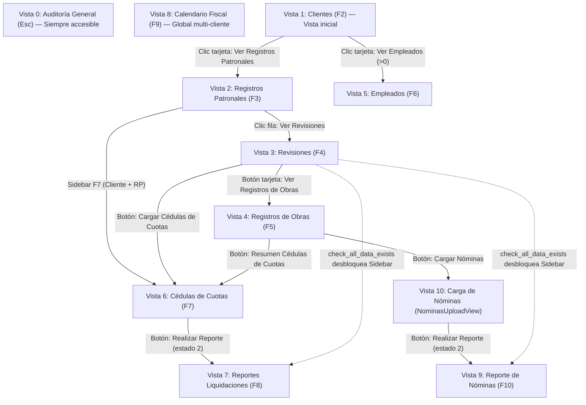

# Documentación Integral de Reglas de Negocio y Funcionamiento — `docu_ffacd` (Firma Fiscal ACD)

Documento de referencia funcional y técnica del sistema **Correcciones Patronales IMSS (`docu_ffacd`)**, construido en **Rust** + **Slint UI** + **PostgreSQL** + **RustFS (S3 compatible)**. Describe de extremo a extremo la arquitectura transversal y el funcionamiento completo de las **9 pantallas principales** solicitadas (más las pantallas auxiliares vinculadas **Vista 0: Auditoría General** y **Vista 10: Carga de Nóminas**).

---

## Arquitectura Transversal, Navegación y Motor de Infraestructura

### Mapa Global de Vistas y Desbloqueo Progresivo

El contenedor principal (`ui/main_view.slint`) conmuta la pantalla activa mediante `AppData.current_view` (`0..=10`). El menú lateral (`ui/sidebar.slint`) habilita el acceso progresivo según el contexto activo (`selected_cliente_id`, `selected_rp_id`, `selected_revision_id`) y los datos detectados en PostgreSQL:

#### Reglas exactas de habilitación en `Sidebar` (`ui/sidebar.slint`) y servidor (`on_navigate_view` en `src/main.rs`)

| Vista (`current_view`) | Nombre en Sidebar / UI | Etiqueta visual | Condición de desbloqueo en `Sidebar` | Guardia / Comportamiento en `on_navigate_view` (`src/main.rs`) |
| :---: | :--- | :---: | :--- | :--- |
| `0` | Auditoría General | `Esc` | Siempre habilitada | Carga tarjetas duales libres de XML y PDF. |
| `1` | Clientes | `F2` | Siempre habilitada (vista inicial) | Limpia cliente, RP, revisión y flags `revision_has_*` / `*_access_allowed`; preserva `clientes_search` y `clientes_filter_tab`; recarga clientes y KPIs globales. |
| `2` | Registros Patronales | `F3` | `selected_cliente_id != ""` | Rechaza si no hay cliente (redirige a `1`); limpia RP, revisión y flags de módulos; preserva cliente y `rp_search`. |
| `3` | Revisiones | `F4` | `client_selected && rp_selected` | Rechaza si `rp_id` está vacío; limpia `selected_revision_*`, `revision_has_*` y flags de acceso; recarga revisiones del RP. |
| `4` | Registros de Obras | `F5` | `client_selected && rp_selected && revision_selected` | Rechaza si `selected_revision_id` está vacío; recarga obras (`creado_usuario = true`). |
| `5` | Empleados | `F6` | `selected_cliente_id != ""` | Rechaza si no hay cliente; preserva todo el contexto activo y filtros; recarga empleados del cliente. |
| `6` | Cédulas de Cuotas | `F7` | `client_selected && rp_selected` | Exige `rp_id`; activa `cedulas_access_allowed = true`; sincroniza RustFS y PostgreSQL (`sync_and_load_cedulas_view_data`). |
| `7` | Reportes Liquidaciones | `F8` | `client_selected && rp_selected && (revision_has_liquidaciones \|\| revision_has_cedulas \|\| reportes_liquidaciones_data_exists \|\| reporte_liquidaciones_access_allowed \|\| rp_has_cedulas \|\| cedulas_access_allowed)` | Exige `!rp_id.is_empty() \|\| !rev_id.is_empty()`; activa `reporte_liquidaciones_access_allowed = true`; sincroniza y carga reporte. |
| `8` | Calendario Fiscal | `F9` | Siempre habilitada | Vista transversal multi-cliente y multi-RP; recarga calendario y días inhábiles. |
| `9` | Reporte de Nóminas | `F10` | `client_selected && rp_selected && revision_selected && (revision_has_nominas \|\| nominas_data_exists \|\| nominas_access_allowed)` | Exige `nominas_access_allowed \|\| revision_has_nominas \|\| nominas_data_exists`; activa `nominas_access_allowed = true`; carga `reportes_nominas`. *(Al arrancar la app, si `fetch_nominas_reporte(..., None)` no está vacío, pre-activa `nominas_access_allowed = true`).* |
| `10` | Carga de Nóminas | *(Sin entrada en Sidebar)* | Acceso exclusivo desde **Vista 4** (`Cargar Nominas`) | Ejecuta `open_nominas_carga()`: cambia `current_view = 10` y carga estadísticas desde BD (`load_nominas_upload_stats`). |

> [!NOTE]
> **Atajos de teclado reales vs. decorativos**: Las etiquetas `Esc`, `F2..F10`, `Ctrl+K` y `"F2 Editar | Tab Sig. Celda | Enter Confirmar"` en `Sidebar`, `TopBar`, `Revisiones`, `Calendario` y `Reporte de Liquidaciones` son **únicamente etiquetas visuales**. No existen `FocusScope` globales para teclas de función. Los únicos manejadores `key-pressed` activos están dentro de los modales CRUD de **Revisiones** y **Registros de Obras** (`Escape` para cerrar, `Tab`/`Backtab` para rotar foco y `Return` para confirmar).

### Componentes del Shell Global

1. **Barra Superior (`ui/topbar.slint`)**:
   - Botón hamburguesa para colapsar/expandir el `Sidebar`.
   - Botón `"← Volver a Clientes (F2)"` (visible cuando `current_view != 0 && current_view != 1 && current_view != 11`) que invoca `navigate_view(1)`.
   - Contexto activo cuando `current_view >= 2 && current_view != 11`: muestra `selected_cliente_nombre` y `"RFC: " + selected_cliente_rfc`.
   - Píldora de estado PostgreSQL: verde (`#ecfdf5`) si `db_connected`, roja (`#fef2f2`) si no; al hacer clic ejecuta `db_status_clicked()` -> `diagnose_postgres()` y muestra un toast con el diagnóstico.
   - Indicador de actualizaciones (`src/updater.rs`).
   - *Anomalía*: `ui/topbar.slint` conserva lógica visual residual para `current_view == 11` (`CONFIGURACIÓN DE BASE DE DATOS POSTGRESQL`), vista que ya no existe en `ui/main_view.slint` ni en `src/main.rs`.
2. **Barra Inferior (`ui/bottom_bar.slint`)**:
   - Muestra **6 KPIs globales** actualizados por `update_global_stats`:
     - `Clientes`: `COUNT(*) FROM public.clientes`
     - `Reg. Patronales`: `COUNT(*) FROM public.registros_patronales`
     - `Revisiones`: `COUNT(*) FROM public.revisiones`
     - `Obras`: `COUNT(*) FROM public.registros_obras WHERE COALESCE(creado_usuario, false) = true`
     - `Empleados Activos`: `COUNT(*) FROM public.empleados WHERE COALESCE(esta_activo, true) = true`
     - `Catálogos Cargados`: `"100% (9 Catálogos)"`
   - Nota: La etiqueta `"Latencia: 5ms"` en `ui/bottom_bar.slint` está fija (hardcodeada) en UI.
3. **Notificaciones Toast y Modal Global de Error de Sistema**:
   - Toast flotante global para mensajes operativos y de validación.
   - Modal `show_system_error_modal` (`z: 9999` en `ui/main_view.slint`), utilizado tras un rollback transaccional PostgreSQL + RustFS para mostrar el detalle técnico del fallo.

### Infraestructura Transversal (PostgreSQL, RustFS, Archivos, Logger y Updater)

- **PostgreSQL (`db_config.json`, `src/db/config.rs`, `src/db/schema.rs`)**:
  - Configuración leída de `db_config.json` (actualmente `host: 127.0.0.1`, `port: 5432`, `database: firma_fiscal_acd`, `user: ivan395`, `ssl_mode: disable`); soporta `connection_url` o contingencia local (`PGHOST`/`PGPORT`/`PGDATABASE`/`PGUSER`/`PGPASSWORD`) y `DEFAULT_AIVEN_URI` TLS (`native_tls` aceptando certificados autofirmados).
  - Al iniciar y reconectar (`on_reconnect_db`), ejecuta `ensure_schema(&mut client)`: crea/migra tablas, catálogos, triggers de limpieza (`trg_clean_*` ejecutando `clean_and_uppercase_entity_fields()`), trigger no bloqueante de topes en liquidaciones (`trg_check_reportes_detalles_liquidaciones_tope`), normalización automática de FK delegacionales en RP, backfill de RFC SAT y CURP RENAPO para empleados incompletos, limpieza de liquidaciones bimestrales o `> 31` días y reconciliación RustFS.
  - **Bug de arranque en catálogos (`src/main.rs:993`)**: `update_global_stats` evalúa `let need_combos = app_data.get_tipos_personas_combo().row_count() == 0;`, pero `ui/models.slint:667` pre-puebla `tipos_personas_combo` con 3 elementos estáticos. Eso hace que `need_combos` siempre sea `false` y se omita la recarga inicial desde PostgreSQL vía `fetch_catalogos_bundle` (`estatus_combo`, `estatus_imss_combo`, `conceptos_combo`, etc.), conservando las listas estáticas de `models.slint`.
- **RustFS / S3 (`src/rustfs.rs`)**:
  - Endpoint `http://127.0.0.1:9000`, credenciales `rustfsadmin`/`rustfsadmin`, bucket `"correciones"` (con una sola `'r'`).
  - Estructura estándar de carpetas mediante objetos marcador `.keep`:
    `<Cliente>/<RP>/<Revision>/Cedulas_de_cuotas/.keep` y `<Cliente>/<RP>/<Revision>/Nominas/.keep`.
  - Papelera lógica (`Trash`): al borrar clientes (`Trash/<Cliente>/`), registros patronales (`<Cliente>/Trash/<RP>/`), revisiones (`<Cliente>/<RP>/Trash/<Revision>/`) o archivos individuales/masivos (`.../Trash/`), los archivos se mueven a `Trash` en lugar de destruirse de inmediato.
- **Descompresión de Archivos (`src/archives.rs`)**:
  - Recorrido recursivo de carpetas con `WalkDir` preservando subrutas relativas.
  - Descompresión paralela de `.zip` (`zip::ZipArchive` + Rayon) y extracción de `.rar` invocando binarios externos `7z` o `unrar`.
- **Auto-actualización (`src/updater.rs`)**:
  - Consulta la API pública de GitHub Releases (`https://api.github.com/repos/Ivan395/docupload/releases/latest`), compara con `env!("CARGO_PKG_VERSION")` vía `semver`, descarga el artefacto en bloques de `64 KB` con progreso y lo aplica según plataforma (`.exe` en Windows o reemplazo de `APPIMAGE` / permisos `0o755` en Linux).
- **Logging Asíncrono (`src/app_logger.rs`)**:
  - Puente no bloqueante para `log` con cola en memoria de `50,000` mensajes (`async-app-logger`), escritura en `./logs/docu_ffacd.log` (o AppData / `~/.local/share/docu_ffacd/logs`) y rotación automática hasta 5 respaldos al superar `25 MB`.

> [!NOTE]
> **Relación con Vista 0 (`Auditoría General`)**: La Vista 0 (`Esc`) ofrece un escritorio dual rápido para procesar **Nóminas (`.xml/.zip/.rar/Carpeta`)** y **Cédulas (`.pdf/.zip/.rar/Carpeta`)** sin contexto previo seleccionado. A diferencia de las Vistas 6 y 10, en Vista 0 el procesamiento de Cédulas **auto-crea** cliente, RP y revisión (`resolve_business_context`), **no** valida pertenencia con modal de discrepancia, **no** sube PDFs a RustFS ni sincroniza automáticamente `reportes_liquidaciones` (y las Nóminas en Vista 0 suben XMLs directos a RustFS sin staging).

---

# 1. Clientes

**Archivos clave**: `ui/clientes_view.slint`, `src/main.rs`, `src/db/catalogos.rs`, `src/validation.rs`, `src/db/schema.rs`, `src/rustfs.rs`.

## 1.1 Propósito y Navegación

Pantalla inicial de la aplicación (`current_view == 1`). Administra el catálogo maestro CRUD de patrones/clientes y actúa como punto de entrada obligatorio para seleccionar el contexto de cliente antes de consultar sus **Registros Patronales (Vista 2)** o su **Padrón de Empleados (Vista 5)**.

- **Hacia qué pantallas dirige**:
  - Botón de tarjeta **`Ver Registros Patronales (<N>)`** -> `select_cliente_for_rp(cli.id, cli.nombre, cli.rfc, cli.has_ingested_data)`: fija `selected_cliente_*`, cambia a **Vista 2 (`Registros Patronales`)**, carga los RP del cliente y actualiza KPIs globales. *(Nota: no limpia explícitamente `selected_rp_*`, `selected_revision_*` previos ni `rp_search`).*
  - Botón de tarjeta **`Ver Empleados (<N>)`** -> `select_cliente_for_empleados(cli.id, cli.nombre, cli.rfc)`: disponible **solo si `cli.empleados_count > 0`**; fija `selected_cliente_id/nombre/rfc` y navega a **Vista 5 (`Empleados`)**. *(No actualiza `selected_cliente_has_data`, no limpia `empleados_search`/`empleados_filter_active_only` ni cierra un panel lateral abierto previamente).*
- **Al regresar a Clientes (`navigate_view(1)`)**: limpia toda la jerarquía seleccionada (`selected_cliente_*`, `selected_rp_*`, `selected_revision_*`, flags `revision_has_*` y permisos `*_access_allowed`), conservando `clientes_search` y `clientes_filter_tab`.

## 1.2 Estructura Visual, Filtros y Tarjetas

- **Cabecera**: Título `"Catálogo de Clientes"`, badge `AppData.clientes_list.length + " Registros"`, buscador en tiempo real (`"Buscar por Nombre o RFC..."`, callback `reload_clientes()`, compara contra `nombre`, `rfc` y `razon_social`) y botón **`+ Nuevo Cliente`**.
- **Banner y estado vacío**: Si `!AppData.db_connected`, muestra banner rojo de desconexión con botón **`Reintentar Conexión`** (`reconnect_db()`); si no hay resultados, muestra estado vacío.
- **Tarjetas de Cliente (`ClienteCardData`)**:
  - Encabezado con `ID`, badge de estado (`"• Nóminas & Cédulas Vinculadas"` en verde si `has_ingested_data`, o `"• Recién Creado - Sin Cédulas"` en ámbar) y botones rápidos **`✏ Editar Datos`** y **`🗑 Eliminar`**.
  - Nombre comercial y `Razón Social` (opcional).
  - Bloque fiscal SAT: `RFC SAT` (`Pendiente` / `[Pendiente de importación]` si vacío), `PERSONA` (`FÍSICA`/`MORAL` o `No clasificado`), `RÉGIMEN FISCAL SAT` (`"{clave} - {nombre}"` o `No asignado`). *(La CURP no se muestra en la tarjeta; solo en el modal de edición).*
  - Contadores y botones inferiores: `N Registros Patronales` + botón **`Ver Registros Patronales (N)`**, y `M Empleados Activos` + botón **`Ver Empleados (M)`** (bloqueado con `"🔒 Sin Empleados (Deshabilitado)"` cuando `empleados_count == 0`).

## 1.3 Lógica de Botones y Modales

1. **Modal Alta de Cliente (`show_new_cliente_modal` -> `open_new_cliente_dialog`)**:
   - Limpia los 4 campos de texto (`nombre`, `razon_social`, `rfc`, `curp`), deja el combo de régimen deshabilitado (`regimen_enabled = false`) hasta elegir `Tipo Persona`.
   - Al seleccionar `Tipo Persona` (`change_new_tipo_persona`), consulta PostgreSQL (`fetch_regimenes_by_tipo_persona`), llena `new_cliente_regimenes_combo` como `"{clave} - {nombre}"`, habilita el combo de régimen y valida en vivo RFC y CURP (`validate_new_cliente_input`).
   - Botón **`Guardar Cliente`**: habilitado únicamente cuando `new_cliente_nombre != "" && new_cliente_rfc != ""`. Llama a `submit_new_cliente`: ejecuta `validate_cliente_data`, resuelve `id_clasificacion_cliente` (`tipos_personas` + `regimenes_fiscales` extrayendo `clave` antes de `'-'`), inserta vía `create_cliente`, cierra el modal y recarga lista + KPIs globales.
   - Botón **`Cancelar` / `✕`** -> `close_new_cliente_dialog()`.
2. **Modal Edición de Cliente (`show_edit_cliente_modal` -> `open_edit_cliente_dialog(client_id)`)**:
   - Carga los datos del cliente y los regímenes de su tipo de persona, preseleccionando la clave actual y ejecutando validación en vivo (`run_validate_edit_cliente`).
   - Botón **`Guardar Cambios`** (`edit_cliente_nombre != "" && edit_cliente_rfc != ""`) -> `submit_edit_cliente`: valida con `validate_cliente_data`, ejecuta `update_cliente`, sincroniza `selected_cliente_nombre`/`selected_cliente_rfc` si el cliente editado es el activo y recarga vista y estadísticas.
3. **Modal Confirmar Eliminación (`show_delete_cliente_modal` -> `open_delete_cliente_dialog`)**:
   - Botón **`Sí, Eliminar Cliente`** -> `confirm_delete_cliente`: abre transacción SQL que **elimina primero explícitamente los `public.cfdis`** referenciados vía `nominas.id_cfdi` (evitando registros huérfanos en `cfdis`, `contratos` y `lista_conceptos_cfdis`), ejecuta `DELETE FROM public.clientes` propagando `ON DELETE CASCADE` a todas las tablas hijas (`registros_patronales`, `empleados`, `revisiones`, `registros_obras`, `nominas`, `liquidaciones`, reportes) y mueve la carpeta `<clean_c>/` a `Trash/<clean_c>/` en RustFS. Si coincidía con el cliente seleccionado, limpia el contexto activo.

## 1.4 Reglas de Negocio, Validaciones y Persistencia

- **RFC (`validate_rfc`, `src/validation.rs`)**: acepta genéricos `"XAXX010101000"` y `"XEXX010101000"`. Exige longitud `12` (**Moral**: 3 letras `A-Z`, `&` o `Ñ` + `YYMMDD` válido + 3 alfanuméricos ASCII) o `13` (**Física**: 4 letras + `YYMMDD` + 3 alfanuméricos ASCII), verificando coincidencia con el `Tipo Persona` elegido. *No valida dígito verificador Mod 11 en captura manual.*
- **CURP (`validate_curp`, `src/validation.rs`)**: 18 caracteres (4 letras ASCII + `YYMMDD` + sexo `H|M|X` + entidad en las 33 claves RENAPO + 3 consonantes internas + pos. 17 alfanumérica + pos. 18 dígito). Si el cliente es **Moral** (o RFC de 12 caracteres), **prohíbe capturar CURP** (`"Persona Moral no lleva CURP"`). *En edición/alta manual no valida dígito Mod 10 ni permite enviar el formulario pese a advertencias visuales si el botón Guardar está habilitado; la validación estricta ocurre al hacer submit y muestra toast de error.*
- **Normalización en BD**: el trigger `trg_clean_clientes` convierte textos a mayúsculas y limpia caracteres no alfanuméricos (conservando `&`, `Ñ`, `ñ` en RFC); `catalogos::clean_alphanumeric` en CURP usa `is_ascii_alphanumeric()` (elimina `Ñ`).
- **Auto-enriquecimiento**: al ingerir Cédulas o Nóminas CFDI, `update_cliente_and_rp_from_biz` rellena `razon_social`, `rfc` (si no duplica), `curp` e infiere `FÍSICA`/`MORAL` sin destruir datos ya capturados.

## 1.5 Discrepancias y Peculiaridades Detectadas

1. **Pestañas de filtro fantasma**: `AppData.clientes_filter_tab` (`0: Todos`, `1: Con Cédulas`, `2: Nuevos / En espera`) y el callback `filter_clientes_tab` existen y filtran en `load_clientes_ui`, pero `ui/clientes_view.slint` **no renderiza botones de pestañas**.
2. **Etiqueta del contador de empleados**: la tarjeta muestra `"Empleados Activos"`, pero `fetch_clientes` (`src/db/catalogos.rs:279`) cuenta **todos** los empleados del cliente sin filtrar `esta_activo = true`.
3. **Flags inertes**: `ClienteCardData.is_sat_locked` y `AppData.edit_cliente_has_data` no bloquean ni deshabilitan ningún campo editable en UI ni en `submit_edit_cliente` (`✏ Editar Datos` siempre está habilitado).
4. **Combo de clasificación en `update_cliente`**: el SQL usa `COALESCE($6, id_clasificacion_cliente)`, por lo que devolver el combo a `"-- Seleccionar --"` conserva la clasificación anterior en vez de poner `NULL`.
5. **Borrado desde Vista 2**: si se elimina el cliente activo desde la cabecera de Vista 2 (`Registros Patronales`), limpia el contexto pero **no redirige automáticamente** de vuelta a Vista 1.

---

# 2. Registros Patronales

**Archivos clave**: `ui/registros_patronales_view.slint`, `src/main.rs`, `src/db/catalogos.rs`, `src/validation.rs`, `src/rustfs.rs`.

## 2.1 Propósito y Navegación

Administra los Números de Registro Patronal (NRP) IMSS pertenecientes al cliente activo (`selected_cliente_id`) y sirve de puente hacia sus expedientes de revisión.

- **Acceso**: desde el botón `Ver Registros Patronales` en Vista 1 o vía Sidebar (`F3`) cuando `selected_cliente_id != ""`.
- **Hacia qué pantallas dirige**:
  - Botón de fila **`📋 Ver Revisiones`** -> `select_rp_for_revisiones(rp.id, rp.registro, rp.subdelegacion, rp.delegacion)`: valida estructura NRP (`is_valid`), guarda `selected_rp_*` y navega a **Vista 3 (`Revisiones`)**.
  - Botón cabecera **`🗑 Eliminar Cliente`** -> abre modal de confirmación para borrar al cliente padre actual (`confirm_delete_cliente`).
  - Navegación lateral a **Vista 6 (`Cédulas de Cuotas`)** una vez que `selected_rp_id` está establecido (o regresando a **Vista 1** desde TopBar/Sidebar).

## 2.2 Estructura Visual, Búsqueda y Tabla

- **Cabecera**: Título `"Registros Patronales IMSS"`, badge de `selected_cliente_nombre` + `RFC`, botón rojo **`🗑 Eliminar Cliente`** (si `selected_cliente_id != ""`) y botón **`+ Nuevo Registro Patronal`**.
- **Buscador**: `LineEdit` ligado a `rp_search` (`"Buscar por NRP, Actividad o Delegación..."`, callback `filter_rp_search()`), junto con contador `N Registros Patronales`.
- **Tabla (6 columnas)**:
  1. `REGISTRO PATRONAL (NRP)`: NRP, alerta `"⚠️ Estructura no válida"` si `!is_valid_structure`, pill `"✓ Sincronizado"` (si `has_ingested_data`) o `"Pendiente"`, y `subdelegacion`.
  2. `ACTIVIDAD ECONÓMICA`: descripción o `"Sin actividad descrita"`.
  3. `CLASE Y FRACCIÓN`: `"Clase " + clase_nombre` y `"Frac. " + fraccion_codigo`.
  4. `PRIMA DE RIESGO`: `rp.prima_riesgo + "%"` formateada a **5 decimales** (`{:.5}`) + `"Prima RT Anual"`.
  5. `TRABAJADORES`: `"👥 " + empleados_count + " Activos"`.
  6. `ACCIONES`: **`✏ Editar`**, **`📋 Ver Revisiones`** y **`🗑`**.

## 2.3 Lógica de Botones y Modal CRUD (`show_rp_modal`)

1. **`+ Nuevo Registro Patronal`** (`open_new_rp_dialog`): limpia `rp_form_*`, fija `rp_form_is_editing = false`, reinicia `fracciones_combo` a `["-- Seleccione primero Clase --"]` y abre modal.
2. **`✏ Editar`** (`select_rp_for_edit(rp_id)`): carga los datos del RP, formatea prima `{:.5}`, resuelve `clases_combo` con `extract_clase_roman`, consulta `fetch_fracciones_by_clase` para poblar y preseleccionar `fracciones_combo`, valida el NRP en vivo y abre modal en modo edición.
3. **Campos dentro del formulario**:
   - `Número de Registro Patronal (NRP) *` (`11 Caracteres`): en `edited` / `changed text` ejecuta `validate_rp_input()`.
   - `Actividad Económica (Opcional)`: badge contador `rp_form_char_count / 300 caracteres` (ámbar `>= 250`, rojo `>= 300`). El callback `update_rp_actividad` (enganchado también vía `AppData.changed rp_form_actividad`) trunca automáticamente cualquier texto a un máximo estricto de **300 caracteres Unicode** (`limit_to_chars`).
   - `Campos Complementarios`: `Domicilio Fiscal / Obra`, `Código Postal` (`5 dígitos`), `Entidad Federativa`, `Área Geográfica` (`A o B`), `Delegación IMSS`, `Subdelegación IMSS`, `Prima de Riesgo RT (% Anual)`, combo **`Clase de Riesgo`** (`change_rp_clase`: consulta `public.clases` y recarga en cascada `fracciones_combo`) y **`Fracción y Actividad RT`**.
4. **Botones del pie del modal**:
   - **`Cancelar`** -> `close_rp_dialog()`.
   - **`Limpiar`** (visible solo en alta) -> `clear_rp_form()`.
   - **`Guardar Registro Patronal` / `Actualizar Registro`**: **solo está habilitado cuando `rp_form_registro != "" && rp_form_registro_status == "valid"`**. Llama a `submit_registro_patronal`:
     - *En alta*: inserta en `public.registros_patronales` (`ON CONFLICT` por `(id_cliente, registro)` único) y crea en RustFS la carpeta inicial `<Cliente>/<RP>/GENERAL/{Cedulas_de_cuotas,Nominas}/.keep`.
     - *En edición*: actualiza datos vía `update_registro_patronal`.
5. **Botón `🗑` en fila** (`open_delete_rp_dialog` -> `confirm_delete_rp`): abre transacción SQL que elimina primero `cfdis` asociados a nóminas del RP, borra el RP con `ON DELETE CASCADE`, mueve `<clean_c>/<clean_rp>/` a `<clean_c>/Trash/<clean_rp>/` en RustFS, limpia `selected_rp_*` y `selected_revision_*` si coincidía con el activo, y recarga RPs, Clientes y KPIs globales.

## 2.4 Reglas de Negocio

- **Validación NRP (`validate_registro_patronal`, `src/validation.rs`)**: tras limpiar caracteres no ASCII-alfanuméricos y pasar a mayúsculas, exige **exactamente 11 caracteres**: 1 letra ASCII inicial seguida de 10 dígitos ASCII. *No verifica dígito verificador IMSS ni cruza contra catálogo de subdelegaciones en captura manual.*
- **Normalización y auto-vínculo**: trigger `trg_clean_rp` convierte a mayúsculas y depura campos. Durante la ingesta de cédulas PDF se ejecuta `clean_actividad` y al arrancar la app PostgreSQL auto-enlaza `id_entidad_federativa` e `id_rel_del_sub` si coinciden nombres/códigos.

## 2.5 Discrepancias Detectadas

1. **Buscador anuncia `"Delegación"`**: el placeholder dice `"Buscar por NRP, Actividad o Delegación..."`, pero `load_registros_patronales_ui` filtra únicamente sobre `registro`, `actividad` y `clase_nombre` (no incluye `delegacion`).
2. **Contador `"Activos"` en columna Trabajadores**: `fetch_registros_patronales_by_cliente` ejecuta `COUNT(DISTINCT l.id_empleado) FROM public.liquidaciones`, contando empleados con liquidaciones de cédulas en ese RP sin filtrar `esta_activo = true` y sin incluir empleados que solo aparezcan en nóminas.
3. **Edición de RP vs. campos FK y RustFS**: `update_registro_patronal` usa `COALESCE($11, id_clasificacion_regimen_persona)`, **no** sobreescribe `codigo_delegacion`, `codigo_subdelegacion`, `id_entidad_federativa` ni `id_rel_del_sub`, y si cambia el texto del NRP **no** renombra la carpeta ya existente en RustFS.
4. **Flag `rp_form_complementary_enabled`**: aunque el código asigna este flag según `has_ingested_data`, todos los campos complementarios son editables en todo momento en UI.

---

# 3. Revisiones

**Archivos clave**: `ui/revisiones_view.slint`, `ui/models.slint`, `src/main.rs`, `src/db/revisiones.rs`, `src/db/calendario.rs`, `src/rustfs.rs`.

## 3.1 Propósito y Navegación

Gestiona los expedientes de corrección patronal IMSS (*Art. 173 RGGIT*) vinculados al Registro Patronal activo (`selected_rp_id`), calculando automáticamente sus plazos legales en **días hábiles IMSS** y controlando las fechas clave, folio, estatus y prórrogas.

- **Acceso**: clic en `Ver Revisiones` desde Vista 2 o vía Sidebar (`F4`) con `selected_cliente_id != "" && selected_rp_id != ""`. Al entrar vía `navigate_view(3)` limpia cualquier `selected_revision_*` previo y los flags `revision_has_*`.
- **Hacia qué pantallas dirige**:
  - **`← Registros Patronales (F3)`**: `navigate_view(2)`.
  - **`Cargar Cedulas de Cuotas`** (modal de origen -> múltiples archivos o carpeta): activa `cedulas_access_allowed = true`, navega a **Vista 6 (`Cédula de Cuotas`)** y lanza el selector de archivos/carpeta inmediatamente.
  - Botón de tarjeta **`Ver Registros de Obras (<N>)`** -> `select_revision_for_obras(rev.id, rev.nombre, rev.folio)`: fija la revisión activa, cambia a **Vista 4 (`Registros de Obras`)**, y ejecuta `check_all_data_exists` desbloqueando en Sidebar **Cédulas (`F7`)**, **Reportes Liquidaciones (`F8`)** y **Reporte de Nóminas (`F10`)** si existen datos previos.

## 3.2 Estructura Visual, KPIs, Búsqueda, Pestañas y Ordenamiento

- **Barra contextual**: badges del RP seleccionado (o banner rojo `⚠️ Estructura Inválida` si el NRP no cumple el formato de 11 caracteres), Cliente + RFC, etiqueta `"Vía Corrección Patronal Art. 173 RGGIT"` y botones **`Cargar Cedulas de Cuotas`** y **`+ Nueva Revisión [F7]`**.
- **4 Tarjetas KPI**:
  1. `TOTAL REVISIONES`: conteo de `revisiones_list` (post-filtro).
  2. `EN TÉRMINO LEGAL`: `"Vigentes"` calculado sobre todas las revisiones del RP cuyo `estatus` en mayúsculas no contiene `"FINALIZADA"` ni `"RECHAZADA"`.
  3. `PRÓRROGAS AUTORIZADAS`: conteo con `pidio_prorroga == true`.
  4. `SUBDELEGACIÓN`: `selected_rp_subdelegacion` (fallback visual `"01 Hidalgo Sur"`).
- **Buscador**: filtra sin distinguir mayúsculas/minúsculas sobre `nombre`, `folio` y `concepto_diferencia`.
- **4 Pestañas (`filter_revisiones_tab`)**:
  - `0 — Todos (N)`
  - `1 — En Proceso`: `estatus` contiene `"PROCESO"`, `"REVISIÓN"` o `"INICIADA"`.
  - `2 — Aprobadas IMSS`: `estatus_imss` contiene `"APROBADA"`.
  - `3 — Con Prórroga (N)`: `pidio_prorroga == true`.
- **Ordenamiento (`sort_revisiones`)**: selector + botón toggle `▲ ASC` / `▼ DESC` con 8 opciones: `Fecha de Creación` (por defecto `DESC` en SQL), `Folio IMSS`, `Nombre`, `Fecha Entrega Revisión`, `Fecha Entrega IMSS`, `Fecha Aprobación IMSS`, `Fecha Con Prórroga` y **`Multi-Criterio (Todos a la vez)`** (desempate en cascada: `folio -> nombre -> fecha_entrega_revision -> fecha_entrega_imss -> created_at_str`, invirtiendo si `DESC`).
- **Tarjetas de Revisión (`RevisionData`)**: muestran nombre, `FOLIO` (o `"S/F"`), `ID DB` (primeros 4 caracteres), pills de estatus interno y ante IMSS, `Concepto Diferencia`, **grid de 6 fechas** (`F. Entrega Revisión`, `F. Máx Entrega Rev.`, `F. Entrega IMSS`, `F. Máx Entrega IMSS`, `F. Aprobación IMSS`, `F. Máx Aprobación IMSS`), barra de prórroga (`SÍ`/`NO`, `F. Aprobación Prórroga`, `F. Entrega con Prórroga`) y 3 acciones al pie: **`Ver Registros de Obras (<N>)`**, **`Editar`** y **`🗑`**.

## 3.3 Lógica de Botones y Modales

1. **`+ Nueva Revisión [F7]` (`open_new_revision_dialog`)**: bloquea la apertura si `!selected_rp_id` o si `validate_registro_patronal` falla sobre el NRP actual; limpia `rev_form_*` y abre modal (`Escape`, `Tab`/`Backtab`, `Return` soportados con `FocusScope`).
2. **Modal Crear / Editar Revisión (`show_revision_modal`)**:
   - Inputs: `Nombre`, `Folio`, combos `Concepto`, `Estatus`, `Estatus IMSS`, `DatePickerField` de `Fecha Entrega IMSS`, `Fecha Aprobación IMSS`, `Fecha Entrega Revisión`, campos calculados de fechas máximas, switch `toggle_rev_prorroga()` (`pidio_prorroga`), `Fecha Aprobación Prórroga` y `Fecha Entrega con Prórroga`.
   - Al editar (`select_revision_for_edit`): recalcula dinámicamente los 4 plazos derivados, además ejecuta `check_all_data_exists` actualizando los flags del Sidebar.
   - Botón **`Guardar`** (`submit_revision`): valida e inserta/actualiza en `public.revisiones`, lanza en segundo plano `rustfs::ensure_revision_structure(&client_nom, &rp_reg, &rev_nom)` y recarga lista.
3. **Modal Confirmar Eliminación (`confirm_delete_revision`)**: abre transacción SQL que primero ejecuta `UPDATE public.nominas SET id_revision = NULL WHERE id_revision = $1` (para no destruir CFDIs maestros de nómina), luego ejecuta `DELETE FROM public.revisiones` (propagando cascada a `registros_obras`, `liquidaciones`, etc.) y mueve `<Cliente>/<RP>/<Revision>/` a `<Cliente>/<RP>/Trash/<Revision>/` en RustFS.
4. **Modal Carga de Cédulas (`show_cargar_cedulas_modal`)**: ofrece **`Múltiples Archivos (.pdf, .zip, .rar)`** (`cargar_cedulas_from_revision`) o **`Carpeta o Directorio Completo`** (`cargar_cedulas_folder_from_revision`), redirigiendo a **Vista 6**.

## 3.4 Reglas de Negocio: Cómputo de Plazos Legales IMSS

Todos los plazos derivados utilizan `add_business_days(start, count, Some(&holidays))` (`src/db/revisiones.rs`), que avanza día por día saltando **sábados, domingos y todas las fechas registradas en `public.imss_inhabiles`**:

| Fecha Base | Regla Exacta | Fecha Derivada |
| :--- | :--- | :--- |
| `fecha_entrega_imss` *(fallback: `fecha_aprobacion_imss`)* | +15 días hábiles IMSS | `fecha_maxima_aprobacion_imss` |
| `fecha_aprobacion_imss` | +40 días hábiles IMSS | `fecha_maxima_entrega_revision` |
| `fecha_entrega_revision` | +120 días hábiles IMSS | `fecha_maxima_entrega_imss` |
| `fecha_maxima_entrega_revision` *(si hay prórroga)* | +10 días hábiles IMSS | `fecha_entrega_con_prorroga` |

- **Normalización y unicidad**: `nombre` y `folio` se guardan en mayúsculas (`uq_revisiones_id_registro_patronal_nombre`, `uq_revisiones_id_registro_patronal_folio`); si `folio` queda vacío o `"S/F"`, se guarda `NULL` en PostgreSQL para evitar colisiones.
- **Conteo `obras_count`**: en la tarjeta de revisión, SQL cuenta **exclusivamente** obras con `COALESCE(ro.creado_usuario, false) = true`.
- **Catálogos semilla en BD (`src/db/schema.rs`)**:
  - `public.estatus`: `INICIADA`, `EN REVISIÓN`, `EN PROCESO DE ACLARACIÓN`, `APROBADA POR EMPRESA`, `PENDIENTE DICTAMEN IMSS`, `APROBADA POR IMSS`, `RECHAZADA`, `APROBADA`, `FINALIZADA`.
  - `public.conceptos` (`PERCEPCIONES` `'001'..'004'`): diferencia en SBC y días inhábiles (Art. 173), omisión de avisos/variables, factor de integración, rectificación de prima RT.

## 3.5 Discrepancias Detectadas

1. **Etiqueta `"+120 días"` en UI**: el badge informativo del modal (`ui/revisiones_view.slint:1243`) dice `"+120 días"` omitiendo `"hábiles"`, aunque el cálculo real en Rust y PostgreSQL sí omite fines de semana e inhábiles IMSS.
2. **Combos iniciales no recargados al arranque**: debido al bug `need_combos` en `src/main.rs:993`, `estatus_combo`, `estatus_imss_combo` y `conceptos_combo` conservan los arreglos estáticos de `ui/models.slint` (donde `conceptos_combo` solo trae el placeholder inicial). Además, al guardar, `estatus_val` tolera acentos/mayúsculas pero `estatus_imss_val` exige coincidencia exacta.
3. **Condición asimétrica de prórroga**: `submit_revision` (`src/main.rs:4772`) guarda `fecha_entrega_con_prorroga` **solo si `pidio_prorroga == true`**, mientras que Calendario (`src/db/calendario.rs`) la calcula si `pidio_prorroga || fecha_aprobacion_prorroga.is_some()`.

---

# 4. Registros de Obras

**Archivos clave**: `ui/registros_obras_view.slint`, `src/main.rs`, `src/db/revisiones.rs`, `src/validation.rs`, `src/db/schema.rs`, `src/db/cedulas.rs`.

## 4.1 Propósito y Navegación

Administra las obras de construcción (`SIROC` / `SATIC`) asociadas a la revisión activa (`selected_revision_id`), capturando clase, tipo de obra, periodo de vigencia (`fecha_inicio`–`fecha_fin`), ubicación, superficie (`m²`), **monto contratado** (base para el Tope del 18% de Guarderías) y adscripción delegacional.

- **Acceso**: clic en `Ver Registros de Obras` en Vista 3 o vía Sidebar (`F5`) teniendo cliente, RP y revisión seleccionados.
- **Hacia qué pantallas dirige**:
  - **`← Revisiones (F4)`**: vuelve a Vista 3 limpiando `selected_revision_*` y flags de acceso.
  - **`Cargar Nominas`** (`open_nominas_carga`): **única puerta de entrada** hacia **Vista 10 (`Carga de Nóminas`)** -> tras procesar nóminas habilita **Vista 9 (`Reporte de Nóminas`)**.
  - **`Resumen Cedulas de Cuotas`** (`open_resumen_cedulas_from_obras`): activa `cedulas_access_allowed = true`, navega a **Vista 6 (`Cédulas de Cuotas`)** y carga cédulas existentes sin abrir selector de archivos.
  - **Sidebar**: **Vista 7 (`Reporte de Liquidaciones`)** y **Vista 9 (`Reporte de Nóminas`)** si sus flags están desbloqueados.

## 4.2 Estructura Visual, KPIs, Búsqueda y Pestañas

- **4 KPIs superiores**:
  1. `TOTAL OBRAS`: longitud filtrada de `obras_list`.
  2. `SUPERFICIE CONSTRUIDA TOTAL`: sumatoria `{:.2} m²` de todas las obras `creado_usuario = true` de la revisión.
  3. `MONTO CONTRATADO TOTAL`: sumatoria `$X,XXX.XX MXN` de todas las obras `creado_usuario = true`.
  4. `SUBDELEGACIÓN IMSS`: `selected_rp_subdelegacion`.
- **Buscador y 3 Pestañas**: buscador filtra por `numero`, `clase`, `tipo_obra` o `ubicacion`. Pestañas (`filter_obras_tab`): `0 — Todas (N)`, `1 — Privadas` (`clase` contiene `"PRIVADA"`), `2 — Públicas` (`clase` contiene `"PUBLICA"` o `"PÚBLICA"`). *(Nota: el combo incluye `"MIXTA"`, que solo aparece en la pestaña `Todas`).* Orden fijo descendente por `created_at DESC`.
- **Tarjetas de Obra**: muestran `REGISTRO: numero`, badge `⚠️ Estructura no válida` si `!is_valid_structure`, `CLASE`, `Tipo`, `MONTO CONTRATADO`, `Ubicación`, grid de 5 columnas (`Fecha Inicio`, `Fecha Fin`, `Superficie Construida`, `Delegación IMSS`, `Subdelegación`), **`Editar Obra`** y **`🗑`**.

## 4.3 Lógica de Botones, Modales y Validaciones

1. **`+ Nuevo Registro de Obra`** (`open_new_obra_dialog`) / **`Editar Obra`** (`select_obra_for_edit`):
   - En alta, `clase` inicia en `"PRIVADA"`, y `delegacion` + `subdelegacion` se heredan automáticamente de `selected_rp_delegacion` y `selected_rp_subdelegacion`.
   - Soportan teclado dentro del modal (`Escape`, `Tab`/`Backtab`, `Return`).
   - **Validación de Número de Obra (`validate_registro_obra`, `src/validation.rs`)** en tiempo real (`validate_obra_input`): tras limpiar caracteres no alfanuméricos y pasar a mayúsculas:
     - **SIROC**: inicia con `'C'` y longitud total de **8 o 9 caracteres** (`'C'` + 7 u 8 dígitos).
     - **SATIC**: inicia con dígito y longitud total de **8 a 10 dígitos**.
   - **Fechas**: `fecha_inicio` y `fecha_fin` son obligatorias (`NOT NULL` en BD) y debe cumplirse `fecha_inicio <= fecha_fin`.
   - **Monto Contratado**: formateado en vivo con `format_monto_input_realtime` (solo dígitos, hasta 2 decimales y comas separadoras de miles) y normalizado al confirmar (`format_monto_final_from_str`). Si el monto está vacío, es `"0"` o `"0.00"`, muestra **advertencia ámbar** indicando que **no podrá calcularse el Límite del 18%** en Reportes Liquidaciones.
   - **Guardar (`submit_obra`)**: ejecuta `UPSERT` por `(id_revision, numero)` marcando **`creado_usuario = true`**.
2. **`🗑` -> Modal Confirmar Eliminación (`confirm_delete_obra`)**: ejecuta `DELETE FROM public.registros_obras WHERE id = $1`.

## 4.4 Regla Crítica del Sistema: `creado_usuario = true` vs. `creado_usuario = false`

Este indicador booleano gobierna el comportamiento de **4 módulos posteriores**:

1. **Ingesta de Cédulas (Vista 6 / Vista 0)**: los números de obra extraídos de PDFs SUA se insertan con `UPSERT` marcando `creado_usuario = false`. Si la obra ya tenía `creado_usuario = true`, PostgreSQL **respeta intactas** sus fechas `fecha_inicio`/`fecha_fin` (solo las expande con `LEAST`/`GREATEST` cuando `creado_usuario = false`).
2. **Depuración automática al iniciar (`src/db/schema.rs`)**: solo depura registros de obra con formato inválido donde `COALESCE(creado_usuario, false) = false`, protegiendo siempre las obras del usuario.
3. **Promoción**: si el usuario registra manualmente en Vista 4 un número de obra previamente detectado por cédula, `create_obra` / `update_obra` la promueven a `creado_usuario = true`.
4. **Impacto transversal**:
   - **Vistas 3 y 4**: solo listan y cuentan obras `creado_usuario = true` (aunque `check_registros_obras_exists` en `nominas_reporte.rs` verifica cualquier fila de `registros_obras` sin filtrar ese flag).
   - **Vista 6 (Cédulas)**: solo las obras `creado_usuario = true` determinan los meses requeridos en el banner de cédulas faltantes.
   - **Vista 7 (Liquidaciones)**: prioriza obras `creado_usuario = true` en asignación automática multi-obra, limpia filas fantasma solo en `!creado_usuario`, y **excluye del Análisis de Guarderías (18%) cualquier obra donde `!creado_usuario`**.
   - **Vista 9 (Reporte de Nóminas)**: si la revisión/RP tiene al menos una obra con `creado_usuario = true`, filtra las nóminas **únicamente** a las que se traslapan con `[fecha_inicio, fecha_fin]` de esas obras; si no hay ninguna obra de usuario, incluye todas las nóminas del RP/revisión.

## 4.5 Discrepancia UI

- En `ui/registros_obras_view.slint:132`, el botón **`Cargar Nominas`** enlaza su color de hover por error a `btn_load_cedulas.has-hover` (del botón vecino `Resumen Cedulas de Cuotas`) en lugar de su propio `TouchArea`.

---

# 5. Empleados

**Archivos clave**: `ui/empleados_view.slint`, `src/main.rs`, `src/db/catalogos.rs`, `src/validation.rs`, `src/cedulas/rfc_sat.rs`, `src/cedulas/curp_renapo.rs`.

## 5.1 Propósito y Navegación

Administra el padrón nominal de trabajadores vinculados al cliente seleccionado (`selected_cliente_id`), permitiendo altas, correcciones de identificadores fiscales/IMSS (RFC, CURP, NSS) y control del estatus activo/baja.

- **Acceso**: botón `Ver Empleados (<N>)` en Vista 1 (solo si `empleados_count > 0`) o vía Sidebar (`F6`) teniendo un cliente activo.
- **Retorno**: vía TopBar (`← Volver a Clientes (F2)`) o Sidebar hacia cualquier otra vista habilitada. **No cuenta con botón de eliminar empleado en la UI.**

## 5.2 Estructura Visual, Filtros y Tabla

- **Cabecera**: Título `"Padrón de Empleados"`, badges de Cliente + RFC y botón **`+ Registrar Empleado`** (`open_new_empleado_dialog`).
- **Barra de Filtros**: buscador `empleados_search` (`"Buscar por Nombre, RFC, CURP o NSS..."`, callback `filter_empleados_search()`), switch **`Solo Empleados Activos`** (`toggle_empleados_filter_active()`), y contador `N Registros mostrados`. El filtrado corre en memoria sobre los empleados del cliente.
- **Tabla (6 columnas)**:
  1. `EMPLEADO / RFC`: nombre, badge ámbar opcional **`pensionado`** (detectado al ingerir cédulas: `P/CV`, `P/IV`, `P`) y `RFC`.
  2. `CURP & NSS`: `CURP` y `NSS`.
  3. `REG. PATRONAL`: RP asociado o `"General"` (proveniente de `nominas`/`liquidaciones`, de solo lectura).
  4. `SBC DIARIO`: formato monetario `$X.XX` o `$0.00` (derivado de nóminas/liquidaciones).
  5. `ESTADO`: pill verde **`Activo`** o gris **`Baja`** (`esta_activo`).
  6. `ACCIÓN`: botón **`✏ Editar`** (`select_empleado_for_edit(emp.id)`).

## 5.3 Panel Lateral Derecho de Alta / Edición (`width: 380px`)

- **Campos**: `Nombre Completo del Empleado *`, `RFC SAT (13 Posiciones - Persona Física)`, `NSS IMSS (11 Dígitos)`, `CURP RENAPO (18 Posiciones)`, banner rojo cruzado (`emp_edit_cross_warning`) y switch **`Empleado Activo en Obra / Nómina`** (`emp_edit_esta_activo`).
- **Botones**: **`✕`** (`close_edit_empleado_panel`) y **`Registrar Empleado` / `Actualizar Empleado`** (`submit_edit_empleado`, clickable siempre que `emp_edit_nombre != ""`). Si falla `validate_empleado_data` al guardar, muestra toast de error y mantiene el panel abierto.
- *(Nota: aunque el backend carga `emp_edit_sbc` y `emp_edit_rp`, el panel no los muestra ni permite editar `pensionado` o RP directamente).*

## 5.4 Reglas de Negocio: Validación Cruzada, NSS Luhn y Backfill SAT/RENAPO

1. **NSS IMSS (`validate_nss`, `src/validation.rs`)**:
   - Exactamente **11 dígitos ASCII**.
   - Subdelegación (`pos 0..2`): entre `01` y `99` (rechaza `00`).
   - **Dígito verificador pos. 11 (Algoritmo Luhn IMSS)**: pesos alternados `[1, 2, 1, 2, 1, 2, 1, 2, 1, 2]`, reduciendo productos ≥ 10 sumando sus dos dígitos; verificador:

     $$d_{11} = \bigl(10 - (\text{sum\_digits} \bmod 10)\bigr) \bmod 10$$

   - **Coherencia temporal**: año de inscripción (`pos 2..4`) debe ser ≥ año de nacimiento (`pos 4..6`), usando **pivote de siglo**: si `yy > 26` entonces `1900 + yy`, si no `2000 + yy`.
2. **Validación de Persona Física y Cruces (`validate_empleado_data`, `src/validation.rs`)**:
   - Exige `nombre` no vacío y **al menos uno** de `{RFC, CURP, NSS}`.
   - Si se captura RFC: debe ser Persona Física (`13` posiciones) y **no puede coincidir con el RFC patronal** del cliente (`"Coincide con el RFC patronal"`).
   - **3 Reglas Cruzadas** (evaluadas en vivo para `emp_edit_cross_warning` en este orden):
     - `cross_validate_rfc_curp`: `rfc[..10] == curp[..10]` (rechaza RFC de 12 pos.).
     - `cross_validate_nss_curp`: `nss[4..6] == curp[4..6]` (año de nacimiento).
     - `cross_validate_nss_rfc`: `nss[4..6] == rfc[4..6]`.
3. **Emparejamiento en Ingesta (Cédulas y Nóminas)**: dentro del mismo `id_cliente`, los trabajadores se buscan en orden estricto **`1. NSS -> 2. CURP (no genérica) -> 3. RFC (no genérico) -> 4. Nombre`**, preservando RFC de 13 caracteres y CURP de 18 ya válidos.
4. **Cálculo / Backfill automático SAT y RENAPO**:
   - Al arrancar (`ensure_schema`) y durante la ingesta de Cédulas/Nóminas, `backfill_empleados_rfc_sat` y `backfill_empleados_curp_renapo` completan RFC o CURP faltantes, genéricos (`XAXX010101000`, etc.) o truncados.
   - `src/cedulas/rfc_sat.rs`: genera RFC con 74 `PALABRAS_INCONVENIENTES_SAT` (sustituye 4.º carácter por `'X'`), homoclave Anexo I/II Mod 34 y dígito verificador Mod 11 a partir de CURP válida.
   - `src/cedulas/curp_renapo.rs`: infiere sexo por lista/terminación `-A`, filtra `PALABRAS_INCONVENIENTES_CURP` (2.º carácter `'X'`), siglo `'A'` si `yy <= 26` si no `'0'`, entidad por defecto `"CL"` y dígito verificador Mod 10 (pesos `18..2`, `Ñ => 24`) a partir de RFC con fecha no genérica.

---

# 6. Cédulas de Cuotas

**Archivos clave**: `ui/cedula_cuotas_view.slint`, `src/main.rs`, `src/cedulas/*`, `src/db/cedulas.rs`, `src/rustfs.rs`, `src/archives.rs`.

## 6.1 Propósito, Máquina de 3 Estados y Navegación

Procesa archivos PDF de **Cédulas de Determinación de Cuotas IMSS (SUA tradicional mensual)** y **Propuestas EMA / EMI-01 mensuales**, validando pertenencia al cliente/RP, desduplicando trabajadores, guardando cuotas y vinculaciones de obra en PostgreSQL + RustFS de forma atómica, y sincronizando hacia `reportes_liquidaciones`.

- **Puntos de entrada**: Sidebar (`F7`, requiere cliente y RP), botón **`Cargar Cedulas de Cuotas`** en Vista 3 (abre Vista 6 y selector), o botón **`Resumen Cedulas de Cuotas`** en Vista 4 (carga datos existentes sin abrir selector).
- **Hacia qué pantallas dirige**:
  - **`← Auditoría Fiscal / Revisiones`**: `navigate_view(3)`.
  - **`Realizar Reporte`** (solo en estado `2`): invoca `open_reporte_liquidaciones()` -> navega a **Vista 7 (`Reportes Liquidaciones`)**.
- **Máquina de 3 estados (`AppData.cedulas_view_state`)**:
  - **Estado `0` (En blanco / Solo carga)**: muestra tarjeta de carga con **`Explorar Archivos`** (`select_cedulas_view_files`: `.pdf, .zip, .rar`), **`Seleccionar Carpeta`** (`select_cedulas_view_folder`) y área de arrastre.
  - **Estado `1` (Staging / En memoria temporal)**: muestra tabla `ARCHIVOS CARGADOS (<count> ANALIZADOS)` (`Archivo`, `Tipo / Extensión`, `Tamaño`, `Págs SUA Detectadas`, `Estatus Extracción`, `Checksum SHA-256` visual `8...4`, botón **`✕`** `remove_cedula_view_file` que manda el archivo en RustFS a `Trash` y borra caché local) y botón **`procesar_y_guardar_cedulas`**. *Nota: al subir archivos (`handle_cedulas_upload_and_inspect`), la app inspecciona, sube a `.staging_<batch_id>/` en RustFS y lanza automáticamente el worker de procesado, por lo que el estado `1` funciona normalmente como paso intermedio.*
  - **Estado `2` (Guardado y Auditado en BD)**: habilita en cabecera **`Realizar Reporte`**, **`Descargar a Excel (.xlsx)`**, **`Borrar Todas las Cédulas`**, **`Cargar Más Cédulas`** (vuelve al estado `0` para agregar más archivos) y **`⟳`** (recarga siempre visible). Despliega banner de inconsistencias, KPIs superiores, tabla detalle paginada de `100` en `100`, estadísticas de auditoría y tabla consolidada de sumatorias.

## 6.2 Estructura Visual de Estado `2` y Tablas

- **Banner de Inconsistencia Cédulas vs. Obras**: idéntico al de Vista 7, alimentado por `check_missing_cedulas_for_revision`, compara los meses cubiertos por obras `creado_usuario = true` de la revisión contra `DISTINCT (mes_periodo_int, mes_periodo, anio_periodo)` en `public.liquidaciones`.
- **Tarjetas KPI superiores y Auditoría de Archivos (`build_cedulas_audit_from_businesses`)**:
  - Periodo (`cedulas_periodo_rango_str`), conteo mensuales/bimestrales, **SBC promedio ponderado / mínimo / máximo** sobre `all_sbc_values`, **Prima RT** (`"RT: {}%"`, fallback `"RT: 7.58875%"`), `TOTAL ARCHIVOS ANALIZADOS` (`validos_sua`, `%`), `ARCHIVOS NO PROCESADOS`, `TRABAJADORES ÚNICOS` (+ repeticiones mensuales), `Importe Total` (Patronal y Obrera; fallback: si falta desglose usa 80%/20% sobre subtotal o estimación `sdi * dias * (0.20 pat / 0.05 obr)`).
  - **Alertas derivadas**: `superposiciones_count` (`detect_overlapping_workers`: mismo trabajador en obras distintas con fechas traslapadas), `obras_fuera_revision_count`, `empleados_obras_fuera_count`, `archivos_cliente_invalido_count` y `sin_obras_revision_warning`.
- **Tabla Detalle (`100` filas/página)**: buscador en vivo por `nombre_trabajador`, `nss`, `rfc_curp`, `registro_patronal` y `registro_obra`; controles `"‹"`, `"›"`, `"« Primera"`, `"‹ Anterior"`, `"Siguiente ›"`, `"Última »"`.
  - 12 Columnas: `# Reg.`, `Mes / Año`, `Reg. Patronal`, `Reg. Obra`, `NSS`, `RFC / CURP`, `Nombre del Trabajador`, `Días`, `SDI`, `Cuota Pat.`, `Cuota Obr.`, `Total Liq.`.
- **Tabla de Sumatorias (`TOTALES Y SUMATORIAS POR MES, REGISTRO PATRONAL Y REGISTRO DE OBRA`)**: agrupa por `(RP, Razón Social, Año, Mes, Obra)`, cuenta trabajadores únicos, acumula días y cuotas, y añade fila final **`GRAN TOTAL` (`CONSOLIDADO AUDITADO`)**.

## 6.3 Motor Extractor PDF SUA/EMA, Validaciones y Commit Atómico

1. **Extracción con conservación de columnas (`src/cedulas/pdf_extractor.rs`)**:
   - Motor primario: **MuPDF nativo in-process**, agrupa glifos por línea base `Y` (tolerancia `2px`), estima resolución horizontal por ancho mediano, descarta sobreimpresos de negritas falsas (`<= cwidth * 0.2`) y reconstruye columnas tabulares. Fallback automático a **`pymupdf` / `python3 -m fitz gettext -mode layout`**.
   - Limpieza (`clean_text`): normaliza variantes corruptas de `"días"`, trunca resúmenes posteriores al último NSS, remueve anotaciones `(homologada...` y comas numéricas.
2. **Filtros de admisión de documento (`src/cedulas/ema.rs`, `view_logic.rs`)**:
   - **Escaneos sin OCR (rechazados)**: `< 50` bytes o `< 50` caracteres extraídos (`SIN TEXTO OCR` / `Inválido OCR`).
   - **Cédulas Bimestrales (rechazadas)**: textos con `"bimestre de proceso"`, `"aportaciones y amortizaciones"`, `"emisión bimestral anticipada"`, `"ebi - 01"` / `"ebi-01"` o `"cuotas rcv"`. Además, al iniciar la app, `clean_and_repair_detalles_liquidaciones_database` purga cualquier liquidación bimestral o con `dias > 31`.
   - **Formatos aceptados**: **Propuesta EMA / EMI-01 Mensual** (soporta renglones de 14, 8, 7, 6 o 5 números) y **Cédula SUA Tradicional Mensual** (mapeo dinámico de encabezados con `Columns::get_column_names`), incluso cuando un mismo PDF contiene múltiples empresas/NRPs.
3. **Extracción por trabajador**: extrae NSS (11 dígitos), nombre (en EMA convierte `# -> Ñ` y extrae banderas de pensionado `P/CV`, `P/IV`, `P`), RFC/CURP/clave de ubicación (`sanitize_employee_identifiers`), obras al final de línea o `"Folio de Registro de Obra: <obra> Días <n>"` acotadas a `[1, 31]`, clave normalizada (`alta`, `baja`, `reing`, `m/s`, `inc`, `aus`), fechas, `dias`, `sdi`, `lic`, `inc`, `aus` y las 14 columnas de importes IMSS.
4. **Validación de pertenencia (`view_logic.rs:876-969`)**: valida contra la revisión/RP activa en orden: `registro_patronal` (`canonical_reg`, tolera 10 vs 11 dígitos con prefijo común) -> `rfc` (omitiendo genéricos SAT) -> fallback `razon_social` solo si faltan ambos. Archivos ajenos o sin texto OCR se mueven a `Cedulas_de_cuotas/Trash/` en RustFS; si todo el lote es inválido, abre **`show_cedulas_client_mismatch_modal`** detallando esperado vs. encontrado.
5. **Deduplicación en 3 niveles**:
   - *Archivo / RustFS*: por mes/año y nombre normalizado (`<Cliente>__<RP>__<Mes>__<Anio>.pdf`), marcando meses a sobrescribir o agregando sufijo `__{seq}.pdf` dentro del mismo lote.
   - *Lote por trabajador*: prioriza SUA con obras o RFC/CURP sobre EMA para `(rp_canon, worker_id, mes_num, anio)`.
   - *PostgreSQL*: consulta `(id_registro_patronal, id_empleado, mes, anio)`; `are_details_exact_match` compara los **21 campos** de `detalles_liquidaciones` (tolerancia `< 0.005`): si es idéntico reutiliza; si difiere y el nuevo es SUA autoritativa reemplaza detalles/vinculaciones; si es EMA no pisa al SUA existente.
6. **Commit atómico de 2 fases (RustFS + PostgreSQL)**:
   - Sube PDFs a `.staging_<batch_id>/...` en RustFS -> abre **única transacción PostgreSQL** que borra meses en `overwrite_months`, inserta/actualiza cliente/RP (`resolve_business_context_for_revision`, creando `"REVISIÓN SUA {MES} {ANIO}"` solo si el RP aún no tenía revisiones), empleados, obras (`creado_usuario = false`), liquidaciones, detalles, vinculaciones y ejecuta `sync_reportes_liquidaciones_for_revision_tx` -> antes de `tx.commit()` ejecuta `rustfs_commit_hook` (mueve sobrescritos a `Trash` y promueve staged a ruta final).
   - Ante cualquier error de PG o RustFS ejecuta `tx.rollback()`, `rollback_staging_files_in_rustfs`, limpia caché local y abre **`show_system_error_modal`**.
   - Al terminar con éxito abre **`show_cedulas_success_modal`** con 5 tarjetas de resumen por módulo.

## 6.4 Borrado Total y Exportación Excel

- **`Borrar Todas las Cédulas`** -> `show_delete_all_cedulas_modal` -> `confirmar_borrar_todas_cedulas`: borra en orden `reportes_detalles_liquidaciones`, `reportes_vinculaciones_obras_liquidaciones`, `reportes_liquidaciones`, `vinculaciones_obras_liquidaciones`, `detalles_liquidaciones` y `liquidaciones`, mueve archivos en RustFS a `Trash`, limpia caché temporal y regresa la vista al **estado `0`**.
- **`Descargar a Excel (.xlsx)`** (`Auditoria_Cedulas_Determinacion_Cuotas_SUA.xlsx`, `export_cedulas_comprehensive_excel`): genera **4 hojas fijas**: `Estadisticas_Auditoria`, `Totales_Mes_RP_Obra`, `Detalle_Cedulas_SUA` y `Cedula_Completa` (33 columnas con las 11 ramas IMSS + incidencias + totales). *(En contraste, Vista 0 genera `./output/reporte_liquidaciones.xlsx` con `Estadisticas`, `No_Procesadas_Omitidas` y 1 hoja por empresa/RP con fórmulas `=SUM`/`=SUMA`).*

## 6.5 Discrepancias Detectadas en Vista 6

1. **Badge de periodo hardcodeado**: `"Periodo Auditable: Ejercicio 2023"` en `ui/cedula_cuotas_view.slint:69` es texto estático.
2. **Filtros de Mes y Obra estáticos en UI**: `on_cedulas_filtrar_mes` y `on_cedulas_filtrar_obra` existen en Rust y `mes_options`/`obra_options` se llenan, pero las píldoras `"Todos los Meses"` y `"Todas las Obras"` en `.slint` son `Text` estáticos sin selector interactivo.
3. **Clasificación `mensuales_count` vs `bimestrales_count`**: `view_logic.rs:1165-1169` clasifica por paridad del mes (`mes % 2 == 0`), aun cuando las cédulas bimestrales reales se rechazan al parsear.
4. **Mensaje del modal de éxito vs BD**: `msg_obras` indica *"No se crearon registros de obra nuevos"*, aunque el backend sí hace `UPSERT` en `registros_obras` con `creado_usuario = false` (ocultos en Vistas 3 y 4).
5. **Modal huérfano**: `show_cedulas_duplicate_modal` tiene UI y callback de cierre implementados, pero nunca se activa desde Rust.

---

# 7. Reportes Liquidaciones

**Archivos clave**: `ui/reporte_liquidaciones_view.slint`, `ui/models.slint`, `src/reporte_view_logic.rs`, `src/db/reporte_liquidaciones.rs`, `src/sua_export.rs`, `src/db/schema.rs`.

## 7.1 Propósito, Compuerta de Acceso y Sincronización Inicial

Pantalla central de análisis y ajuste fiscal (`current_view == 7`). Cruza las **liquidaciones importadas de Cédulas SUA/EMA** contra las **obras registradas (`creado_usuario = true`)** y las **nóminas/movimientos afiliatorios**, permitiendo asignar trabajadores a una o varias obras, prorratear las cuotas IMSS por rama, validar topes legales contra bajas/incidencias/vigencias, auditar el **Límite del 18% de Guarderías**, generar el lote de **6 archivos SUA (`.TXT`)** y exportar el libro **Excel de 5 hojas**.

- **Compuerta de acceso (`Sidebar F8`)**: habilitada cuando `selected_cliente_id != "" && selected_rp_id != ""` y existe al menos un indicador de cédulas/liquidaciones (`revision_has_liquidaciones || revision_has_cedulas || reportes_liquidaciones_data_exists || reporte_liquidaciones_access_allowed || rp_has_cedulas || cedulas_access_allowed`). También se abre directamente desde el botón **`Realizar Reporte`** en **Vista 6 (`Cédulas de Cuotas`)**.
- **Al activar la vista (`sync_and_load_reporte_data`)**:
  - Ejecuta `sync_reportes_liquidaciones_for_revision_tx`: resuelve RPs equivalentes, depura meses fuera de obras del usuario, deduplica por `(id_rp, id_rev, id_emp, anio, mes_int)`, sincroniza `reportes_liquidaciones`, `reportes_vinculaciones_obras_liquidaciones` (`rvol`) y `reportes_detalles_liquidaciones` (`rdl`), aplica bloqueo de bajas (`clave = 'baja' => id_registro_obra = NULL, dias = 0, dias_registro_obra = 0`), replica movimientos de nóminas (`copy_nominas_a_reportes`) y restaura montos originales desde `detalles_liquidaciones`.
  - Si existen obras con `monto == 0`, emite advertencia al respecto.
  - Mantiene estado de sesión en `ReporteSessionState` con paginación de `100` filas por página.

## 7.2 Estructura Visual Completa de la Pantalla

### Cabecera Superior y Banner de Advertencia

- **Título**: `"📊 Reporte de Liquidaciones y Prorrateo por Obra"`.
- **3 Botones de acción en cabecera**:
  1. **`📥 Exportar a Excel (.xlsx)`** -> `exportar_reporte_liquidaciones_excel()`.
  2. **`📄 Exportar SUA`** -> `reporte_abrir_modal_exportar_sua()` (abre modal de exportación SUA).
  3. **`↺ Revertir Cambios`** -> `revertir_reporte_liquidaciones()` -> llama a `revertir_reporte_liquidaciones_a_originales` en PostgreSQL para restaurar días, vinculaciones e importes originales de cédula.
- **Banner expandible de Cédulas Faltantes**: visible cuando `reporte_has_missing_cedulas_warning && reporte_inconsistencias_detalles.length > 0`; al hacer clic (`reporte_show_missing_cedulas_details`) despliega explicación normativa SIROC/RACERF y el detalle de meses de obras `creado_usuario = true` sin cédula en `public.liquidaciones`.

### Tarjetas KPI Superiores

Cuatro tarjetas evaluadas sobre **`all_rows`** (universo completo sin filtros):

1. `REGISTROS PROCESADOS`: `"{N} filas (100 en pág)"`.
2. `OBRAS EN REVISIÓN`: `"{N} Homologadas"` (filtra únicamente `creado_usuario = true`).
3. `SUBTOTAL CUOTAS IMSS`: $\sum \text{subtotal\_orig}$ (importe original sin prorrateo).
4. `IMPORTE SUBTOTAL` (tarjeta verde): $\sum \text{subtotal}$ (importe ya prorrateado).

*(Nota: `reporte_kpi_diferencia_str` se calcula en Rust en `src/reporte_view_logic.rs`, pero no cuenta con tarjeta en `.slint`).*

### Barra de Filtros, Pestañas de Meses y Panel de Acciones Masivas

- **Filtros**:
  - `LineEdit` `"Buscar Empleado..."`: filtra por coincidencia en nombre, RFC, CURP, NSS, periodo, mes, año, RP u `obra_numero`.
  - `ReporteEmpleadoMultiFilterWidget`: selector desplegable multi-trabajador con buscador interno, selección/deselección total y botón `✕`.
  - **`🏗️ Ver Obras (N)`**: alterna el panel lateral derecho (*Right Side Drawer*, `width: 350px`), que lista únicamente las obras `creado_usuario = true` con vigencia (`dd/mm/yyyy al dd/mm/yyyy`) y badge `"N emps. únicos (M reg)"`; clic sobre una obra alterna su filtro (`reporte_seleccionar_obra_usuario`).
  - Combos: `🏗 Obra` (incluye obras `creado_usuario = true` u obras referenciadas en `all_rows`), `📅 Periodo`, `🏷 Estado` (`"Todos"`, `"Asignados"`, `"Sin Asignar (Pendiente)"`).
  - **`⇅ Ordenar...`** (`Ordenar (K)` si hay criterios activos) -> abre Modal de Ordenamiento Multi-Criterio (`1. obra`, `2. anio`, `3. mes`, `4. rfc`, cada uno con toggle `Ascendente`/`Descendente`).
  - **`✕ Limpiar`** -> `reporte_limpiar_todos_filtros()`.
- **Pestañas de Meses**: visibles cuando hay más de 1 periodo; muestran `"Todos los meses (N)"` y una pestaña `"{periodo_str} (M)"` por periodo.
- **Panel de Acciones Masivas (`Panel Masivo`)**:
  - `ReporteSelectedCombobox`, **`☑️ Todos Visibles`** (`reporte_toggle_select_all(true)`, omitiendo filas de baja), **`✕ Deseleccionar`**, **`👥 Filtrar Selección (N)...`** / **`✕ Filtro Empleados Activo`**, **`✏️ Modificar por Lote (N)...`** (`reporte_open_batch_edit_modal`), **`⚡ Asignar Máximo`** (`reporte_request_confirm_igualar_dias` -> `reporte_execute_confirm_igualar_dias`), **`🔗❌ Desvincular`** (`reporte_batch_desvincular_obra`), **`🏗️ Seleccionar por Obra...`** (`reporte_open_select_obras_modal`).

### Tabla Principal (31 Columnas), Fila Expandible, Pie Fijo y Panel Guarderías 18%

- **Tabla Principal (`height: 580px`, ancho interno `3405px` sincronizado con pie fijo, paginada `100` en `100`)**:
  1. Checkbox (`🔒` bloqueado en bajas)
  2. `#`
  3. `Mes / Año`
  4. `NSS`
  5. `RFC / CURP`
  6. `Nombre del Trabajador` + badges en línea: `⚠️ Discrepancia`, `🔗 Obra i/N`, `pensionado`
  7. `Reg. Patronal`
  8. `✏️ Registro de Obra` (clickable si `!is_baja` -> abre Modal Unificado)
  9. `Días Céd.` (clickable si `!is_baja`)
  10. `Días Obra` (clickable si `!is_baja`; `🔒` en bajas, `-` sin asignar)
  11. `Clave` (pill roja en bajas; clickable si `!is_baja`)
  12. `Fecha`
  13. `SDI`
  14. `Lic.` (resaltado `#b45309` si > 0)
  15. `Inc.` (resaltado `#b45309` si > 0)
  16. `Aus.` (resaltado `#b45309` si > 0)
  17–27. **11 columnas de cuotas IMSS (`ReporteNumericCell`)**: `Cuota Fija`, `Exc. Pat.`, `Exc. Obr.`, `PD Pat.`, `PD Obr.`, `GMP Pat.`, `GMP Obr.`, `Riesgo Trab.`, `IV Pat.`, `IV Obr.`, `Guard y PS` — muestran importe prorrateado y, cuando aplica prorrateo, el importe original debajo en gris (resaltado con prefijo `"Orig: "` en hover).
  28. `Suma Patronal`
  29. `Suma Obrera`
  30. `Subtotal`
  31. `Acciones`: **`✏️` / `🔒`** (Modal Unificado o Masivo si hay > 1 fila seleccionada), **`➕`** (`reporte_open_add_obra_modal`, agrega división multi-obra), **`🗑️`** (`reporte_delete_split_row`, visible solo si `can_delete_split`, es decir, `SiblingCount > 1`).
- **Prioridad de resaltado visual de fila**: `selected` > `tiene_inconsistencia` > `has_incidencias` > `is_assigned` (paleta rotativa de 10 colores según índice de obra) > sin asignar cebra.
- **Detalle expandible**: clic en fila (`reporte_toggle_expand_row`) despliega `movimientos_resumen` por tramos (`CLAVE`, `Fecha`, `SDI`, `Días Cédula`, incidencias, `Obra`) y, si aplica, la observación de inconsistencia de PostgreSQL.
- **Pie Fijo (`TOTAL GENERAL (N):` / `TOTAL MES (N):`)**: suma sobre **`filtered_rows`** días cédula, días obra asignados, `Lic`/`Inc`/`Aus` y las 14 columnas monetarias.
- **Paginación**: `"Mostrando registros X - Y de Z (Paginado de 100 en 100)"`, `|< Primera`, `< Anterior`, `actual / total`, `Siguiente >`, `Última >|`.
- **Panel Inferior — Análisis de Guarderías (18%)**: muestra 4 tarjetas por cada obra con `creado_usuario = true` sobre `filtered_rows` (fallback `all_rows` si vacío): `VALOR GUARDERÍAS (1% GPS)` (con badge amarillo `⚠️ > 18%` si `supera_18`), `VALOR TOTAL DE LA OBRA`, `LÍMITE 18% DE LA OBRA` y `TOTAL CUOTAS GPS IMSS`.

## 7.3 Los 8 Modales Activos de Reportes Liquidaciones

1. **Modal Unificado de Edición Multi-Obra (`show_reporte_edit_modal`)**: si existen > 1 filas seleccionadas al editar, redirige automáticamente al **Modal Masivo**; bloqueado para filas `baja`. Muestra `Total Disponibles = min(dias_cedula, days_in_month) - (lic + inc + aus)`, KPI en vivo (`Días Asignados / Disponibles`), tabla superior editable con `Tope dinámico` recalculado y botón `✕` por obra, catálogo inferior (`⭐ [Usuario - Vigente]` / `📁 [Cédula - Vigente]`) y alertas inline. **`Guardar Asignación`** (habilitado solo si `!has_errors && selected_count > 0`) invoca `reporte_submit_unified_edit_multi`.
2. **Modal Vincular a Otra Obra (`show_reporte_add_obra_modal`)**: divide un registro agregando una obra hermana adicional. Sugiere automáticamente `min(dias_available, dias_obra_en_mes)`; impide superar `dias_cedula`, superar `tope_mes` o duplicar obra sobre el mismo `id_parent_reporte_liq` (`reporte_submit_add_obra`).
3. **Modal Modificar por Lote (`reporte_open_batch_edit_modal`)**: tabla scrollable de trabajadores seleccionados (excluye `baja`) con edición inline de `Días Obra` (dispara redistribución entre filas hermanas del empleado/mes), checklist multi-obra (`reporte_batch_edit_obras_multiselect`) y casillas opcionales para cambiar `"Modificar Días Cédula SUA"` y/o `"Modificar Días Registro Obra"`. Al guardar (`reporte_submit_batch_edit`): si checklist > 0 asigna múltiples obras con distribución cronológica automática (`batch_assign_multiple_obras_to_employees`); si checklist == 0 aplica cambios manteniendo obra o guardando las ediciones inline (`batch_save_reporte_row_updates`).
4. **Modal Confirmar Asignar Máximo**: confirma aplicar `max_permitido` en BD a `selected_ids` o a todas las `filtered_rows` (`reporte_execute_confirm_igualar_dias`).
5. **Modal Ordenamiento Multi-Criterio**: define dirección `Ascendente`/`Descendente` por cascada fija (`obra`, `anio`, `mes`, `rfc`).
6. **Modal Explorar / Filtrar Empleados Seleccionados**: agrupa trabajadores únicos (usando RFC limpio no genérico vía `get_clean_non_generic_rfc`), permite **`Seleccionar todas sus apariciones`** entre todos los meses y filtra por meses y obras (incluyendo `"sin_asignar"`).
7. **Modal Selección Rápida por Obra**: selecciona en lote todas las filas no baja asociadas a las obras marcadas (incluyendo `"sin_asignar"`).
8. **Modal Exportar SUA**: preselecciona obras `creado_usuario` (o todas si no hay); botones preset (`"all"`, `"obras"`, `"sin_obra"`, `"none"`). Opera sobre `all_rows`.

## 7.4 Lógica Matemática y Analítica del Reporte de Liquidaciones

### A. Días Efectivos, Intervalos Activos de Trabajador y Tope Máximo

1. **Días efectivos base de cédula**:
   - En BD (`calculate_max_dias_obra_for_employee_movements` y `batch_assign_multiple_obras_to_employees`):

     $$\text{dias\_efectivos} = \max\Bigl(0,\; \operatorname{round}\bigl(\text{dias\_cedula} - (\text{lic} + \text{inc} + \text{aus})\bigr)\Bigr)$$

   - En recálculo en memoria (`recalculate_row_in_memory`): mantiene flotante `(dias_cedula - (lic + inc + aus)).max(0.0)` sin `.round()`.
   - En modales de UI:

     $$\text{total\_disponibles} = \begin{cases} \max(0,\; \text{dias\_cedula} - (\text{lic} + \text{inc} + \text{aus})) & \text{si } 0 < \text{dias\_cedula} < \text{dias\_del\_mes} \\ \max(0,\; \text{dias\_del\_mes} - (\text{lic} + \text{inc} + \text{aus})) & \text{en otro caso} \end{cases}$$

2. **Vigencia de obra en el mes (`calculate_obra_days_in_month`)**: intersecta $[\text{obra\_fecha\_inicio},\; \text{obra\_fecha\_fin}]$ con $[\text{inicio\_mes},\; \text{fin\_mes}]$; retorna `None` si ambas fechas de la obra son `None`.
3. **Intervalos activos del empleado en el mes (`calculate_employee_active_intervals`)**: recorre cronológicamente los tramos/movimientos del empleado en el mes:
   - Si el primer movimiento del mes es `BAJA`, el empleado inicia activo desde el día 1 del mes (`month_start`) hasta la fecha de esa baja; de lo contrario, espera un evento `ALTA` o `REING` para abrir intervalo.
   - Cada `BAJA` cierra el intervalo activo actual; si el último movimiento deja un intervalo abierto, continúa activo hasta `month_end`.
4. **Tope permitido por intersección (`overlap_days`)**: intersecta los intervalos activos del trabajador con la vigencia de la obra en el mes y acota frente a `dias_efectivos`:

   $$\text{tope\_max\_dias} = \min\bigl(\text{dias\_efectivos},\; \text{overlap\_days}\bigr)$$

### B. Algoritmo de Asignación Multi-Obra y Redistribución Reactiva

- **Asignación cronológica automática (`allocate_days_across_obras`)**: simula día a día las fechas activas del trabajador dentro del mes. Para cada fecha ordena las obras candidatas vigentes según **5 criterios de desempate estricto**:
  1. `creado_usuario == true` (prioridad a obras del usuario sobre obras auto-detectadas).
  2. `fecha_inicio` más reciente (descendente).
  3. Menor duración total `(fecha_fin - fecha_inicio)` (ascendente).
  4. Menor cantidad de días ya asignados en esa iteración (balanceo).
  5. Orden original en la lista.

  Si al terminar el mes `sum_assigned != target_total_dias`, reescala y ajusta residuales hasta cuadrar con `target_total_dias`.
- **Redistribución reactiva en modales**:
  - En Modal Unificado (`redistribute_edit_obras_days`, llamada *"Regla Amaya Aranda"* en el código): al cambiar los días de una obra seleccionada, redistribuye la diferencia entre las demás obras seleccionadas respetando su `tope` individual y `total_disponibles`.
  - En Modal Masivo (`redistribute_batch_workers_days`): al editar inline `Días Obra`, reajusta las filas hermanas del mismo empleado/mes.

### C. Prorrateo de Cuotas IMSS ("Regla de Tres")

Sea $\text{dias\_base} = \text{dias\_cedula}$ y $d_{\text{obra}}$ los días asignados a la obra (acotados en BD a $[0, 31]$ y en memoria a $\max(0, \text{dias\_cedula} - (\text{lic}+\text{inc}+\text{aus}))$):

- Si la fila **no está vinculada** a una obra (`id_registro_obra == NULL`): $\text{factor} = 1.0$.
- Si está vinculada pero $\text{dias\_cedula} \le 0$ o $d_{\text{obra}} \le 0$: las **14 columnas monetarias** se fijan en `$0.00`.
- En caso normal (vinculada con días válidos):

  $$\text{factor} = \frac{d_{\text{obra}}}{\text{dias\_base}}$$

  *(En PostgreSQL `batch_save_reporte_row_updates`, este factor se acota con `.clamp(0.0, 10.0)` y se aplica con `ROUND((COALESCE(dl.col, rdl.col, 0.0) * factor)::numeric, 2)`).*
- Cada una de las 11 ramas (`cf`, `exc_pat`, `exc_obr`, `pd_pat`, `pd_obr`, `gmp_pat`, `gmp_obr`, `rt`, `iv_pat`, `iv_obr`, `gps`) y el `subtotal` se multiplican por $\text{factor}$ y se redondean a 2 decimales (`round2(v) = (v * 100.0).round() / 100.0`).
- **Totales patronal y obrera en memoria (`recalculate_row_in_memory`)**:

  $$\text{Patronal} = \operatorname{round2}(\text{CF} + \text{Exc\_Pat} + \text{PD\_Pat} + \text{GMP\_Pat} + \text{RT} + \text{IV\_Pat} + \text{GPS})$$

  $$\text{Obrera} = \operatorname{round2}(\text{Exc\_Obr} + \text{PD\_Obr} + \text{GMP\_Obr} + \text{IV\_Obr})$$

  $$\text{Subtotal} = \operatorname{round2}(\text{Subtotal\_Orig} \times \text{factor})$$

### D. Análisis de Guarderías (Tope del 18% del Valor de Obra)

Calculado en `compute_guarderias_kpis` **exclusivamente sobre obras con `creado_usuario == true`**:

1. $\text{Total GPS Obra} = \sum \text{gps}$ (sobre filas filtradas vinculadas a esa obra, o todas si el filtro queda vacío).
2. **Valor de Guarderías equivalente al 1% IMSS**:

   $$\text{Valor Guarderías} = \frac{\text{Total GPS Obra}}{0.01} = \text{Total GPS Obra} \times 100$$

3. **Límite del 18% de la Obra**:

   $$\text{Límite 18\%} = \text{Monto Contratado Obra} \times 0.18$$

4. **Bandera de Exceso (`supera_18`)**:

   $$\text{supera\_18} = (\text{Monto Obra} > 0 \;\land\; \text{Valor Guarderías} > \text{Límite 18\%}) \;\lor\; (\text{Monto Obra} == 0 \;\land\; \text{Valor Guarderías} > 0)$$

### E. Validación por Trigger en PostgreSQL (`trg_check_reportes_detalles_liquidaciones_tope`)

El trigger `BEFORE INSERT OR UPDATE` sobre `public.reportes_detalles_liquidaciones` es **estrictamente no bloqueante / permisivo** (nunca lanza `RAISE EXCEPTION`): evalúa **6 condiciones** y, si falla alguna, marca `tiene_inconsistencia = TRUE` y redacta el diagnóstico en `observacion_validacion`:
1. Días `< 0` o `> 31`.
2. Obra sin vigencia dentro del mes de la liquidación.
3. `overlap_days == 0` al cruzar vigencia de obra con movimientos `BAJA`/`ALTA`/`REING`.
4. Días asignados superiores a `overlap_days`.
5. Suma acumulada de días entre todas las obras vinculadas al detalle excediendo los días de cédula.
6. Duplicidad en la tupla `(id_reporte_liquidacion, id_registro_obra, clave, fecha)`.

## 7.5 Exportaciones: SUA (6 Archivos `.TXT`) y Excel (5 Hojas `.xlsx`)

### Exportación SUA (`src/sua_export.rs`)

Genera **6 archivos de texto de longitud fija** (saltos de línea `CRLF`, limpiando sufijos de pensión en nombres de trabajador):

1. `1_ASEG_<Folio>.TXT`: **164 caracteres** por línea (asegurados).
2. `2_AFIL_<Folio>.TXT`: **80 caracteres** por línea (datos afiliatorios; CP por defecto `"64000"`, UMF `"000"`).
3. `3_MOVOBRA_<Folio>.TXT`: **48 caracteres** por línea, movimiento `"30"`; recorta el fin de intersección activa aplicando la regla `fecha_fin <= fecha_baja - 1 día`.
4. `4_MOVT_<Folio>.TXT`: **49 caracteres** por línea, deduplicación exacta en orden cronológico: código `02` (Baja), `08` (Reingreso explícito o implícito posterior a una baja), `07` (Modificación de SDI cuando $|\Delta \text{SDI}| > 0.01$) y `11` (Ausentismo/Licencia).
5. `5_CRED_<Folio>.TXT`: **51 caracteres** por línea *(actualmente se emite sin registros salvo población externa del vector `creds`)*.
6. `6_INCAP_<Folio>.TXT`: **49 caracteres** por línea con folios sintéticos `"IN{:06}"`.

### Exportación Excel (`export_reporte_liquidaciones_to_excel`)

Genera hasta **5 hojas** (si faltan metadatos de cliente/obra usa fallbacks en `src/reporte_view_logic.rs` incluyendo `"15/04/2026 AL 30/06/2026"`):

- **Hoja 0 (`"Reporte Final"`)**: 19 columnas sobre `filtered_rows` + cálculo de Guarderías (`grand_gps / 0.01`).
- **Hoja 1 (`"Prorrateo por Obra"`)**: 31 columnas sobre `filtered_rows` + tarjetas KPI de Guarderías.
- **Hoja 2 (`"Totales por Empleado y Obra"`)**: 27 columnas sobre `all_rows` filtrado estrictamente a obras `creado_usuario`.
- **Hoja 3 (`"Totales por Empleado"`)**: 27 columnas sobre el mismo universo (`all_rows` limitado a `creado_usuario`).
- **Hoja 4 (`"Análisis de Guarderías (18%)"`)**: 8 columnas + tarjetas KPI (se crea si `!guarderias_kpis.is_empty()`).

## 7.6 Discrepancias y Código Huérfano Detectados en Vista 7

1. **Modal SUA omite `3_MOVOBRA` y desfase de numeración**: `ui/reporte_liquidaciones_view.slint:6648` describe 5 archivos (`1_ASEG`, `2_AFIL`, `3_MOVT`, `4_CRED`, `5_INCAP`), omitiendo `3_MOVOBRA_<Folio>.TXT` y desfasando los prefijos respecto a `src/sua_export.rs` (que sí genera los 6 archivos).
2. **Longitud documentada vs. real de `1_ASEG`**: un comentario en `src/sua_export.rs:616` dice `168 chars`, pero `debug_assert_eq!(164)` (`L388`) exige **164 caracteres**.
3. **Atajos de teclado decorativos**: la paginación muestra `"F2 Editar | Tab Sig. Celda | Enter Confirmar"`, pero no existe ningún `FocusScope` ni evento `key-pressed` en `ui/reporte_liquidaciones_view.slint`.
4. **Universos distintos entre KPIs, tabla/pie y Excel**: los 4 KPIs de cabecera suman `all_rows`; el pie fijo y las hojas 0–1 de Excel suman `filtered_rows`; Guarderías usa `filtered_rows` (o `all_rows` si vacío); y las hojas 2–3 de Excel filtran `all_rows` solo a `creado_usuario`.
5. **Desfase visual en columna Acciones del pie**: cabecera y filas reservan `90px` para `Acciones`, mientras el pie fijo reserva `55px`.
6. **Redondeo en `dias_efectivos`**: `recalculate_row_in_memory` no aplica `.round()`, mientras que los cálculos en BD (`calculate_max_dias_obra_for_employee_movements` y lote) sí redondean.
7. **Callbacks/modales huérfanos o legacy sin disparo en UI**: `reporte_totales_por_mes` / `show_reporte_totales_por_mes`, `reporte_kpi_diferencia_str`, `reporte_verificar_y_corregir_dias` (cuyo contador `obras_auto_vinculadas` además queda siempre en `0`), `show_reporte_obra_picker_modal`, `show_reporte_edit_dias_modal`, `reporte_submit_unified_edit`, `reporte_batch_apply`, `reporte_batch_poner_dias_cero` y `reporte_batch_apply_dias_obra`.

---

# 8. Calendario Fiscal

**Archivos clave**: `ui/calendario_view.slint`, `src/calendario_view_logic.rs`, `src/db/calendario.rs`, `src/db/schema.rs`.

## 8.1 Propósito, Alcance Transversal y Navegación

Vista global **multi-cliente y multi-RP** (`current_view == 8`) que consolida en un solo tablero mensual los **8 hitos legales** de todas las revisiones patronales del sistema y administra el catálogo maestro de **días inhábiles del IMSS** (`public.imss_inhabiles`) del que dependen todos los plazos legales de Vista 3.

- **Acceso**: siempre habilitada en `Sidebar` (`F9`), sin requerir cliente, RP ni revisión seleccionados.
- **Hacia qué pantalla intenta dirigir**: botón en el panel inspector **`Ver Detalles en Pantalla de Revisiones (F4)`** -> `cal_go_to_revision_view(cal_selected_revision.id)`. *(Ver anomalía crítica más abajo).*

## 8.2 Estructura Visual, KPIs y Pestañas

- **Cabecera**: 2 KPIs (`<N> Inhábiles IMSS` y `<M> Revisiones`) y botón **`+ Agregar Día Festivo`** (`cal_open_add_holiday_modal`). *(Rust también calcula `cal_month_milestones_count`)*.
- **2 Pestañas (`cal_switch_tab`)**:
  - **Tab `0` — `Cuadrícula Calendario`**.
  - **Tab `1` — `Catálogo Días Festivos IMSS`**: al entrar, reinicia el año al año local actual y limpia el buscador.

## 8.3 Tab 0: Cuadrícula Mensual, los 8 Hitos e Inspector

- **Controles de fecha**: botones `◀` (`cal_prev_month`), etiqueta `"{Mes} {Año}"`, `▶` (`cal_next_month`), **`Ir a Hoy`** (`cal_today`) y chips rápidos de año **`2024`, `2025`, `2026`, `2027`** (`cal_set_year`).
- **Cuadrícula `6×7` (42 celdas, Lunes a Domingo)**:
  - Fines de semana con fondo `#f8fafc`; días inhábiles IMSS con fondo ámbar `#fffbeb`, borde `#fde68a` y bandera `🎉`; día actual con píldora `HOY`.
  - Consulta todas las revisiones en BD y recalcula al vuelo los 4 plazos derivados usando la caché global en memoria de `imss_inhabiles`.
- **Los 8 Hitos por Revisión y su Código de Color**:
  1. **Entrega IMSS**: azul `#2563eb` (`Entr: `)
  2. **Máx. Aprob. IMSS (15d)**: cian `#0284c7` (`Máx: `)
  3. **Aprobación IMSS**: esmeralda `#059669` (`Aprob: `)
  4. **Máx. Entrega Rev. (40d)**: morado `#7c3aed` (`Rev: `)
  5. **Entrega Revisión**: verde azulado `#0d9488` (`Ent.Rev: `)
  6. **Máx. Entrega IMSS (120d)**: carmesí `#e11d48` (`120d: `)
  7. **Aprob. Prórroga**: naranja `#ea580c` (`Prór: `)
  8. **Entrega Prórroga (+10d)**: magenta `#c026d3` (`+10d: `)
- **Panel Derecho (Inspector)**:
  - *Sin revisión seleccionada*: buscador (`cal_search_revisions` sobre `nombre`, `folio`, `cliente_nombre`, `rp_numero`) y tarjetas clicables (`cal_select_revision`).
  - *Con revisión seleccionada*: filtra la cuadrícula solo a los hitos de esa revisión marcando sus celdas con borde de `2px` (`is_highlighted`), muestra línea de tiempo vertical con los 8 hitos, botón `✕` (`cal_clear_selected_revision`) y botón **`Ver Detalles en Pantalla de Revisiones (F4)`**.

## 8.4 Modales del Calendario y Tab 1: Catálogo de Días Inhábiles IMSS

1. **Modal Detalle de Día (`show_day_detail_modal`, clic en cualquier celda -> `cal_day_clicked`)**: muestra fecha completa, badges `DÍA DE HOY` / `🎉 DÍA INHÁBIL IMSS`, tarjeta de festivo (`Por Ley / Oficial` vs `Registrado por Usuario`), listado de hitos del día con botón **`Inspeccionar`** por cada hito (`cal_inspect_revision_from_detail`: cierra modal y selecciona esa revisión en el inspector), y botón **`➕ Marcar día como Festivo IMSS`** (visible cuando `!cal_detail_is_holiday`).
2. **Modal Agregar Día Festivo (`cal_show_add_holiday_modal`)**: `DatePickerField` (`DD/MM/YYYY`), motivo y botón **`Guardar Día Festivo`** (`cal_submit_add_holiday`).
3. **Modal Confirmar Eliminación (`cal_show_delete_holiday_modal`)**: advierte del recálculo automático en cascada; botón **`Sí, Eliminar Festivo`** (`cal_confirm_delete_holiday`).
4. **Tab 1 — Catálogo Días Festivos IMSS (`public.imss_inhabiles`)**:
   - Selector de año `◀`/`▶` (`cal_holiday_catalog_prev_year`/`next_year`) y buscador en vivo (`motivo`, `fecha_str`, `dia`).
   - **Semilla oficial protegida (`es_sistema = true`)**: precargada en `ensure_schema` para **2024 (10 fechas, incl. 01/10/2024 Transmisión del Poder Ejecutivo Federal y Jueves/Viernes Santo 28–29/03/2024), 2025 (9 fechas), 2026 (9 fechas) y 2027 (9 fechas)**. Mostrada con badge `🔒 Oficial / Sistema` y bloqueada contra borrado tanto en UI como en BD (`delete_user_holiday`).
   - **Festivos de usuario (`es_sistema = false`)**: muestran badge `👤 Usuario (Personalizado)` y botón `🗑️ Eliminar`.
   - **Regla de recálculo global en cascada**: al insertar (verificando fecha no duplicada `uq_imss_inhabiles_fecha` y calculando día de semana en español) o eliminar un festivo de usuario, se refresca el `RwLock<HashSet<NaiveDate>>` global y `recalculate_affected_revisions` recorre **todas las revisiones** en PostgreSQL recalculando y actualizando en BD `fecha_maxima_aprobacion_imss`, `fecha_maxima_entrega_revision`, `fecha_maxima_entrega_imss` y `fecha_entrega_con_prorroga`.

## 8.5 Discrepancias y Bugs Detectados en Vista 8

1. **Bug de navegación Calendario -> Revisiones**: `cal_go_to_revision_view` (`src/calendario_view_logic.rs:793-799`) asigna únicamente `selected_revision_id` y llama `navigate_view(3)` **sin asignar `selected_rp_id` ni `selected_cliente_id`**. Sin RP activo, `on_navigate_view(3)` rechaza la navegación; y aunque haya un RP previo seleccionado, `on_navigate_view(3)` limpia `selected_revision_id` a `""`.
2. **Badges `badge2` y `badge3` omitidos en UI**: `generate_month_cells` en Rust puebla `badge1`, `badge2`, `badge3`, `more_count` y `summary_label`, pero `ui/calendario_view.slint` únicamente renderiza `summary_label` o bien `badge1` y `+<more_count> más`, ignorando `badge2` y `badge3`.
3. **Criterio asimétrico de prórroga vs. Revisiones**: Calendario calcula el hito `+10d` cuando `pidio_prorroga || fecha_aprobacion_prorroga.is_some()`, mientras Revisiones al guardar solo persiste `fecha_entrega_con_prorroga` si `pidio_prorroga == true`.

---

# 9. Reporte de Nóminas

**Archivos clave**: `ui/nominas_view.slint`, `ui/nominas_upload_view.slint`, `src/nominas_view_logic.rs`, `src/nominas_upload_view_logic.rs`, `src/db/nominas_reporte.rs`, `src/nominas/*`, `src/sat.rs`.

## 9.1 Propósito y Flujo Completo (Vista 10 Alimentadora + Vista 9 Reporte)

El módulo de nóminas se compone de dos vistas coordinadas:

- **Vista 10 (`NominasUploadView` — Carga y Procesamiento de Nóminas)**: accesible **únicamente** desde el botón **`Cargar Nominas`** de **Vista 4 (`Registros de Obras`)**. Replica la máquina de **3 estados** (`nominas_view_state`: `0` subida `.xml/.zip/.rar/Carpeta`, `1` archivos en staging + `Procesar y Guardar`, `2` estadísticas mensuales, tabla detalle paginada de `100` en `100`, **`Borrar Todo`** y **`Realizar Reporte`** -> navega a **Vista 9**).
- **Vista 9 (`Reporte de Nóminas`, `current_view == 9`, Sidebar `F10`)**: compara los **días pagados en CFDI de Nómina 1.2** contra los **días reportados en Cédulas de Cuotas IMSS**, desglosa percepciones dinámicas por concepto, permite **ajustar días y recalcular importes proporcionalmente** (con bloqueo si el empleado tiene `BAJA`), **copiar nóminas como plantilla**, y **detectar y generar masivamente nóminas faltantes** a partir de las cédulas.

> [!IMPORTANT]
> **Regla de filtrado por obras de usuario**: En `reportes_nominas`, si la revisión o RP activo cuenta con obras creadas por el usuario (`creado_usuario = true`), el reporte incluye **exclusivamente las nóminas cuyas fechas se traslapan con `[fecha_inicio, fecha_fin]`** de dichas obras (reflejado en el badge `"⚠ Solo obras creadas por el usuario"`). Si no existen obras de usuario, muestra todas las nóminas del RP/revisión.

## 9.2 Vista 10 (`Carga de Nóminas`): Parsing CFDI 4.0 / Nómina 1.2, Validación SAT y Acciones

1. **Botones principales**:
   - Cabecera: `←` (`navigate_view(2)` hacia Registros Patronales), badge `Nóminas › Carga y Procesamiento`, **`Borrar Todo`** (estado `2`), **`Realizar Reporte`** (`realizar_reporte_nominas()` -> activa `nominas_access_allowed = true` y abre **Vista 9**) y **`⟳`** (`recargar_nominas_view()`).
   - Carga (estados `0`/`1`): **`Explorar Archivos`** (`.xml, .zip, .rar`), **`Seleccionar Carpeta`** (`WalkDir` recursivo), **`✕`** por archivo en staging y **`Procesar y Guardar`**.
2. **Motor de parsing CFDI (`src/nominas/parser.rs`, `processor.rs`)**:
   - Extrae de comprobantes CFDI 4.0 + Complemento de Nómina `1.2`: `UUID`, emisor, receptor (`RFC`, `CURP`), `RegistroPatronal`, `NumSeguridadSocial`, `FechaPago`, `FechaInicialPago`, `FechaFinalPago`, `FechaInicioRelLaboral`, `NumDiasPagados`, `TipoNomina`, `PeriodicidadPago`, `SalarioBaseCotApor`, `SalarioDiarioIntegrado`, totales gravados/exentos y conceptos individuales (`Percepciones`, `Deducciones`, `OtrosPagos`).
3. **Validación en línea ante SAT (`src/sat.rs`)**: consulta el servicio SOAP oficial del SAT por comprobante para verificar vigencia/estatus (`Vigente` vs `Cancelado`), rechazando comprobantes cancelados en `No_Procesadas_Omitidas`.
4. **Modales en Vista 10**:
   - **`show_nominas_mismatch_modal`**: informa discrepancias entre los XML cargados (`RFC Emisor` o `Reg. Patronal`) y la revisión activa.
   - **`show_delete_all_nominas_modal`**: **`Sí, Borrar Todo`** ejecuta `delete_all_nominas(&mut client)` y mueve archivos de RustFS `Nominas/` a `Trash`.
5. **Salida Excel del lote de procesamiento (`src/nominas/excel.rs`)**: genera libro con hojas `Estadisticas`, `No_Procesadas_Omitidas` y **1 hoja por empresa**.

## 9.3 Estructura Visual de Vista 9 (`Reporte de Nóminas`)

- **Adaptabilidad responsiva**: derivada de `table_w = AppData.window_width - 40px` (`wide >= 1500px`, `medium >= 1250px`, `narrow >= 1020px`) para evitar ciclos de layout en Slint y priorizar columnas críticas (Periodo, Trabajador, Días, Percepciones).
- **Cabecera**: título `"Reporte de Nóminas"`, pills `"Comparativo días Nómina vs Cédula"` y `"⚠ Solo obras creadas por el usuario"`, subtítulo dinámico (`"N nómina(s) · M trabajador(es)"`) y 2 botones:
  1. **`🔍 Detectar Faltantes`** / **`Faltan N Nóminas`** -> `nominas_open_faltantes_modal()`.
  2. **`📥 Exportar a Excel (.xlsx)`** -> `nominas_export_excel()`.
- **6 Tarjetas KPI (calculadas sobre `filtered_rows`)**:
  1. `NÓMINAS`
  2. `TRABAJADORES`
  3. `DÍAS PAGADOS (NÓMINA)`
  4. `DÍAS CÉDULA`
  5. `DIFERENCIA` (`OK` si $|\Delta| \le 0.01$ y hay cédula, o diferencia numérica)
  6. `TOTAL PERCEPCIONES`
- **Barra de Filtros (`apply_nominas_filtering`)**:
  - Buscador en vivo (`nombre_trabajador`, `nss`, `rfc`, `curp`, `registro_patronal`, `periodo_str`) + botón `✕` limpiar.
  - Combo **`Periodo`**, Combo **`Año`**, Combo **`Días`** (`"Todos"`, `"Coinciden"` [$|\Delta| \le 0.01$ y `dias_cedula > 0`], `"Difieren"` [$|\Delta| > 0.01$ y `dias_cedula > 0`], `"Sin cédula"`), botón toggle **`Solo sin cédula`** (`nominas_toggle_only_sin_cedula`), y botón **`🗓 Ver días/mes` / `Ocultar días/mes`** (`nominas_toggle_detalle`).
- **Tabla Principal (`min_width = 1630px + percepcion_headers.len() * 110px`, paginada `100` en `100`)**:
  - Columnas fijas: `#`, `Periodo` (`MES / AÑO`), `Sem.` (semana ISO `S1..S53`), `Trabajador`, `NSS`, `RFC / CURP`, `F. Inicio`, `F. Fin`, `F. Pago`, `F. CFDI`, **`Días Nóm. ✏`** (botón clickable para editar), `Días Céd.`, `Dif.` (`OK` verde, diferencia ámbar o `-` gris), **N columnas dinámicas de percepciones** (`nominas_percepcion_headers`), **`Percepciones`** (botón clickable `▸ $X.XX` que abre detalle de conceptos), `Gravado`, `Exento`, `S. Diario`, `Acciones` (**`✏ Días`** y **`📋 Copiar`**) y **`Días por mes del trabajador`** (`MesDiaChip` por cada mes del trabajador con comparativa `Nd / Md`, calculado sobre `all_rows` para no alterarse al filtrar).
- **Pie Fijo**: banda **`TOTALES POR MES`** (`periodo`, `n`, `d pagados`, `vs d cédula`, percepciones) y controles de paginación (`Mostrando X–Y de Z nómina(s)`, `<`, `>`, `actual / total`).

## 9.4 Los 4 Modales Activos de Vista 9

1. **Modal `Percepciones de la Nómina`** (`nominas_open_percepciones`): lista los conceptos de `reportes_detalles_nominas` de tipo `PERCEPCIONES` (`Clave`, `SAT`, `Concepto`, `Gravado`, `Exento`, `Importe`).
2. **Modal Editar Días y Recálculo Proporcional** (`nominas_open_edit`):
   - Verifica `check_empleado_tiene_baja_periodo` (`clave = 'BAJA'` en `reportes_detalles_liquidaciones` del periodo): si tiene `BAJA`, muestra banner rojo de advertencia y **bloquea la edición de días e importes** (`enabled: !AppData.nominas_edit_is_baja`).
   - Si no tiene baja, al modificar `NUEVOS DÍAS A MODIFICAR` (`nominas_edit_recalc_dias`) recalcula al instante cada concepto editable, y permite editar conceptos manualmente (`nominas_edit_update_concepto`) antes de guardar (`nominas_save_edit`).
3. **Modal Copiar / Crear Nómina desde Plantilla** (`nominas_open_copy_modal`): permite elegir una **`Nómina a Copiar (Plantilla)`** del mismo trabajador, **`Mes Destino`**, **`Año Destino`** y **`Días Nómina Destino`** (recalculando proporcionalmente los montos respecto a los días de la plantilla) y guardar una nueva nómina sintética en `reportes_nominas` (`nominas_submit_create_nomina`).
4. **Modal `🔍 Detector de Nóminas Faltantes (según Cédulas de Cuotas)`** (`nominas_open_faltantes_modal`): detecta periodos donde el trabajador aparece en cédulas (`Alta`, `Baja`, `Reing`, etc.) pero le falta nómina en `reportes_nominas`, sugiere plantilla y días faltantes, permite selección individual o masiva (**`Seleccionar Todas`** / **`Deseleccionar`**) y creación **individual** (`nominas_faltantes_crear_individual`) o **masiva** (`create_bulk_missing_nominas` vía `nominas_faltantes_crear_masivo`), recargando la tabla automáticamente.

## 9.5 Fórmulas Matemáticas y Reglas Analíticas de Nóminas

### A. Cálculo de Salario Diario (`sd_calculado`) y SDI LFT 2023+ (`calculate_salaries`, `src/nominas/models.rs`)

Cuando el comprobante XML aporta `dias_pagados` y el importe de sueldo base (`sueldo_importe`), más la antigüedad derivada de `FechaInicioRelLaboral`:

1. **Descuento de séptimo día (descanso semanal LFT)**:

   $$\text{sunday\_per\_week} = \left\lfloor \frac{\text{dias\_pagados}}{7.0} \right\rfloor, \qquad \text{dias\_trabajados} = \text{dias\_pagados} - \text{sunday\_per\_week}$$

2. **Salario Diario Calculado**:

   $$\text{sd\_calculado} = \operatorname{round2}\left(\frac{\text{sueldo\_importe}}{\text{dias\_trabajados}}\right)$$

3. **Días de Vacaciones (Reforma LFT 2023+ "Vacaciones Dignas")**: escala progresiva de `12` a `20` días en los primeros años y +2 días por cada 5 años adicionales de antigüedad.
4. **Factor de Integración (15 días de aguinaldo + 25% de prima vacacional)**:

   $$\text{factor\_integracion} = 1.0 + \frac{15.0}{365.0} + \frac{\text{vacation\_days} \times 0.25}{365.0}$$

5. **Salario Diario Integrado Calculado**:

   $$\text{sdi\_calculado} = \operatorname{round2}\bigl(\text{sd\_calculado} \times \text{factor\_integracion}\bigr)$$

### B. Recálculo Proporcional de Conceptos por Cambio de Días (`recalcular_conceptos_proporcional`, `src/nominas_view_logic.rs`)

Si $\text{dias\_original} > 0$, al capturar `dias_nuevos`:

$$\text{factor} = \frac{\text{dias\_nuevos}}{\text{dias\_original}}$$

$$\text{importe\_nuevo} = \operatorname{round2}\bigl(\text{importe\_original} \times \text{factor}\bigr)$$

### C. Clasificación Comparativa Días Nómina vs. Cédula (`apply_nominas_filtering`)

Sea $\Delta = \text{num\_dias\_pagados} - \text{dias\_cedula}$:
- **`Coinciden` (`"OK"` verde)**: $\text{dias\_cedula} > 0 \;\land\; |\Delta| \le 0.01$.
- **`Difieren` (ámbar)**: $\text{dias\_cedula} > 0 \;\land\; |\Delta| > 0.01$.
- **`Sin cédula` (`"-"` gris)**: $\text{dias\_cedula} \le 0$.

## 9.6 Exportación Excel de Vista 9 (`export_reporte_nominas_to_excel`)

Exporta `./output/Reporte_Nominas_<Cliente>_<YYYYMMDD_HHMMSS>.xlsx` sobre `filtered_rows` (fallback `all_rows` si vacío) y abre la carpeta `./output`:

1. **Hoja 1 — `"Reporte de Nóminas"`**: inmoviliza paneles `(4, 9)`, encabezado/pie de impresión con Razón Social y columnas `#`, `Periodo`, `Año`, `Mes`, `Reg. Patronal`, `NSS`, `RFC`, `CURP`, `Nombre del Trabajador`, `Días Nóm.`, `Días Céd.`, `Diferencia`, `Sueldos Base`, `Percep. Gravadas`, `Percep. Exentas`, `Total Percepciones`, todas las columnas dinámicas **`Percep: <concepto>`**, `SDI`, `SDI Calculado`, `Tipo Nómina`, `Periodicidad`, `Fecha Inicial Pago`, `Fecha Final Pago`, `Fecha Pago`, `Inicio Rel. Lab.`, `Emisión CFDI`, `Archivo`, más fila final `TOTAL GENERAL`.
2. **Hoja 2 — `"Resumen por Obra"`** *(creada si `!totales_por_rp.is_empty()`)*: agrega `SUM(dias_registro_obra)` de obras con `creado_usuario = true` en 5 columnas (`#`, `Registro Patronal`, `Número de Obra`, `Tipo de Obra`, `Total Días Cédula`) + `TOTAL GENERAL`.

## 9.7 Discrepancias y Anomalías Detectadas en Vistas 9 y 10

1. **Borrado global en Vista 10 (`delete_all_nominas`)**: el botón `Borrar Todo` desde Vista 10 ejecuta `delete_all_nominas` eliminando **todas las nóminas en PostgreSQL globalmente** (sin acotar a cliente/RP/revisión activos), mientras en RustFS intenta mover solo las de la revisión activa.
2. **Buscador inoperante en Vista 10**: `load_nominas_upload_stats` pasa `None` en lugar de usar `search_query`, por lo que `nominas_view_filtrar_busqueda` recarga estadísticas ignorando el texto buscado.
3. **Campos sin UI en Vista 10**: los totales/promedios de `mes_stats` y campos `sbc_*` se calculan y cargan hacia `AppData`, pero no se renderizan en `ui/nominas_upload_view.slint`.
4. **Atomicidad asimétrica respecto a Vista 6**: Vista 10 sube XMLs a RustFS sin el patrón de doble fase `.staging_<batch_id>` + rollback automático exclusivo de Vista 6.
5. **Columna `"S. Diario"` en tabla de Vista 9**: la celda en `nominas_view_logic.rs:425` muestra `r.salario_diario_integrado` (SDI) bajo el encabezado `"S. Diario"`, mientras el Excel sí separa columnas `SDI` y `SDI Calculado`.
6. **Totales por RP/Obra sin tabla en UI de Vista 9**: `nominas_totales_por_registro_patronal` se consulta y publica hacia `AppData`, pero no tiene bloque visual en `ui/nominas_view.slint` (solo aparece como Hoja 2 `"Resumen por Obra"` del Excel).
7. **Campo `nominas_faltantes_search` sin input**: existe el estado en Rust pero el modal de faltantes en `.slint` no incluye caja de búsqueda.
