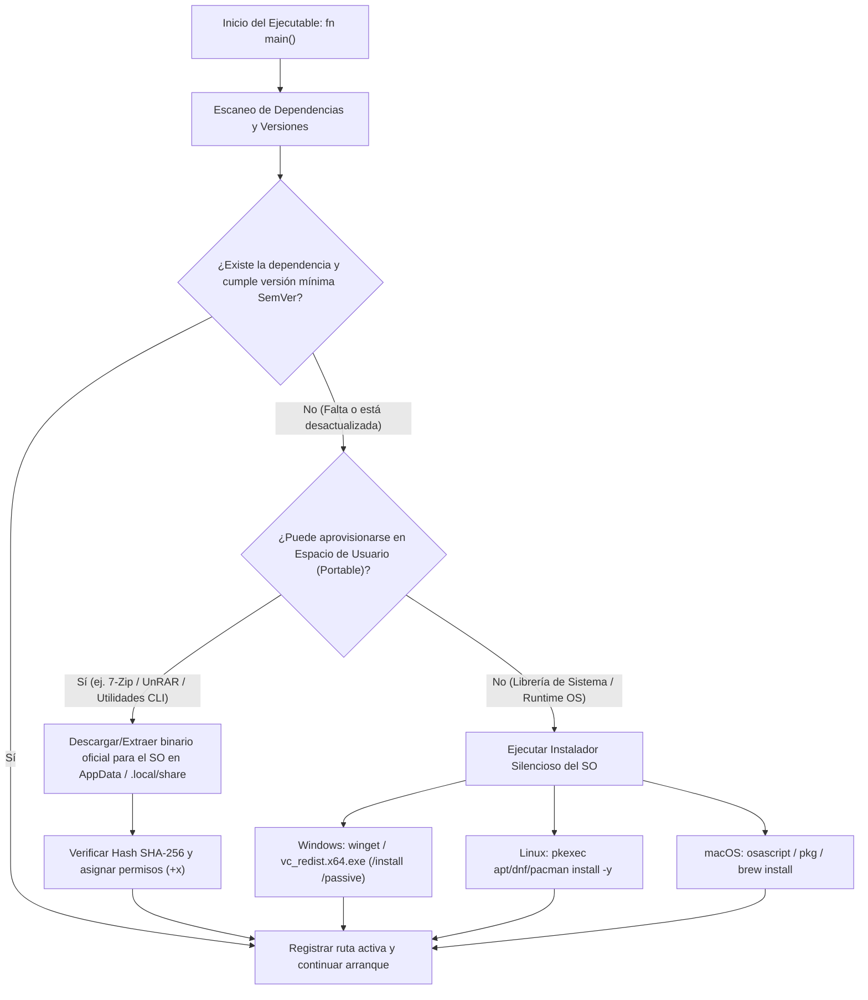
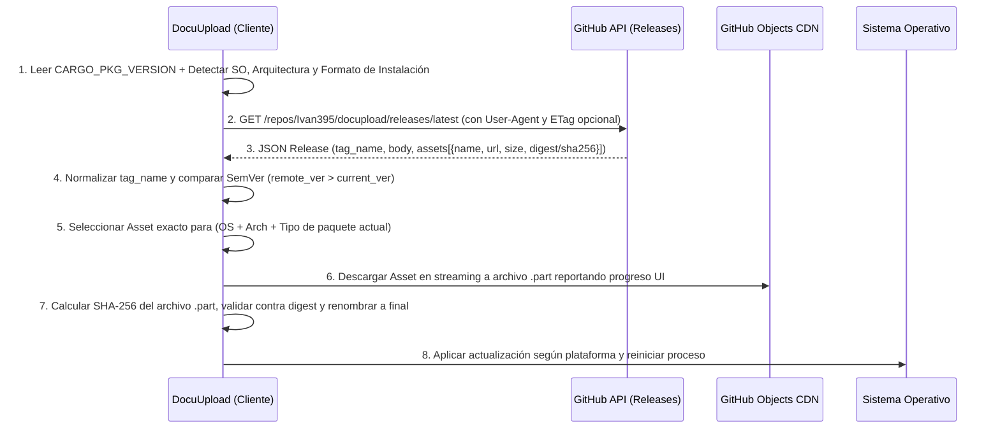

# Análisis Técnico: Empaquetado Multiplataforma, Auto-gestión de Dependencias y Actualizaciones desde GitHub

Este documento presenta un análisis técnico completo del proyecto **DocuUpload (`docu_ffacd`)** respecto a:

1. El estado actual del empaquetado en **Windows, Linux y macOS** y sus brechas reales.
2. La arquitectura necesaria para que el **propio ejecutable instale o actualice automáticamente** cualquier dependencia faltante o desactualizada en el sistema operativo.
3. El análisis de la implementación actual y los **pasos completos** que debe ejecutar la aplicación para verificar, descargar y aplicar actualizaciones desde los repositorios de GitHub.

---

## 1. Análisis del Empaquetado Actual (Windows, Linux y macOS)

### 1.1 Mapa de Dependencias Reales del Binario (`docu_ffacd`)

Al inspeccionar [`Cargo.toml`](Cargo.toml), `Cargo.lock` y las llamadas a procesos del sistema en `src/`, las dependencias del programa se dividen en dos capas principales:

1. **Librerías nativas enlazadas al compilar / arrancar (`.dll`, `.so`, `.dylib`)**:
   - **Interfaz gráfica (`slint = "1.18.1"`, `rfd = "0.15"`, `arboard = "3"`)**:
     - **Windows**: APIs nativas Win32 / Direct3D / OpenGL y el runtime **Microsoft Visual C++ Redistributable (`VCRUNTIME140.dll`, `MSVCP140.dll`)**.
     - **Linux**: `libfontconfig.so.1`, `libfreetype.so.6`, `libX11.so.6`, `libXext.so.6`, `libXrender.so.1`, `libxcb.so.1`, `libxkbcommon.so.0`, `libwayland-client.so.0`, `libGL.so.1` / `libEGL.so.1` y `xdg-desktop-portal` (vía D-Bus para `rfd`).
     - **macOS**: Frameworks del sistema (`AppKit`, `CoreFoundation`, `CoreGraphics`, `Metal`, `QuartzCore`).
   - **Motor PDF (`mupdf` / `mupdf-sys`)** ([`Cargo.toml`](Cargo.toml#L34)):
     - Compila MuPDF en C mediante `cc` y genera bindings con `bindgen` (lo cual exige `libclang` en la máquina que compila). En Linux y macOS, si `pkg-config` detecta `freetype2`, `harfbuzz`, `libpng` o `zlib` en el sistema durante la compilación, los enlaza dinámicamente.
   - **Conexión TLS a PostgreSQL (`postgres-native-tls` + `native-tls`)** ([`Cargo.toml`](Cargo.toml#L44-L45), [`src/db/config.rs`](src/db/config.rs#L1-L2)):
     - Mientras que `reqwest` y `rust-s3` usan `rustls-tls` (sin depender de OpenSSL del sistema), **`native-tls` en Linux sí enlaza dinámicamente contra OpenSSL del sistema (`libssl.so.3` / `libcrypto.so.3`)**. En Windows usa `SChannel` y en macOS `Security.framework` (ambos nativos del SO).

2. **Binarios externos invocados en tiempo de ejecución (`std::process::Command`)**:
   - **Descompresión de archivos `.rar`** ([`src/archives.rs`](src/archives.rs#L213-L355)): El soporte `.zip` es nativo en Rust (`zip` crate), pero para `.rar` la función `extract_rar_with_dest` invoca obligatoriamente `7z` (`get_7z_candidates`) o `unrar`/`WinRAR` (`get_unrar_candidates`).
   - **Fallback de extracción PDF (`pymupdf` / `python -m fitz`)** ([`src/cedulas/pdf_extractor.rs`](src/cedulas/pdf_extractor.rs#L198-L292)): `extract_with_layout` usa MuPDF nativo en memoria (`extract_with_mupdf_native`), pero si falla recurre a `extract_with_pymupdf_cli`, que busca `pymupdf` o `python3 -m fitz`.
   - **Utilidades del escritorio** ([`src/main.rs`](src/main.rs#L561-L580)): `explorer` (Windows), `xdg-open` (Linux) y `open` (macOS).

---

### 1.2 Diagnóstico por Sistema Operativo: ¿Realmente se empaqueta bien?

#### A. Windows ([`packaging/windows/build_windows.bat`](packaging/windows/build_windows.bat) e [`packaging/windows/installer.iss`](packaging/windows/installer.iss))

- **Qué hace actualmente**: Incrusta recursos e icono con `winres` en [`build.rs`](build.rs#L7-L17), descarga `vc_redist.x64.exe`, crea un `.zip` portable y compila el instalador `DocUpload-Setup-0.5.0.exe` con Inno Setup.
- **Problemas detectados**:
  1. **Permisos de escritura en `C:\Program Files`**: [`installer.iss`](packaging/windows/installer.iss#L16) instala la aplicación en `{autopf}\Firma Fiscal ACD\DocUpload` (`C:\Program Files\...`). Sin embargo, la aplicación guarda `db_config.json` (`DbConfig::resolve_config_path` en [`src/db/config.rs`](src/db/config.rs#L128-L151)), `analista_actual.txt` y la carpeta `logs/` en el directorio de trabajo actual o junto al `.exe`. En Windows, un usuario estándar **no tiene permisos de escritura dentro de `C:\Program Files`**, provocando que los cambios de configuración de base de datos o logs fallen al ejecutarse desde el acceso directo.
  2. **Ejecución de `vc_redist.x64.exe` en Inno Setup**: En [`installer.iss`](packaging/windows/installer.iss#L43) se incluye la bandera `runascurrentuser` al ejecutar `vc_redist.x64.exe`. El redistribuible de Visual C++ requiere privilegios administrativos elevados; en un contexto sin elevación, `/quiet` puede fallar silenciosamente sin notificar al usuario.
  3. **Sin soporte `.rar` de fábrica**: Ni el `.exe` instalador ni el `.zip` portable incluyen `7z.exe` + `7z.dll` (que son LGPL y redistribuibles), por lo que en una PC Windows sin 7-Zip o WinRAR preinstalado fallará la carga de archivos `.rar`.
  4. **Compilación de `mupdf-sys` en entornos Windows limpios**: Requiere `libclang` (`LIBCLANG_PATH`) para `bindgen` durante el build.

#### B. Linux ([`build_deb.sh`](packaging/debian/build_deb.sh), [`build_rpm.sh`](packaging/fedora/build_rpm.sh), [`docu_ffacd.spec`](packaging/fedora/docu_ffacd.spec), [`build_arch.sh`](packaging/arch/build_arch.sh), [`build_appimage.sh`](packaging/appimage/build_appimage.sh))

- **Qué hace actualmente**: Construye paquetes `.deb`, `.rpm`, `.pkg.tar.zst` y `.AppImage`.
- **Problemas detectados**:
  1. **Dependencias omitidas en `.deb`, `.rpm` y `.PKGINFO`**:
     - En [`build_deb.sh`](packaging/debian/build_deb.sh#L73), [`docu_ffacd.spec`](packaging/fedora/docu_ffacd.spec#L8-L15) y [`build_arch.sh`](packaging/arch/build_arch.sh#L71-L78) **no se declaran** `openssl` (`libssl3`), `ca-certificates`, `libgl1` / `libegl1`, `libxkbcommon0`, `xdg-utils` (para `xdg-open`), ni `p7zip-full` / `7zip` (para `.rar`).
     - En Ubuntu 24.04+ (transición `t64`), paquetes como `libpng16-16` pasaron a llamarse `libpng16-16t64`. Fijar `Depends:` manualmente en [`build_deb.sh`](packaging/debian/build_deb.sh#L73) en lugar de calcularlos dinámicamente con `dpkg-shlibdeps` o declarar alternativas (`libpng16-16 | libpng16-16t64`) puede impedir instalar el `.deb` en Ubuntu 24.04.
     - En [`.github/workflows/release.yml`](.github/workflows/release.yml#L25-L28) falta incluir explícitamente `pkg-config`, `libssl-dev` y `libclang-dev` en el paso `apt-get install`.
  2. **Contaminación de drivers OpenGL dentro del AppImage**:
     - En [`build_appimage.sh`](packaging/appimage/build_appimage.sh#L91-L105) se copian todas las librerías de `ldd` excepto `libc`, `libm`, `libpthread`, `libdl`, `ld-linux` y `librt`.
     - Esto provoca que si el binario enlaza con `libGL.so.1`, `libEGL.so.1`, `libGLX.so.0`, `libGLdispatch.so.0`, `libdrm.so.2`, `libgbm.so.1` o `libstdc++.so.6` de Ubuntu 22.04, estas se incluyan dentro de `AppDir/usr/lib/`. Cuando el AppImage se ejecuta en una distribución más reciente (ej. Fedora 40+, Arch Linux o Ubuntu 24.04), las librerías Mesa/OpenGL antiguas empaquetadas entran en conflicto con los drivers GPU (`*_dri.so` / NVIDIA) del sistema anfitrión y la ventana gráfica de Slint no arranca.
  3. **Construcción del `.rpm` desde un runner Ubuntu**:
     - En [`.github/workflows/release.yml`](.github/workflows/release.yml#L36-L37), el paquete RPM se genera dentro de `ubuntu-22.04`, donde `%{?dist}` y la base de dependencias RPM difieren de Fedora/RHEL, pudiendo producir discrepancias de `SONAME` o metadatos al instalar en Fedora.
  4. **Permisos de directorio de trabajo al lanzar desde `/usr/share/applications/docu_ffacd.desktop`**:
     - Instalado vía `.deb` o `.rpm`, el binario vive en `/usr/bin/docu_ffacd` (solo lectura). Si el entorno de escritorio lo inicia con `CWD = /` o `$HOME`, creará `db_config.json` y `logs/` sueltos en `$HOME` o fallará por permisos si `CWD` no es escribible.

#### C. macOS ([`packaging/macos/build_dmg.sh`](packaging/macos/build_dmg.sh) e [`packaging/macos/Info.plist`](packaging/macos/Info.plist))

- **Qué hace actualmente**: Crea la estructura `DocUpload.app`, copia `.dylib` de Homebrew a `Contents/Frameworks` con `install_name_tool`, y genera el `.dmg`.
- **Problemas detectados**:
  1. **Corrupción de firma en Apple Silicon (`SIGKILL - Code Signature Invalid`)**:
     - En [`.github/workflows/release.yml`](.github/workflows/release.yml#L82) se usa `macos-latest` (Apple Silicon ARM64). En macOS ARM64, el kernel exige que todo ejecutable tenga una firma criptográfica válida (incluso ad-hoc).
     - En [`build_dmg.sh`](packaging/macos/build_dmg.sh#L53), al modificar el binario con `install_name_tool -change`, **la firma del linker queda invalidada**. Como el script no ejecuta después `codesign --force --deep --sign - "$BUNDLE_DIR/$APP_NAME"`, macOS matará la aplicación al instante de abrirla.
  2. **Dependencias `.dylib` transitivas no resueltas**:
     - El bucle con `otool -L` en [`build_dmg.sh`](packaging/macos/build_dmg.sh#L46-L55) solo copia las `.dylib` de primer nivel del ejecutable, pero si una `.dylib` copiada a `Contents/Frameworks/` apunta a otra `.dylib` en `/opt/homebrew/opt/...` (por ejemplo, `libfreetype` -> `libpng`), esa ruta interna no se reescribe con `install_name_tool` y fallará en cualquier Mac sin Homebrew.
  3. **Binario de una sola arquitectura**:
     - Solo compila la arquitectura nativa del runner (`aarch64-apple-darwin` en `macos-latest`), dejando fuera a Macs con procesador Intel (`x86_64-apple-darwin`), salvo que se compile para ambos targets y se combinen en un Universal Binary con `lipo -create`.
  4. **Gatekeeper**:
     - Sin firma con certificado Apple Developer ID y notarización, los archivos descargados de GitHub llevarán el atributo `com.apple.quarantine`.

---

## 2. Análisis: Auto-Instalación y Auto-Actualización de Dependencias desde el Propio Ejecutable

Para cumplir el requerimiento de que **"si un sistema operativo no cuenta con alguna dependencia, el mismo ejecutable la instale automáticamente o la actualice según sea el caso"**, es indispensable distinguir dos momentos técnicos del ciclo de vida de un ejecutable:

### 2.1 El Dilema del Cargador del SO (Pre-`main`) vs. Tiempo de Ejecución (Post-`main`)

- **Antes de `fn main()` (Cargador del SO: `ntdll.dll` / `ld-linux.so` / `dyld`)**:
  Si al ejecutable `docu_ffacd` le falta una librería dinámica obligatoria en su tabla de importación (como `VCRUNTIME140.dll` en Windows o `libssl.so.3` / `libfontconfig.so.1` en Linux), **el sistema operativo aborta el proceso antes de que se ejecute la primera línea de Rust en `fn main()`**.
- **Después de iniciar `fn main()`**:
  Cualquier herramienta externa (`7z`, `unrar`, `pymupdf`, certificados, fuentes, librerías cargadas bajo demanda con `dlopen`) sí puede ser verificada, descargada, instalada y actualizada por el propio ejecutable.

### 2.2 Estrategia Integral para que el Ejecutable sea 100% Autónomo y Auto-Reparable

#### Paso A: Eliminar bloqueos Pre-`main` (Enlace Estático o Launcher)

1. **En Windows**:
   - Enlazar estáticamente el runtime de C (`CRT`) agregando en `.cargo/config.toml` para `x86_64-pc-windows-msvc`: `rustflags = ["-C", "target-feature=+crt-static"]` (o utilizar un micro-launcher estático). Con `+crt-static`, `docu_ffacd.exe` **arranca siempre incluso en un Windows recién instalado sin VC++ Redistributable**, y ya dentro de `fn main()` puede verificar el registro de Windows e instalar/actualizar `vc_redist.x64.exe` si algún componente secundario lo requiere.
2. **En Linux**:
   - Reemplazar `postgres-native-tls` por un conector TLS basado en `rustls` (igual que ya se usa en `reqwest` y `rust-s3`), eliminando la dependencia dura de `libssl.so.3`.
   - En el AppImage, excluir de `AppDir/usr/lib` las librerías del driver gráfico del host (`libGL*`, `libEGL*`, `libdrm*`, `libgbm*`, `libxcb*`, `libX11*`) para usar las del sistema anfitrión, y mantener empaquetadas `libfontconfig`, `libfreetype`, `libpng` y `libz`.
3. **En macOS**:
   - Compilar `mupdf-sys` con sus librerías internas (`freetype`, `harfbuzz`, `zlib`, `libpng`) de forma **estática**, dejando únicamente frameworks nativos de Apple (`AppKit`, `CoreFoundation`, `Metal`, `Security`) que siempre existen en el SO.

#### Paso B: Motor de Auto-Instalación y Auto-Actualización en `fn main()` (`DependencyManager`)

Al arrancar la aplicación, el ejecutable debe ejecutar un verificador de dependencias (`check_and_provision_dependencies()`) con el siguiente flujo:

##### Cómo debe operar en cada Sistema Operativo

1. **Aprovisionamiento Automático en Espacio de Usuario (Sin permisos de Administrador — Ideal para `7z` / `unrar`)**:
   - **Problema que resuelve**: Actualmente [`src/archives.rs`](src/archives.rs#L327-L332) falla si el usuario no instaló manualmente 7-Zip o WinRAR.
   - **Cómo lo hace el ejecutable**:
     - Define un directorio de herramientas gestionadas por la app:
       - **Windows**: `%LOCALAPPDATA%\DocUpload\bin\`
       - **Linux**: `~/.local/share/docu_ffacd/bin/`
       - **macOS**: `~/Library/Application Support/DocUpload/bin/`
     - Al iniciar, ejecuta `<bin_7z> i` o parsea la versión de `7z`.
     - Si no existe en el sistema ni en la carpeta `bin/` (o si su versión es inferior a la mínima requerida, ej. `< 24.08`):
       - El ejecutable descarga automáticamente mediante `reqwest` la distribución oficial ligera de 7-Zip (`7zr.exe` / `7za.exe` en Windows, `7zz` estático en Linux `x86_64`, `7zz` universal en macOS) desde el repositorio oficial o desde el propio GitHub Release del proyecto.
       - Verifica su checksum SHA-256, lo guarda en la carpeta `bin/` del usuario, en Linux/macOS aplica `chmod 0o755`, y agrega esa carpeta como primera prioridad en `get_7z_candidates()`.
     - **Ventaja**: Es 100% silencioso, multiplataforma, se auto-actualiza cuando cambia la versión objetivo y **no requiere permisos de administrador (`sudo` / UAC)**.

2. **Auto-Instalación / Actualización de Dependencias del Sistema Operativo**:
   - **Windows**:
     - **Detección**: Consultar la clave del registro `HKLM\SOFTWARE\Microsoft\VisualStudio\14.0\VC\Runtimes\x64` (`Installed`, `Major`, `Minor`, `Bld`).
     - **Instalación / Actualización automática**: Si no existe o `Bld` es menor al requerido, el ejecutable descarga `https://aka.ms/vs/17/release/vc_redist.x64.exe` a `%TEMP%\vc_redist.x64.exe` y lo ejecuta con `vc_redist.x64.exe /install /passive /norestart` (o usa `winget install --id Microsoft.VCRedist.2015+.x64 --silent --accept-package-agreements --accept-source-agreements`).
   - **Linux**:
     - **Detección**: Comprobar la presencia de librerías y utilidades (`xdg-open`, `fontconfig`, `7z`, `unrar`) usando `dlopen` (`libloading`) o buscando en `PATH`.
     - **Instalación / Actualización automática**: Detectar el gestor de paquetes leyendo `/etc/os-release` (`apt-get`, `dnf`, `pacman`, `zypper`) e invocar **`pkexec`** (que despliega la ventana gráfica nativa de autenticación de Polkit en el escritorio Linux):
       - Debian/Ubuntu: `pkexec apt-get update && pkexec apt-get install -y --only-upgrade <paquetes>`
       - Fedora/RHEL: `pkexec dnf install -y <paquetes>`
       - Arch Linux: `pkexec pacman -S --noconfirm --needed <paquetes>`
   - **macOS**:
     - **Detección**: Comprobar herramientas en `/usr/bin`, `/opt/homebrew/bin` y `/usr/local/bin`.
     - **Instalación / Actualización automática**: Para herramientas gestionadas (`7zz`), descargarlas directamente en `~/Library/Application Support/DocUpload/bin/` y limpiar el atributo de cuarentena con `xattr -d com.apple.quarantine <binario>`. Si se requiere instalar un paquete `.pkg` del sistema, invocar el diálogo nativo de macOS mediante `osascript -e 'do shell script "installer -pkg ... -target /" with administrator privileges'`.

---

## 3. Análisis de los Pasos para Verificar y Aplicar una Nueva Actualización en GitHub

Actualmente la aplicación ya cuenta con una implementación base en [`src/updater.rs`](src/updater.rs), conectada a la interfaz en [`src/main.rs`](src/main.rs#L7738-L7915) y al modal [`ui/update_modal.slint`](ui/update_modal.slint).

### 3.1 Qué Hace Actualmente y Qué Problemas Tiene

| Fase | Estado actual en [`src/updater.rs`](src/updater.rs) y [`src/main.rs`](src/main.rs#L7738-L7915) | Brechas / Problemas detectados |
| :--- | :--- | :--- |
| **1. Repositorio y CI/CD** | Consulta `https://api.github.com/repos/Ivan395/docupload/releases/latest`. | 1. En `git remote -v`, `origin` apunta a **GitLab** (`git@gitlab.com:Ivan395/docupload.git`) y `origin_gh` a **GitHub**. Si no se empujan los tags a `origin_gh`, GitHub nunca genera el Release. 2. Existe un archivo duplicado y desactualizado en [`actions/workflows/release.yml`](actions/workflows/release.yml) además del real en [`.github/workflows/release.yml`](.github/workflows/release.yml). 3. En [`.github/workflows/release.yml`](.github/workflows/release.yml#L5-L8), el workflow se dispara en cada push a `master` usando la versión de `Cargo.toml` (`v0.5.0`), sobrescribiendo el mismo release `v0.5.0` sin aumentar SemVer, por lo que `remote_ver > current_ver` (`0.5.0 > 0.5.0`) resulta `false` y los usuarios no detectan la actualización. |
| **2. Chequeo al arrancar** | En [`src/main.rs`](src/main.rs#L7894-L7914), espera 3 segundos y llama a `check_for_updates()`. | Cuando detecta una actualización al arrancar, pone `set_update_available(true)` pero **no abre el modal (`set_show_update_modal(true)`) ni muestra una notificación toast**, pasando desapercibida para el usuario. |
| **3. Selección de Asset en Linux** | `select_best_asset()` ([`src/updater.rs`](src/updater.rs#L130-L140)) siempre prioriza `.AppImage` sobre `.deb`, `.rpm` o `.pkg.tar.zst`. | Si el usuario instaló la app mediante `.deb` o `.rpm` (ejecutando `/usr/bin/docu_ffacd`), el actualizador descarga el `.AppImage` en `/tmp` y en `apply_update_now()` ([`src/updater.rs`](src/updater.rs#L249-L266)), al no existir la variable `APPIMAGE`, simplemente ejecuta el AppImage desde `/tmp`. Al reiniciar la PC, `/tmp` se borra y `/usr/bin/docu_ffacd` sigue en la versión vieja. |
| **4. Seguridad e Integridad** | `download_update_file()` ([`src/updater.rs`](src/updater.rs#L148-L213)) descarga directamente a `/tmp/<asset_name>`. | No usa un archivo temporal `.part` (si se corta la red a mitad de descarga queda un instalador corrupto) y **no verifica el hash SHA-256** antes de ejecutar el binario descargado. |
| **5. Aplicación del Update** | `apply_update_now()` ([`src/updater.rs`](src/updater.rs#L216-L283)) lanza el `.exe` (Windows), reemplaza `APPIMAGE` (Linux) o hace `open .dmg` (macOS). | - **Windows**: Lanza Inno Setup sin banderas `/CLOSEAPPLICATIONS` ni `/SILENT`, pudiendo chocar con el archivo `docu_ffacd.exe` aún bloqueado por el sistema. - **Linux (AppImage)**: Hace `fs::copy(file_path, &current_path)` sobre un binario en ejecución (lo que en Linux puede fallar con `ETXTBSY - Text file busy` si no se usa un `rename` atómico). - **macOS**: Solo monta el `.dmg` con `open`, sin reemplazar `DocUpload.app` ni cerrar la app actual. |

---

### 3.2 Los 8 Pasos que Debe Realizar la Aplicación para Checar e Instalar Actualizaciones desde GitHub

#### Paso 1: Identificación del Entorno Local (Versión, SO, Arquitectura y Método de Instalación)
Antes de consultar o elegir qué descargar, el ejecutable debe identificar:
1. **Versión compilada**: `env!("CARGO_PKG_VERSION")` parseada como `semver::Version`.
2. **Sistema operativo y arquitectura**: `std::env::consts::OS` (`windows`, `linux`, `macos`) y `std::env::consts::ARCH` (`x86_64`, `aarch64`).
3. **Tipo de instalación activa**:
   - **Linux**:
     - Si existe `std::env::var("APPIMAGE")` → Instalación tipo **AppImage**.
     - Si `std::env::current_exe()` está en `/usr/bin/docu_ffacd`: verificar si pertenece a `dpkg -S /usr/bin/docu_ffacd` (→ **`.deb`**), `rpm -qf /usr/bin/docu_ffacd` (→ **`.rpm`**) o `pacman -Qo /usr/bin/docu_ffacd` (→ **`.pkg.tar.zst`**).
   - **Windows**:
     - Verificar si junto a `current_exe()` existe `unins000.exe` (instalado con **Inno Setup `.exe`**) o si corre en modo **Portable (`.zip`)**.
   - **macOS**:
     - Verificar la ruta del bundle `.app` ascendiendo desde `Contents/MacOS/docu_ffacd` hasta `DocUpload.app`.

#### Paso 2: Petición HTTP a la API de GitHub Releases
- Realizar una petición `GET` a:
  `https://api.github.com/repos/Ivan395/docupload/releases/latest`
- **Cabeceras obligatorias**:
  - `User-Agent: DocuUpload-App/<version> (<os>; <arch>)` (GitHub rechaza con `403 Forbidden` cualquier petición sin `User-Agent`).
  - `Accept: application/vnd.github+json`
  - `X-GitHub-Api-Version: 2022-11-28`
- **Manejo de códigos de estado y Rate-Limiting**:
  - `200 OK`: Procesar respuesta JSON.
  - `404 Not Found`: No hay releases publicados todavía (o el repositorio es privado; si es privado requerirá token de solo lectura `Authorization: Bearer ...`).
  - `403 Forbidden` / `429 Too Many Requests`: Revisar `X-RateLimit-Remaining`. Guardar en caché local la última consulta automática (15–30 min) para no agotar las 60 peticiones/hora por IP de la API pública de GitHub.

#### Paso 3: Parseo y Normalización de la Versión Remota (SemVer)
- Extraer `tag_name` del JSON (ej. `"v0.6.0"` o `"0.6.0-1"`), ignorar releases con `"draft": true` o `"prerelease": true` (salvo que se habilite un canal beta).
- Limpiar prefijos (`v`, `V`, espacios) y parsear con `semver::Version::parse`.
- Comparar estrictamente `remote_version > local_version`.

#### Paso 4: Emparejamiento Inteligente del Asset (`select_best_asset`)
Filtrar el arreglo `assets` del JSON de GitHub buscando coincidencia de **plataforma/arquitectura** y **formato de instalación detectado en el Paso 1**:
- **Windows**:
  - Instalado con Inno Setup → buscar `DocUpload-Setup-*.exe`.
  - Portable → buscar `DocuUpload-*-windows-x64.zip`.
- **Linux**:
  - AppImage → buscar `*.AppImage`.
  - Gestor de paquetes → buscar `*.deb` (Debian/Ubuntu), `*.rpm` (Fedora/RHEL) o `*.pkg.tar.zst` (Arch).
- **macOS**:
  - Buscar el asset correspondiente a la arquitectura (`aarch64` / `x86_64` o Universal) en formato `.dmg` o `.tar.gz`.

#### Paso 5: Notificación No Intrusiva en la Interfaz Gráfica (Slint)
- Si el chequeo fue **automático al inicio**: activar el indicador visual en la barra de navegación y mostrar el modal o un toast invitando a actualizar, mostrando versión actual, nueva versión, tamaño en MB (`filesize_bytes`) y el changelog (`body` del release).
- Si el chequeo fue **manual**: abrir inmediatamente el `UpdateModal` o informar con un toast que ya cuenta con la última versión.

#### Paso 6: Descarga Atómica con Streaming y Control de Progreso
- Descargar desde `browser_download_url` hacia un archivo temporal con sufijo `.part` (ej. `/tmp/DocUpload-Setup-0.6.0.exe.part`) usando buffers de 64 KB.
- Emitir eventos al hilo principal de Slint (`slint::invoke_from_event_loop`) actualizando porcentaje y MB descargados.
- Al concluir, confirmar que los bytes descargados coinciden con `asset.size` antes de renombrar `.part` al archivo final.

#### Paso 7: Verificación Criptográfica de Integridad (SHA-256)
- Aprovechando que el proyecto ya incluye `sha2 = "0.10"` en [`Cargo.toml`](Cargo.toml#L39), calcular el hash `Sha256` del archivo descargado.
- Compararlo contra el campo `digest` (`"sha256:..."`) provisto por la API de GitHub Releases en cada asset (o contra un archivo `SHA256SUMS` adjunto al release). Si no coincide, eliminar el archivo temporal y abortar con error de integridad.

#### Paso 8: Aplicación de la Actualización y Reinicio Limpio según el SO
- **Windows**:
  - Instalador `.exe` (Inno Setup): ejecutarlo pasando `/SILENT /CLOSEAPPLICATIONS /RESTARTAPPLICATIONS` (o `/PASSIVE`) y cerrar inmediatamente el proceso actual (`std::process::exit(0)`) para liberar `docu_ffacd.exe`.
  - Portable `.zip`: renombrar el ejecutable en curso `docu_ffacd.exe` a `docu_ffacd.exe.old`, extraer el nuevo `docu_ffacd.exe`, lanzarlo y cerrar el proceso viejo (al iniciar, la nueva versión borra `docu_ffacd.exe.old`).
- **Linux**:
  - **AppImage** (`APPIMAGE` definido): copiar el nuevo AppImage a la misma carpeta del AppImage actual con nombre temporal `.new`, asignarle `chmod 0o755`, hacer un `std::fs::rename` atómico sobre la ruta `APPIMAGE` (evitando el error `ETXTBSY` del kernel Linux), lanzar el nuevo AppImage y hacer `exit(0)`.
  - **`.deb` / `.rpm` / `.pkg.tar.zst`**: ejecutar `pkexec apt-get install -y /tmp/paquete.deb` (o `pkexec dnf upgrade -y /tmp/paquete.rpm` / `pkexec pacman -U --noconfirm /tmp/paquete.pkg.tar.zst`), relanzar `/usr/bin/docu_ffacd` y hacer `exit(0)`.
- **macOS**:
  - Montar el `.dmg` silenciosamente con `hdiutil attach -nobrowse -mountpoint /Volumes/DocuUploadUpdate <archivo.dmg>`, copiar `DocUpload.app` sobre la ruta del bundle actual (ej. `/Applications/DocUpload.app`) con `ditto`, desmontar con `hdiutil detach`, relanzar la aplicación con `open -n /Applications/DocUpload.app` y terminar el proceso actual con `std::process::exit(0)`.
