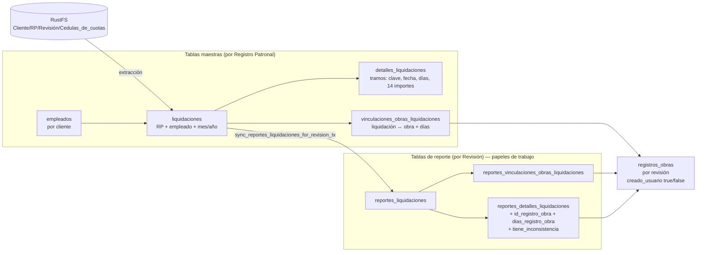

# Plan de Mejora — Cédulas de Cuotas (Vista 6) y Reportes de Liquidaciones (Vista 7)

> Basado en `documentacion_reglas_negocio.md` (secciones 6 y 7) **y verificado contra el código actual** de la rama `fix_vinculacion` (incluye cambios sin commit).
> Fecha: 2026-11-12.

---

## 0. Resumen ejecutivo

El programa ya hace mucho bien: extrae PDFs SUA/EMA con MuPDF, valida pertenencia al cliente/RP, sube primero a una carpeta temporal (*staging*) y guarda en una sola transacción. Además permite prorratear cuotas por obra con topes por movimientos (alta/baja/reingreso). **Pero hay 4 problemas de fondo** que causan duplicados, pérdida del trabajo del analista y documentos incorrectos ante el IMSS:

1. **La deduplicación depende solo del código, no de la base de datos.** No existe ninguna restricción `UNIQUE` en `liquidaciones`, `reportes_liquidaciones` ni `empleados`. Por eso existen las rutinas de "limpieza de duplicados" (síntoma, no cura).
2. **Volver a subir un mes, o simplemente abrir la Vista 7, puede borrar el trabajo manual del analista.** La re-carga borra el mes completo, incluidos los reportes. La sincronización elimina filas de reportes que quedan fuera del rango de las obras.
3. **No existe un registro de archivos.** El SHA-256 solo se muestra en pantalla. No hay tabla que diga "este PDF (hash X) generó estas liquidaciones", así que no se puede detectar un archivo idéntico ya cargado ni rastrear el origen.
4. **El Excel que se presenta al IMSS lleva datos fijos de otro cliente.** El representante legal `"ARTURO CARRILLO DOMINGUEZ"` está fijo en el código para **todos** los clientes (`src/reporte_view_logic.rs:5154`). El RFC `GON2110075C9`, `COAHUILA/SALTILLO` y el periodo `15/04/2026 AL 30/06/2026` se usan como valores por defecto (`src/db/reporte_liquidaciones.rs:3934-3955`).

El plan propone: **(a)** restricciones en BD con *upserts* idempotentes, **(b)** una tabla `archivos_cedulas` con hash, **(c)** una sincronización incremental que **nunca borra** el trabajo del usuario, **(d)** una nueva pantalla **"Asignación por Empleado"** para los 3 escenarios de vinculación y **(e)** un Excel IMSS con lista de verificación previa y sin datos fijos.

---

## 1. Cómo funciona hoy (punto por punto)

### 1.1 Modelo de datos actual



- `liquidaciones` es **por RP** (ya no tiene `id_revision`; la columna se eliminó en una migración, `schema.rs:1073-1093`).
- `reportes_liquidaciones` es **por revisión** (`id_revision NOT NULL`).
- `registros_obras` es **por revisión** (`UNIQUE (id_revision, numero)`). Las obras que se leen de la cédula se crean con `creado_usuario = false`.

### 1.2 Flujo de carga en Vista 6 (paso a paso)

| # | Paso | Dónde | Qué hace |
|---|------|-------|----------|
| 1 | Selección | `select_cedulas_view_files` / `_folder` | `.pdf/.zip/.rar` o carpeta; `archives.rs` descomprime en paralelo. |
| 2 | Inspección | `inspect_cedula_file_with_context` (`view_logic.rs:320`) | Calcula el SHA-256 (solo para mostrarlo), cuenta páginas SUA y detecta mes/año/RP para el nombre estándar `<Cliente>__<RP>__<Mes>__<Anio>.pdf`. |
| 3 | Detección de "mes repetido" | `main.rs:2025-2045` | Si ya existe en RustFS un archivo de ese mes, marca el mes en `overwrite_months`. **Solo muestra un aviso (toast)**, no pide confirmación. |
| 4 | Staging | `upload_staging_file_to_rustfs` | Sube a `.staging_<batch_id>/`. |
| 5 | Procesado automático | `process_and_audit_cedulas` (`view_logic.rs:648`) | Rechaza escaneos sin texto y bimestrales; parsea EMA/SUA; valida pertenencia (RP → RFC → razón social); manda a `Trash` los archivos ajenos. |
| 6 | Deduplicación en el lote | mismo | Por `(rp, trabajador, mes, año)`; la cédula SUA con obras o RFC/CURP tiene prioridad sobre EMA. |
| 7 | Transacción PG | `save_cedulas_audit_to_db` (`view_logic.rs:1786`) | Borra los meses de `overwrite_months` (**incluye `reportes_*`**, `view_logic.rs:2020+`). Después, por cada empleado, `save_single_cedula_employee_tx`. |
| 8 | Emparejar empleado | `cedulas.rs:972-993` | `WHERE nss = $2 OR curp = $3 OR rfc = $4 OR nombre = $5`, con prioridad en ese orden. |
| 9 | Liquidación | `cedulas.rs:1129-1300` | Busca liquidaciones existentes del mismo RP/empleado/mes. Si los 21 campos son idénticos, la reutiliza. Si la nueva es SUA autoritativa, reemplaza los detalles. Si es EMA, no pisa la existente. |
| 10 | Obras | `cedulas.rs:1087-1125` | Valida el número SIROC/SATIC, hace UPSERT en `registros_obras` (`creado_usuario=false`) e inserta en `vinculaciones_obras_liquidaciones`. |
| 11 | Sync a reportes | `sync_reportes_liquidaciones_for_revision_tx` (`reporte_liquidaciones.rs:680`) | Dentro de la misma transacción. |
| 12 | Commit RustFS → commit PG | `rustfs_commit_hook` (`main.rs:2420-2455`) | Manda los archivos sustituidos a `Trash` y promueve el staging **antes** de `tx.commit()`. |
| 13 | Error | — | `rollback` + `rollback_staging_files_in_rustfs` + modal de error de sistema. |

### 1.3 Sincronización a reportes (al guardar **y cada vez que se abre la Vista 7**)

1. Resuelve los RPs equivalentes y la revisión activa.
2. **Si hay obras del usuario**, hace `DELETE` en `reportes_liquidaciones` de todo mes que no se traslape con alguna obra `creado_usuario = true` (`reporte_liquidaciones.rs:733-790`).
3. `DELETE` de duplicados con `ROW_NUMBER()` (`:792-830`).
4. `DELETE` de vinculaciones y detalles "fantasma" de obras `creado_usuario=false` (`:832-890`).
5. `INSERT ... SELECT DISTINCT ON` desde `liquidaciones` (**todas las del RP**, sin filtro de revisión) y `NOT EXISTS` (`:893-985`).
6. Asegura las obras de la revisión, copia los detalles, aplica la regla de bajas (`dias=0`, sin obra), replica movimientos de nóminas y restaura los montos originales.

### 1.4 Edición y salida en Vista 7

- Tabla de 31 columnas, **una fila por empleado-mes-tramo-obra**, paginada de 100 en 100.
- 8 modales: unificado multi-obra, agregar obra, lote, asignar máximo, ordenar, explorar empleados, seleccionar por obra y SUA.
- Prorrateo: `factor = días_obra / días_cédula` aplicado a las 11 ramas. Guarderías 18% solo con obras de usuario.
- Trigger permisivo `trg_check_reportes_detalles_liquidaciones_tope`, que marca inconsistencias sin bloquear.
- Excel de 5 hojas y 6 archivos SUA `.TXT`.

---

## 2. Gaps detectados (verificados en código)

Severidad: 🔴 crítico (dato incorrecto o pérdida de trabajo) · 🟠 alto · 🟡 medio · ⚪ menor.

| ID | Sev. | Gap | Evidencia | Consecuencia |
|----|------|-----|-----------|--------------|
| G1 | 🔴 | **Excel IMSS con datos fijos** | `reporte_view_logic.rs:5151-5154` (representante legal siempre fijo; RFC, delegación y subdelegación por defecto). `reporte_liquidaciones.rs:3934-3955` (por defecto, incluido el periodo `15/04/2026 AL 30/06/2026`). | El documento oficial puede salir con el representante, RFC o periodo de otro cliente. |
| G2 | 🔴 | **Re-subir un mes borra el trabajo del analista** | `main.rs:2037-2039` (solo un toast) + `delete_cedula_for_month_tx` (`view_logic.rs:2045-2080`) borra `reportes_detalles`, `reportes_vinculaciones` y `reportes_liquidaciones` del mes. | Se pierden todas las asignaciones manuales de obra y días de ese mes sin confirmación. |
| G3 | 🔴 | **Sync destructivo al abrir la vista** | `reporte_liquidaciones.rs:733` (`DELETE ... NOT EXISTS obra en rango`). | Si el analista acorta la vigencia de una obra o la borra, desaparecen filas de reporte con sus ediciones. Si luego corrige la fecha, las filas vuelven "de fábrica". |
| G4 | 🔴 | **Sin restricciones UNIQUE** en `liquidaciones (rp, emp, año, mes)`, `reportes_liquidaciones (rev, emp, año, mes)` ni `empleados (cliente, nss)` | `schema.rs:394-540`, `:1371-1404` (solo índices normales). | Los duplicados dependen de la lógica de la aplicación; prueba de ello son las rutinas `cleanup_all_duplicate_reportes_detalles` y el `DELETE ... rn > 1`. |
| G5 | 🟠 | **Condición de carrera en guardado concurrente (Vista 0)** | `save_cedulas_concurrent` (`cedulas.rs:1477`): una transacción por empleado en `par_iter`. | El mismo NSS en 2 meses se procesa en paralelo: los dos `SELECT` no encuentran nada y los dos hacen `INSERT`, lo que **duplica el empleado**. |
| G6 | 🟠 | **Emparejamiento por nombre** como último recurso | `cedulas.rs:977` (`OR nombre = $5`). | Dos homónimos con NSS distinto pueden fusionarse si a uno le falta NSS. |
| G7 | 🟠 | **Datos inventados** | Detalle sustituto con `dias = 30` y montos en 0 cuando no hay tramos (`cedulas.rs:1214-1250`). Mes no reconocido → **enero** (`cedulas.rs:1081`, y `ELSE 1` en el SQL de sync). Días de obra forzados a `clamp(1,31)` (`cedulas.rs:1094`, `:1121`). | Liquidaciones fantasma o asignadas al mes equivocado; una obra con 0 días se registra como 1. |
| G8 | 🟠 | **Doble fuente de verdad** del vínculo obra en reportes | `reportes_detalles_liquidaciones.id_registro_obra` **y** `reportes_vinculaciones_obras_liquidaciones`. | Pueden desincronizarse; varias rutinas existen solo para reconciliarlas. |
| G9 | 🟠 | **La revisión no tiene periodo** | `revisiones` no tiene `periodo_inicio/fin` (`schema.rs:237-257`); la sync copia **todas** las liquidaciones del RP (`:960`). | Cédulas de otra revisión del mismo RP aparecen en esta revisión; solo se filtran de forma indirecta, por las fechas de las obras. |
| G10 | 🟠 | **No hay registro de archivos** | `compute_sha256_short` solo se muestra (`view_logic.rs:154`); `liquidaciones.nombre_archivo` es texto libre. | No se detecta "este PDF ya se cargó"; no se sabe qué PDF originó cada dato; la deduplicación se hace por nombre y mes. |
| G11 | 🟠 | **Orden del commit 2 fases** | `rustfs_commit_hook` promueve en RustFS **antes** de `tx.commit()`. | Si el `COMMIT` de PG falla (red, *serialization*), RustFS ya movió los archivos sustituidos a Trash y promovió los nuevos: el estado queda inconsistente. |
| G12 | 🟡 | **Reconciliación pesada al arrancar** | `main.rs:7060-7078` → `reconcile_all_liquidaciones_vinculaciones_from_rustfs` descarga y re-parsea **todo el bucket** y reescribe `vinculaciones_obras_liquidaciones`. | Arranque lento, uso de red y cambios en la BD sin que el usuario lo sepa. |
| G13 | 🟡 | **Universos distintos** entre KPIs (`all_rows`), pie de tabla y Excel (`filtered_rows`) | Doc §7.6.4. | Si el analista deja un filtro activo al exportar, el Excel sale **incompleto**. |
| G14 | 🟡 | **Dos caminos de ingesta con reglas distintas** | Vista 0 crea el contexto sin validar, no sube a RustFS y no sincroniza reportes (doc, nota de arquitectura). | Datos en la BD sin PDF de respaldo. |
| G15 | 🟡 | **Obras detectadas en la cédula invisibles** | Vistas 3 y 4 solo muestran `creado_usuario=true`. | El analista no sabe qué números de obra trae la cédula ni puede "adoptarlos" con un clic. |
| G16 | 🟡 | **UX centrada en filas, no en empleados** | Tabla de 31 columnas y 1 fila por tramo. | Contestar "¿qué obras tiene Juan en marzo–junio?" exige filtrar y paginar. |
| G17 | ⚪ | Filtros de mes/obra estáticos en Vista 6, badge "Ejercicio 2023" fijo, modal SUA que lista 5 archivos en lugar de 6, atajos decorativos | Doc §6.5 y §7.6. | Confusión. |
| G18 | ⚪ | Credenciales RustFS `rustfsadmin` fijas y bucket `"correciones"` | `rustfs.rs`. | Seguridad y mantenimiento. |

---

## 3. Modelo de datos objetivo

### 3.1 Principios

1. **La BD garantiza la unicidad**; el código hace `INSERT ... ON CONFLICT`.
2. **Las maestras son la verdad de lo que dice el PDF**; los reportes son la verdad de lo que decide el analista. Ninguna sync automática borra una decisión del analista.
3. **Un solo lugar** guarda "este empleado-mes va a esta obra con N días".
4. **Todo dato tiene su origen**: archivo (hash) → liquidación → reporte → exportación.

### 3.2 DDL propuesto (migraciones en `src/db/schema.rs`)

```sql
-- ============ 1. Registro de archivos ============
CREATE TABLE IF NOT EXISTS public.archivos_cedulas (
    id                   uuid PRIMARY KEY DEFAULT uuidv7(),
    id_registro_patronal uuid NOT NULL REFERENCES public.registros_patronales(id) ON DELETE CASCADE,
    id_revision_carga    uuid REFERENCES public.revisiones(id) ON DELETE SET NULL, -- desde dónde se subió (informativo)
    sha256               char(64) NOT NULL,
    nombre_original      varchar(350) NOT NULL,
    rustfs_key           varchar(700),
    tipo                 varchar(10) NOT NULL CHECK (tipo IN ('SUA','EMA')),
    anio_periodo         smallint NOT NULL,
    mes_periodo_int      smallint NOT NULL CHECK (mes_periodo_int BETWEEN 1 AND 12),
    paginas              smallint,
    trabajadores         integer,
    estado               varchar(20) NOT NULL DEFAULT 'STAGED'
                         CHECK (estado IN ('STAGED','ACTIVO','REEMPLAZADO','PAPELERA')),
    reemplazado_por      uuid REFERENCES public.archivos_cedulas(id),
    created_at           timestamptz DEFAULT now(),
    CONSTRAINT uq_archivos_cedulas_rp_sha UNIQUE (id_registro_patronal, sha256)
);
CREATE INDEX IF NOT EXISTS idx_archivos_cedulas_rp_periodo
    ON public.archivos_cedulas(id_registro_patronal, anio_periodo, mes_periodo_int) WHERE estado = 'ACTIVO';

-- ============ 2. Maestras con unicidad real ============
ALTER TABLE public.liquidaciones
    ADD COLUMN IF NOT EXISTS id_archivo uuid REFERENCES public.archivos_cedulas(id) ON DELETE SET NULL,
    ADD COLUMN IF NOT EXISTS origen varchar(5) CHECK (origen IN ('SUA','EMA'));
ALTER TABLE public.liquidaciones ALTER COLUMN mes_periodo_int SET NOT NULL;
ALTER TABLE public.liquidaciones ADD CONSTRAINT chk_liq_mes CHECK (mes_periodo_int BETWEEN 1 AND 12);
-- (ejecutar ANTES el script de depuración de duplicados, §8 Fase 1)
ALTER TABLE public.liquidaciones
    ADD CONSTRAINT uq_liquidaciones_rp_emp_periodo
    UNIQUE (id_registro_patronal, id_empleado, anio_periodo, mes_periodo_int);

-- Empleados: un NSS por cliente; una CURP real por cliente
CREATE UNIQUE INDEX IF NOT EXISTS uq_empleados_cliente_nss
    ON public.empleados(id_cliente, nss) WHERE nss IS NOT NULL AND btrim(nss) <> '';
CREATE UNIQUE INDEX IF NOT EXISTS uq_empleados_cliente_curp
    ON public.empleados(id_cliente, curp)
    WHERE curp IS NOT NULL AND curp NOT IN ('XEXX010101HNEXXXA4');  -- mantener en sync con validation::is_generic_sat_identifier

-- ============ 3. Revisión con periodo ============
ALTER TABLE public.revisiones
    ADD COLUMN IF NOT EXISTS periodo_inicio date,
    ADD COLUMN IF NOT EXISTS periodo_fin date;
ALTER TABLE public.clientes
    ADD COLUMN IF NOT EXISTS representante_legal varchar(150);

-- ============ 4. Reportes: unicidad + estado + marca de edición ============
ALTER TABLE public.reportes_liquidaciones
    ADD COLUMN IF NOT EXISTS estado varchar(20) NOT NULL DEFAULT 'ACTIVO'
        CHECK (estado IN ('ACTIVO','FUERA_PERIODO','EXCLUIDO')),
    ADD COLUMN IF NOT EXISTS editado_usuario boolean NOT NULL DEFAULT false,
    ADD COLUMN IF NOT EXISTS cedula_actualizada boolean NOT NULL DEFAULT false; -- la maestra cambió después de editar
ALTER TABLE public.reportes_liquidaciones
    ADD CONSTRAINT uq_rl_rev_emp_periodo UNIQUE (id_revision, id_empleado, anio_periodo, mes_periodo_int);

-- ============ 5. Bitácora de cambios (deshacer + auditoría) ============
CREATE TABLE IF NOT EXISTS public.reportes_cambios (
    id                     uuid PRIMARY KEY DEFAULT uuidv7(),
    id_revision            uuid NOT NULL REFERENCES public.revisiones(id) ON DELETE CASCADE,
    id_reporte_liquidacion uuid REFERENCES public.reportes_liquidaciones(id) ON DELETE CASCADE,
    lote_id                uuid NOT NULL,           -- agrupa una acción masiva para deshacerla completa
    accion                 varchar(30) NOT NULL,    -- VINCULAR, REEMPLAZAR, DESVINCULAR, SIN_OBRA, DIAS, REVERTIR
    antes                  jsonb,
    despues                jsonb,
    usuario                varchar(100),
    created_at             timestamptz DEFAULT now()
);
CREATE INDEX IF NOT EXISTS idx_reportes_cambios_rev ON public.reportes_cambios(id_revision, created_at DESC);

-- ============ 6. Exportaciones entregadas ============
CREATE TABLE IF NOT EXISTS public.exportaciones_reportes (
    id          uuid PRIMARY KEY DEFAULT uuidv7(),
    id_revision uuid NOT NULL REFERENCES public.revisiones(id) ON DELETE CASCADE,
    tipo        varchar(10) NOT NULL CHECK (tipo IN ('XLSX','SUA')),
    version     integer NOT NULL,
    sha256      char(64) NOT NULL,
    rustfs_key  varchar(700) NOT NULL,
    resumen     jsonb,          -- totales, nº filas, advertencias aceptadas
    created_at  timestamptz DEFAULT now(),
    CONSTRAINT uq_export_rev_tipo_version UNIQUE (id_revision, tipo, version)
);
```

### 3.3 Una sola fuente para el vínculo obra (G8)

**Recomendación:** que `reportes_detalles_liquidaciones` sea la **única** fuente. Cada fila es un tramo asignado a una obra (o a `NULL` = sin obra). `reportes_vinculaciones_obras_liquidaciones` pasa a ser una **vista**:

```sql
-- Migración: renombrar la tabla vieja y exponerla como vista para no romper consultas existentes
ALTER TABLE public.reportes_vinculaciones_obras_liquidaciones RENAME TO reportes_vinculaciones_obras_liquidaciones_legacy;
CREATE VIEW public.reportes_vinculaciones_obras_liquidaciones AS
SELECT rdl.id_reporte_liquidacion,
       rdl.id_registro_obra,
       SUM(rdl.dias_registro_obra)::smallint AS dias_registro_obra
FROM public.reportes_detalles_liquidaciones rdl
WHERE rdl.id_registro_obra IS NOT NULL
GROUP BY rdl.id_reporte_liquidacion, rdl.id_registro_obra;

CREATE UNIQUE INDEX IF NOT EXISTS uq_rdl_tramo_obra
    ON public.reportes_detalles_liquidaciones(id_reporte_liquidacion, clave, fecha, id_registro_obra)
    NULLS NOT DISTINCT;   -- PostgreSQL 15+; reemplaza la condición 6 del trigger
```

Después, en `src/db/reporte_liquidaciones.rs`, se eliminan los `INSERT/DELETE` a `rvol` (búsqueda: `reportes_vinculaciones_obras_liquidaciones`) y se conserva solo la escritura en `rdl`.

### 3.4 RustFS: ruta por RP y por hash

Como las liquidaciones maestras son **por RP** y se reutilizan entre revisiones, los PDFs también deben vivir por RP:

```
<Cliente>/<RP>/Cedulas_de_cuotas/<AAAA>-<MM>/<sha256[0..12]>__<nombre_original_sanitizado>.pdf
<Cliente>/<RP>/Cedulas_de_cuotas/.staging_<batch_id>/...
<Cliente>/<RP>/<Revision>/Entregables/v<N>_Reporte_Liquidaciones_<fecha>.xlsx
<Cliente>/<RP>/<Revision>/Entregables/v<N>_SUA/*.TXT
```

- El hash en el nombre hace imposible pisar un archivo distinto por accidente.
- **Migración:** script único que recorre `<Cliente>/<RP>/<Revision>/Cedulas_de_cuotas/*.pdf`, calcula el hash, copia a la nueva ruta y crea la fila en `archivos_cedulas` (`ON CONFLICT DO NOTHING` por hash). Al terminar, `reconcile_all_liquidaciones_vinculaciones_from_rustfs` deja de ser necesario al arranque.

---

## 4. Flujo objetivo de carga (1 o muchos PDFs)

```mermaid
sequenceDiagram
    actor A as Analista
    participant UI as Vista 6
    participant W as Worker (rayon)
    participant FS as RustFS
    participant PG as PostgreSQL

    A->>UI: Arrastra PDFs / ZIP / carpeta
    UI->>W: Fase 1 pre-análisis (sin tocar BD ni RustFS)
    W->>W: hash, texto, tipo SUA/EMA, RP, mes, nº trabajadores
    W->>PG: SELECT sha256 existentes + periodos ya cargados (solo lectura)
    W-->>UI: Clasificación por archivo
    UI-->>A: Pantalla "Revisión previa de carga"
    A->>UI: Confirma (decide qué hacer con los meses ya cargados)
    UI->>FS: Fase 2: sube a .staging_<batch>
    UI->>PG: BEGIN; archivos_cedulas(STAGED); upserts; sync incremental; COMMIT
    PG-->>UI: OK
    UI->>FS: Fase 3: promover staging → ruta final; reemplazados → Trash
    UI->>PG: UPDATE archivos_cedulas SET estado='ACTIVO'
    UI-->>A: Resumen + "Ir a asignación"
```

### Paso 1 — Pre-análisis local (sin efectos)

Archivo nuevo `src/cedulas/preanalisis.rs`:

```rust
pub enum ClasificacionArchivo {
    Nuevo,                                   // periodo sin datos
    IdenticoYaCargado { id_archivo: Uuid },  // mismo sha256 en este RP → se omite
    MismoPeriodoDistinto {                   // ya hay datos de ese mes
        archivos_previos: Vec<Uuid>,
        empleados_con_ediciones: usize,      // cuántos reportes editados afecta
    },
    DuplicadoEnLote { igual_a: PathBuf },    // dos copias en la misma selección
    AjenoCliente { esperado: String, encontrado: String },
    Bimestral,
    SinTexto,                                // escaneo sin OCR
    MesNoDetectado,                          // antes se iba a ENERO (G7)
}

pub struct PreanalisisArchivo {
    pub path: PathBuf,
    pub sha256: String,           // completo, 64 hex
    pub tipo: Option<TipoCedula>, // SUA | EMA
    pub rp: Option<String>,
    pub anio: Option<i16>,
    pub mes: Option<i16>,
    pub trabajadores: usize,
    pub paginas: u16,
    pub clasificacion: ClasificacionArchivo,
    pub business: Option<Business>, // resultado del parseo, se reutiliza en el Paso 3
}

pub fn preanalizar_lote(
    pool: &DbPool,
    id_revision: Uuid,
    paths: &[PathBuf],
    progress: &(dyn Fn(usize, usize, &str) + Sync),
) -> Result<Vec<PreanalisisArchivo>, String>;
```

- Usa `par_iter` para extraer y parsear (CPU), y **una sola** consulta de lectura a PG: `SELECT sha256, id FROM archivos_cedulas WHERE id_registro_patronal = $1 AND sha256 = ANY($2)`.
- Para `MismoPeriodoDistinto`, cuenta `reportes_liquidaciones WHERE editado_usuario` en esos meses, para avisar cuánto trabajo se afecta.
- **Parsear una sola vez:** el `Business` del pre-análisis se guarda y se reutiliza en el Paso 3 (hoy se inspecciona y luego se vuelve a procesar).

### Paso 2 — Pantalla "Revisión previa de carga" (estado 1 de Vista 6, rediseñado)

```
┌ Revisión previa de carga — 37 archivos ──────────────────────────────────────────┐
│ ✅ 28 nuevos    ⏭ 5 idénticos (se omiten)    ⚠ 2 meses ya cargados    ⛔ 2 rechazados │
├──────────────────────────────────────────────────────────────────────────────────┤
│ Archivo                 Tipo  RP          Periodo   Trab.  Estado                │
│ cedula_marzo.pdf        SUA   A1234567890 03/2026   142    ✅ Nuevo               │
│ cedula_abril (1).pdf    SUA   A1234567890 04/2026   139    ⏭ Idéntico a abril.pdf │
│ cedula_mayo_v2.pdf      SUA   A1234567890 05/2026   141    ⚠ Mayo ya cargado       │
│                                                     [● Fusionar conservando asignaciones] │
│                                                     [○ Reemplazar y descartar asignaciones] │
│                                                     [○ No cargar]                │
│ escaneo.pdf             —     —           —         —      ⛔ Sin texto (OCR)      │
│ otra_empresa.pdf        SUA   B9876543210 05/2026   12     ⛔ RP ajeno al cliente  │
├──────────────────────────────────────────────────────────────────────────────────┤
│                         [Cancelar]   [Cargar 29 archivos →]                      │
└──────────────────────────────────────────────────────────────────────────────────┘
```

- **Por defecto: "Fusionar conservando asignaciones"** (ver §5.3).
- Los rechazados **no** se suben a RustFS (hoy se suben a staging y luego se mandan a Trash).
- Deben poder ordenarse por estado y filtrarse.

### Paso 3 — Commit en el orden correcto (corrige G11)

`src/cedulas/ingesta.rs` (nuevo; sustituye a `save_cedulas_audit_to_db`):

```rust
pub fn ingestar_lote(
    pool: &DbPool,
    id_revision: Uuid,
    seleccion: &[PreanalisisArchivo],   // solo los confirmados
    politica_mes_existente: PoliticaMes, // Fusionar | Reemplazar
    progress: &(dyn Fn(usize, usize, &str) + Sync),
) -> Result<ResumenIngesta, IngestaError> {
    // 1. Subir a RustFS staging (paralelo, I/O). Si falla → borrar staging y terminar.
    // 2. BEGIN (una sola transacción, secuencial: evita la carrera de G5)
    //    2.1 INSERT archivos_cedulas (estado='STAGED') ... ON CONFLICT (id_registro_patronal, sha256) DO NOTHING RETURNING id
    //    2.2 por empleado: upsert_empleado(...)  → §4.1
    //    2.3 por liquidación: upsert_liquidacion(...) → §4.2
    //    2.4 upsert de obras de la cédula (creado_usuario=false) + vinculaciones maestras
    //    2.5 sync_incremental_reportes(tx, id_revision, &periodos_afectados) → §5
    //    2.6 COMMIT
    // 3. Promover staging → ruta final; archivos reemplazados → Trash.
    // 4. UPDATE archivos_cedulas SET estado='ACTIVO', rustfs_key=... WHERE id = ANY($1)
    //    Si 3 o 4 fallan: los archivos quedan en 'STAGED' y un job de reintento al arrancar
    //    (barato: solo lee filas STAGED) los promueve. Los datos de PG ya son correctos.
}
```

> **Por qué PG primero:** si PG falla no pasó nada (el staging se descarta). Si falla RustFS después del commit, solo queda pendiente un "mover archivo", que es idempotente y se puede reintentar. En el orden actual, un fallo en `COMMIT` deja RustFS modificado sin datos en PG.

### 4.1 Upsert de empleado (corrige G5 y G6)

```sql
-- Con NSS (caso normal en cédulas SUA/EMA): la unicidad la garantiza el índice uq_empleados_cliente_nss
INSERT INTO public.empleados (id_cliente, nombre, rfc, curp, nss, clave_ubicacion, pensionado)
VALUES ($1, $2, $3, $4, $5, $6, $7)
ON CONFLICT (id_cliente, nss) WHERE nss IS NOT NULL AND btrim(nss) <> ''
DO UPDATE SET
    nombre     = COALESCE(NULLIF(btrim(public.empleados.nombre), ''), EXCLUDED.nombre),
    rfc        = CASE WHEN length(btrim(public.empleados.rfc)) = 13
                       AND public.empleados.rfc <> 'XAXX010101000'
                      THEN public.empleados.rfc ELSE EXCLUDED.rfc END,
    curp       = CASE WHEN length(btrim(public.empleados.curp)) = 18
                      THEN public.empleados.curp ELSE EXCLUDED.curp END,
    pensionado = COALESCE(EXCLUDED.pensionado, public.empleados.pensionado)
RETURNING id;
```

- **Sin NSS:** buscar por CURP real y luego por RFC no genérico. **Nunca por nombre solo.** Si solo hay nombre, crear el empleado y marcarlo en el resumen como "⚠ sin identificador, revisar en Vista 5", en lugar de fusionarlo con otro.
- Mantener una caché `HashMap<nss, Uuid>` dentro del lote para no repetir consultas.

### 4.2 Upsert de liquidación (idempotente)

```sql
INSERT INTO public.liquidaciones (id_registro_patronal, id_empleado, mes_periodo, mes_periodo_int,
                                  anio_periodo, nombre_archivo, id_archivo, origen)
VALUES ($1, $2, $3, $4, $5, $6, $7, $8)
ON CONFLICT (id_registro_patronal, id_empleado, anio_periodo, mes_periodo_int) DO UPDATE SET
    id_archivo     = CASE WHEN public.liquidaciones.origen = 'SUA' AND EXCLUDED.origen = 'EMA'
                          THEN public.liquidaciones.id_archivo ELSE EXCLUDED.id_archivo END,
    origen         = CASE WHEN public.liquidaciones.origen = 'SUA' THEN 'SUA' ELSE EXCLUDED.origen END,
    nombre_archivo = CASE WHEN public.liquidaciones.origen = 'SUA' AND EXCLUDED.origen = 'EMA'
                          THEN public.liquidaciones.nombre_archivo ELSE EXCLUDED.nombre_archivo END
RETURNING id, (xmax = 0) AS insertado;
```

Después, en Rust:

1. Si la liquidación ya existía y es SUA mientras la entrante es EMA: **no tocar los detalles** (se conserva la regla actual).
2. Si no: comparar con `are_details_exact_match` (ya existe). Si son iguales, no hacer nada. Si difieren, `DELETE` + `INSERT` de los detalles y guardar `periodos_cambiados.insert((id_empleado, anio, mes))` para el Paso 2.5.
3. **Eliminar el detalle sustituto** (`dias=30`, montos en 0; `cedulas.rs:1214`). Si un trabajador no tiene tramos, se reporta como *warning* de parseo y no se inserta.
4. **Mes no detectado = error del archivo** (clasificación `MesNoDetectado`), nunca enero.
5. Días de obra: `clamp(0, 31)` y conservar 0 si así viene; no forzar a 1.

### 4.3 Vista 0: unificar

`processor.rs:537` debe llamar a la misma `ingestar_lote` (con contexto auto-creado). Así se elimina `save_cedulas_concurrent` y su carrera, y todo PDF queda respaldado en RustFS y en `archivos_cedulas`.

---

## 5. Sincronización maestras → reportes (incremental y no destructiva)

### 5.1 Universo de la revisión (corrige G9)

```
universo(revisión) = liquidaciones del RP cuyo (año, mes) ∈
    1) [periodo_inicio, periodo_fin] de la revisión, si está capturado
    2) si no: unión de vigencias de obras creado_usuario = true
    3) si no: todas las liquidaciones del RP
```

Agregar `Periodo revisado (inicio/fin)` al modal de Revisión (Vista 3). Si está vacío, proponerlo automáticamente con los meses de las cédulas cargadas.

### 5.2 Reglas de la nueva `sync_incremental_reportes`

```rust
pub fn sync_incremental_reportes(
    tx: &mut Transaction,
    id_revision: Uuid,
    periodos: Option<&BTreeSet<(Uuid /*emp*/, i16, i16)>>, // None = toda la revisión
) -> Result<SyncResumen, String>;
```

1. **Insertar lo que falta:**
   `INSERT INTO reportes_liquidaciones ... SELECT ... FROM liquidaciones WHERE <universo> ON CONFLICT (id_revision, id_empleado, anio_periodo, mes_periodo_int) DO NOTHING`.
   Esto elimina el `DISTINCT ON`, el `NOT EXISTS` y el `DELETE rn > 1`.
2. **Lo que sale del universo NO se borra:** `UPDATE ... SET estado = 'FUERA_PERIODO'`. Si vuelve a entrar, `estado = 'ACTIVO'` con sus ediciones intactas. La UI lo muestra en una pestaña "Fuera de periodo (N)".
3. **Detalles de filas nuevas o no editadas** (`editado_usuario = false`): copiar los tramos de `detalles_liquidaciones` y la **asignación inicial** desde `vinculaciones_obras_liquidaciones` (obras que trae la cédula), con este emparejamiento:
   - El número de obra de la cédula coincide con una obra `creado_usuario=true` de la revisión → se asigna a esa obra.
   - No coincide → `id_registro_obra = NULL` y una **sugerencia** visible ("La cédula indica obra C1234567, no registrada. [Registrar obra]").
4. **Detalles de filas editadas** (`editado_usuario = true`) cuya maestra cambió:
   - Se conservan las asignaciones de obra y los días.
   - Se actualizan los importes base (`*_orig`) y se **recalcula el prorrateo** con el factor existente.
   - Se marca `cedula_actualizada = true` (badge "📄 Cédula actualizada — revisar").
   - Si los nuevos días de cédula son menores que la suma asignada → `tiene_inconsistencia` (el trigger ya lo hace).
5. **Bajas:** se mantiene la regla actual (`clave='baja'` → días 0, sin obra).
6. **Cuándo se ejecuta:** al terminar una ingesta (solo para los periodos afectados), al guardar una obra o el periodo de la revisión, y con el botón **"⟳ Sincronizar"**. **No** cada vez que se abre la vista. Al abrir, solo se ejecuta `fetch_reporte_liquidaciones`.

### 5.3 "Fusionar conservando asignaciones" vs "Reemplazar"

| Política | Maestras | Reportes |
|----------|----------|----------|
| **Fusionar** (por defecto) | Upsert por empleado-mes; los empleados que ya no vienen en el nuevo PDF **se conservan** y se marcan como `origen` del archivo anterior. | Paso 5.2.4: se conservan las ediciones. |
| **Reemplazar** | Borra las liquidaciones del mes **que no vienen** en el nuevo PDF; upsert del resto. | Se borran solo las filas de los empleados eliminados; las demás se tratan igual que con Fusionar. Se registra en `reportes_cambios` (se puede deshacer). |

Con esto se elimina `delete_cedula_for_month_tx` del flujo normal (queda solo para "🗑 Borrar mes" explícito, con confirmación).

---

## 6. Experiencia del analista: los 3 escenarios de vinculación

### 6.1 Panel de avance (arriba de la Vista 7)

```
┌ Avance de asignación — Revisión FOLIO 123 · Mar–Ago 2026 ─────────────────────────┐
│ 142 empleados · 812 empleado-mes                                                  │
│ ████████████████████░░░░░░  78% asignados   ▸ 121 con obra  ▸ 17 sin obra  ▸ 4 ⚠  │
│ [Ver sin obra (17)]  [Ver inconsistencias (4)]  [Ver cédula actualizada (2)]      │
└───────────────────────────────────────────────────────────────────────────────────┘
```

El sistema **detecta el escenario** y sugiere la acción:

| Escenario | Detección | Sugerencia automática |
|-----------|-----------|-----------------------|
| **A. Todos vinculados** | ≥ 95% de empleado-mes con obra desde la cédula | "La cédula trae obra para todos. Revisa las 4 inconsistencias y exporta." |
| **B. Algunos** | 5–95% | "17 empleados sin obra. [Asignar con asistente]". El filtro "Sin obra" se activa solo. |
| **C. Ninguno o casi ninguno** | < 5% | Abre el **Asistente de asignación masiva** (§6.4). |

### 6.2 Nueva pestaña "Asignación por Empleado" (el corazón de la mejora)

Es una vista alterna a la tabla de 31 columnas (que se conserva como pestaña "Detalle de cuotas").

```
┌ Empleados (142) ──────────┐┌ Matriz empleado × mes ─────────────────────────────────────────────┐
│ 🔍 Buscar nombre/NSS/RFC   ││              MAR       ABR        MAY        JUN       JUL       AGO │
│ Filtro: [Todos ▾]          ││ PÉREZ JUAN   [C123]30  [C123]30   [C123]15   [C456]30  —         —   │
│  ● Sin obra (17)           ││                                   [C456]16                          │
│  ● 1 obra (98)             ││ LÓPEZ ANA    [ — ]30   [ — ]30    [C123]31   [C123]30  [C123]31  🔒B │
│  ● 2+ obras (23)           ││ RUIZ PEDRO   ⚠[C789]31 [C789]30   ...                               │
│  ● Con inconsistencia (4)  ││                                                                     │
│ ☐ PÉREZ JUAN     2 obras   ││ Leyenda: [Cxxx]n = obra + días · [ — ] sin obra · 🔒B baja · ⚠      │
│ ☐ LÓPEZ ANA      1 obra ⚠  ││ Clic en celda = editar · Shift+clic = rango · Ctrl+clic = varias      │
│ ☐ RUIZ PEDRO     1 obra    │└─────────────────────────────────────────────────────────────────────┘
└────────────────────────────┘
┌ Detalle: PÉREZ JUAN · NSS 12345678901 · RFC PEJJ800101XXX ────────────────────────────────────────┐
│ Mes      Días céd.  Lic/Inc/Aus  Disponibles  Obras asignadas                         Acciones    │
│ MAY 2026    31        0/0/0         31        C123 (01/03–20/05) 15d  ✕               [+ Obra]    │
│                                               C456 (15/05–31/08) 16d  ✕               [Sin obra]  │
│ JUN 2026    30        0/0/0         30        C456 30d ✕                              [+ Obra]    │
│ [Aplicar esta asignación a: ☐ todos los meses  ☐ meses sin obra]  [Copiar del mes anterior]      │
│ [↺ Revertir empleado a cédula]                                            [Deshacer (Ctrl+Z)]     │
└───────────────────────────────────────────────────────────────────────────────────────────────────┘
```

**Operaciones por empleado (todas en una transacción, registradas en `reportes_cambios`):**

| Acción | Efecto en `reportes_detalles_liquidaciones` |
|--------|---------------------------------------------|
| **Vincular obra** (+ Obra) | Inserta un tramo con la nueva obra. Días sugeridos = `min(disponibles − asignados, tope de intersección)` (`calculate_max_dias_obra_for_employee_movements`, ya existe). |
| **Reemplazar obra** (clic sobre el chip) | `UPDATE id_registro_obra = nueva` conservando los días; los recorta al tope de la nueva obra si se excede. |
| **Quitar obra** (✕) | Borra ese tramo. Si era el último, deja una fila con `id_registro_obra = NULL` y días = días de cédula (factor 1). |
| **Dejar sin obra** | Borra todos los tramos con obra del empleado-mes y deja uno `NULL`. |
| **Cambiar días** | Edición en línea con la redistribución reactiva actual (`redistribute_edit_obras_days`). |
| **Aplicar a varios meses** | Repite la operación en los meses elegidos, respetando bajas y vigencias. Los meses donde no aplica se reportan ("JUL: obra no vigente, omitido"). |
| **Copiar del mes anterior** | Copia las obras del mes previo, con días recalculados al tope del mes destino. |
| **Revertir a cédula** | Restaura desde las maestras (`revertir_reporte_liquidaciones_a_originales`, pero solo para ese empleado). |

Después de cada operación: recalcular el prorrateo de los 11 ramos del empleado-mes, poner `editado_usuario = true` y refrescar **solo** esas filas en memoria (no recargar las 812).

### 6.3 Pestaña "Asignación por Obra"

Una tarjeta por obra con su vigencia, monto, empleados únicos, días totales, GPS acumulado y semáforo del 18%. Al hacer clic se ve la lista de empleados-mes asignados, con las acciones **"Agregar empleados…"** (selector multi con filtro por mes) y **"Quitar seleccionados"**. Esta vista resuelve "¿quién trabajó en la obra C123?".

### 6.4 Asistente de asignación masiva (escenario C)

Modal de 3 pasos:

1. **Regla:** elegir una de:
   - *Por vigencia:* "Asignar a cada empleado-mes la(s) obra(s) vigente(s) en ese mes". Usa `allocate_days_across_obras` (ya existe, con 5 criterios de desempate).
   - *Todos a una obra:* "Todos los empleados de [meses] → obra [X]".
   - *Importar de Excel/CSV:* columnas `NSS | AÑO | MES | OBRA | DÍAS` (permite que el analista prepare la asignación en Excel, como suele hacerlo con el cliente).
   - *Copiar de otra revisión* del mismo RP (empleados repetidos).
2. **Vista previa:** tabla con lo que va a cambiar (nuevas, reemplazadas y omitidas por baja, vigencia o tope) y los totales de días por obra.
3. **Aplicar:** una transacción y un `lote_id` en `reportes_cambios`. El botón **"Deshacer este lote"** queda disponible.

### 6.5 Otras mejoras de UX

- **Atajos reales** con `FocusScope` en la vista: `Ctrl+F` buscar, `Ctrl+Z`/`Ctrl+Y` deshacer/rehacer, `Enter` editar celda, `Supr` quitar obra, `Ctrl+E` exportar. Retirar las etiquetas decorativas que no funcionan.
- **Sugerencias inline** cuando la cédula trae una obra no registrada: botón "Registrar obra C1234567" que abre el modal de Vista 4 prellenado con el número y el rango de meses donde aparece (resuelve G15).
- **Filtros de Vista 6 funcionales** (mes y obra): conectar `on_cedulas_filtrar_mes/obra` a `ComboBox`.
- **Indicador de guardado** ("Guardado ✓ hace 5 s") en lugar de toasts por cada edición.
- **No recargar todo después de cada edición:** actualizar solo las filas afectadas en `ReporteSessionState.all_rows`.

---

## 7. Excel final para el IMSS

### 7.1 Lista de verificación previa a exportar (modal)

```
┌ Verificación antes de generar el entregable IMSS ───────────────────────┐
│ ✅ Datos del patrón: Razón social, RFC, NRP, Delegación/Subdelegación    │
│ ⛔ Representante legal no capturado  [Capturar…]          ← BLOQUEA      │
│ ✅ Periodo de revisión: 01/03/2026 – 31/08/2026                          │
│ ⚠ 17 empleado-mes sin obra asignada  [Ver]                               │
│ ⚠ 4 inconsistencias de días/tope     [Ver]                               │
│ ⚠ Obra C456 sin monto contratado (no se calcula el 18%)  [Editar obra]   │
│ ⚠ Obra C123 excede el 18% de guarderías                                  │
│ ℹ Hay filtros activos: el entregable SIEMPRE incluye todas las filas     │
│      activas (no solo las filtradas).                                    │
│                [Cancelar]  [Generar borrador]  [Generar entregable v3]   │
└─────────────────────────────────────────────────────────────────────────┘
```

- **Bloqueantes:** representante legal, RFC, NRP, folio y periodo de la revisión.
- **Advertencias:** se pueden aceptar, y quedan registradas en `exportaciones_reportes.resumen`.
- "Generar borrador" pone una marca de agua "BORRADOR" en el encabezado y **no** incrementa la versión.

### 7.2 Reglas de contenido

1. **Quitar todos los valores fijos** (`reporte_view_logic.rs:5151-5154`, `reporte_liquidaciones.rs:3934-3955`). `ReporteFinalHeaderMeta` se construye con una función nueva:

   ```rust
   pub fn fetch_reporte_header_meta(client: &mut Client, id_revision: Uuid)
       -> Result<ReporteFinalHeaderMeta, Vec<String /*campos faltantes*/>>;
   // SELECT c.razon_social, c.rfc, c.representante_legal, rp.registro,
   //        rp.delegacion, rp.subdelegacion, r.folio, r.periodo_inicio, r.periodo_fin
   // FROM revisiones r JOIN registros_patronales rp ... JOIN clientes c ...
   ```

   Si faltan campos → `Err(lista)`, que alimenta la lista de verificación. **Nunca un valor por defecto.**
2. **Un solo universo:** el entregable usa `reportes_liquidaciones WHERE estado = 'ACTIVO'` completo (corrige G13). Los filtros de pantalla solo afectan la vista y, opcionalmente, una exportación marcada "Vista filtrada — no entregable".
3. **Periodo de obra** en el encabezado: `MIN(fecha_inicio) AL MAX(fecha_fin)` de las obras de usuario, o el periodo de la revisión.
4. **Totales con fórmulas** (`=SUM`) además de los valores, para que el IMSS o el analista puedan auditarlos. Paneles inmovilizados, filtros de Excel, impresión en horizontal, "ajustar a 1 página de ancho" y títulos repetidos por página (`set_repeat_rows`).
5. **Proteger las hojas** (sin contraseña o con una configurable) para evitar ediciones accidentales del entregable.
6. **Guardar el entregable** en RustFS (`.../<Revision>/Entregables/v<N>_...xlsx`) y en `exportaciones_reportes` con su hash, para saber exactamente qué versión se presentó.
7. **Modal SUA:** corregir la lista a los 6 archivos reales (`1_ASEG`…`6_INCAP`).

---

## 8. Plan de implementación por fases

> Cada fase se puede entregar por separado (rama + PR). Las fases 0 y 1 son prioritarias porque corrigen datos incorrectos.

### Fase 0 — Correcciones críticas rápidas (1–2 días)

| # | Tarea | Archivos | Detalle |
|---|-------|----------|---------|
| 0.1 | Quitar los datos fijos del Excel | `src/reporte_view_logic.rs:5151-5160`, `src/db/reporte_liquidaciones.rs:3934-3955` | Agregar `clientes.representante_legal` (campo en el modal de cliente, Vista 1). Si falta un dato → toast de error y no exportar. |
| 0.2 | Confirmar antes de sobrescribir un mes | `src/main.rs:2136-2150` | Si `overwrite_months` no está vacío, abrir un modal (reutilizar `show_cedulas_duplicate_modal`, que ya existe sin uso) con los meses y cuántas filas editadas se perderían. Sin confirmación, el worker no se lanza. |
| 0.3 | Mes no detectado = error | `src/db/cedulas.rs:1074-1082` | Sustituir `else { 1 }` por `return Err(...)`; el archivo pasa a "no procesados". |
| 0.4 | Eliminar el detalle sustituto `dias=30` | `src/db/cedulas.rs:1214-1250` | Reemplazar por un `warn!` y un contador en el resumen. |
| 0.5 | `clamp(0,31)` en los días de obra | `src/db/cedulas.rs:1094, 1110, 1121` | — |
| 0.6 | Reconciliación de arranque → botón manual | `src/main.rs:7060-7078` | Mover a "Herramientas → Reparar vinculaciones desde RustFS" con confirmación y progreso. Al arranque, dejar solo `clean_and_repair_detalles_liquidaciones_database`, si es barata. |
| 0.7 | Quitar la búsqueda por nombre | `src/db/cedulas.rs:977` | Eliminar `OR nombre = $5` cuando hay NSS, CURP o RFC. Si solo hay nombre, permitirla solo con coincidencia exacta **y** sin NSS en la fila existente. |

### Fase 1 — Integridad en BD (2–3 días)

1. **Script de depuración previo** (función `dedupe_before_constraints(tx)` en `schema.rs`, idempotente):
   ```sql
   -- Empleados duplicados por NSS: elegir sobreviviente (el más antiguo), re-apuntar FKs y borrar el resto
   WITH d AS (
     SELECT id, id_cliente, nss,
            FIRST_VALUE(id) OVER (PARTITION BY id_cliente, nss ORDER BY created_at, id) AS keep_id
     FROM public.empleados WHERE nss IS NOT NULL AND btrim(nss) <> ''
   )
   UPDATE public.liquidaciones l SET id_empleado = d.keep_id FROM d
   WHERE l.id_empleado = d.id AND d.id <> d.keep_id;
   -- repetir el UPDATE para nominas, reportes_liquidaciones, reportes_nominas, etc.
   DELETE FROM public.empleados e USING d WHERE e.id = d.id AND d.id <> d.keep_id;

   -- Liquidaciones duplicadas por (rp, emp, año, mes): conservar la "mejor" (SUA con obras > cuotas > antigua)
   -- y re-apuntar reportes_liquidaciones.id_liquidacion antes de borrar.
   ```
2. Aplicar la DDL del §3.2 (restricciones, columnas nuevas y tablas `archivos_cedulas`, `reportes_cambios`, `exportaciones_reportes`).
3. Deduplicar `reportes_liquidaciones` por `(id_revision, id_empleado, anio, mes)`, conservando la fila con más ediciones, y agregar la restricción `uq_rl_rev_emp_periodo`.
4. Migración de `rvol` a vista (§3.3), con un `INSERT` previo de lo que exista en `rvol` y no en `rdl`.
5. **Prueba:** `cargo test` con una BD de prueba. Ejecutar `ensure_schema` dos veces seguidas (debe ser idempotente).

### Fase 2 — Nueva ingesta (4–6 días)

1. `src/cedulas/preanalisis.rs`: `preanalizar_lote` (§4, Paso 1). Reutiliza `pdf_extractor`, `ema.rs`, `processor.rs` y la validación de pertenencia de `view_logic.rs:876-969`. Esa validación se debe extraer a una función pura `validar_pertenencia(&Business, &ContextoEsperado) -> Result<(), Discrepancia>`.
2. `src/cedulas/ingesta.rs`: `ingestar_lote` (§4, Paso 3) con `upsert_empleado`, `upsert_liquidacion` y `upsert_obras_cedula`, partiendo de `save_single_cedula_employee_tx`, que hoy hace todo junto.
3. `src/rustfs.rs`: `stage_file(key_final, bytes) -> StagedKey`, `promote_staged(&[StagedKey])` y `retry_pending_promotions(pool)` (lee `archivos_cedulas WHERE estado='STAGED' AND created_at < now() - interval '5 min'`).
4. UI `ui/cedula_cuotas_view.slint`: rediseño del estado 1 como "Revisión previa" (§4, Paso 2), con un `ComboBox` de política por mes repetido.
5. `src/main.rs`: `handle_cedulas_upload_and_inspect` deja de lanzar el worker de forma automática; ahora: pre-análisis → mostrar → el usuario confirma → `ingestar_lote`.
6. Vista 0: `processor.rs:537` usa `ingestar_lote`. Eliminar `save_cedulas_concurrent`.
7. Script de migración de RustFS a la ruta por RP y hash (§3.4) como comando de mantenimiento.

### Fase 3 — Sync incremental (3–4 días)

1. `sync_incremental_reportes` (§5.2) en `src/db/reporte_liquidaciones.rs`, sustituyendo los pasos 1, 1.1, 1.2, 1.3 y 2 de `sync_reportes_liquidaciones_for_revision_tx`.
2. Marcar `editado_usuario = true` en **todas** las funciones de edición: `batch_save_reporte_row_updates`, `add_obra_vinculacion_for_employee`, `delete_obra_vinculacion_detail`, `batch_assign_multiple_obras_to_employees`, `batch_update_reporte_rows` y `update_single_reporte_row`.
3. Insertar en `reportes_cambios` desde esas mismas funciones (helper `registrar_cambio(tx, lote_id, accion, antes, despues)`).
4. `on_navigate_view(7)` en `main.rs`: quitar la sync automática; solo cargar. Agregar el botón "⟳ Sincronizar" en la cabecera.
5. Pestaña "Fuera de periodo (N)" y badge "📄 Cédula actualizada".
6. Campos `periodo_inicio/fin` en el modal de Revisión (Vista 3, `submit_revision`).

### Fase 4 — UI de asignación por empleado (6–8 días)

1. Modelo Slint en `ui/models.slint`:
   ```slint
   export struct AsigCelda { anio: int, mes: int, obras: [AsigObraChip], dias_cedula: int,
                             disponibles: int, es_baja: bool, inconsistente: bool, sin_obra: bool }
   export struct AsigObraChip { id_obra: string, numero: string, dias: int, color_idx: int }
   export struct AsigEmpleadoFila { id_empleado: string, nombre: string, nss: string, rfc: string,
                                    num_obras: int, tiene_inconsistencia: bool, celdas: [AsigCelda] }
   ```
2. Rust: `build_matriz_asignacion(state: &ReporteSessionState) -> (Vec<String /*meses*/>, Vec<AsigEmpleadoFila>)` agrupando `all_rows` por empleado y por mes.
3. Nuevas funciones DB (una transacción cada una, todas con `registrar_cambio`):
   - `vincular_obra(tx, id_rl, id_obra, dias: Option<i16>)`
   - `reemplazar_obra(tx, id_rl, id_obra_actual, id_obra_nueva)`
   - `quitar_obra(tx, id_rl, id_obra)`
   - `dejar_sin_obra(tx, id_rl)`
   - `aplicar_asignacion_a_meses(tx, id_empleado, id_revision, plantilla, meses) -> Vec<Omision>`
   - `copiar_mes_anterior(tx, id_rl)`
   - `revertir_empleado(tx, id_empleado, id_revision)`
   - `deshacer_lote(tx, lote_id)`, que aplica `antes` en orden inverso.

   Todas reutilizan `calculate_max_dias_obra_for_employee_movements` y la función de prorrateo. Conviene **extraer el prorrateo a una sola función** `prorratear(detalle_orig, dias_obra, dias_cedula) -> Montos`, usada en memoria y en BD, para eliminar la diferencia de redondeo documentada en §7.6.6.
4. Slint: `ui/asignacion_empleados_view.slint` (lista, matriz y panel de detalle), integrada como pestaña en la Vista 7.
5. Pestaña "Asignación por Obra" (§6.3).
6. Asistente masivo (§6.4), incluida la importación CSV/XLSX (`calamine` para leer xlsx).
7. `FocusScope` con atajos reales.

### Fase 5 — Entregable IMSS (2–3 días)

1. `fetch_reporte_header_meta` y la lista de verificación previa (§7.1).
2. Exportación desde `estado='ACTIVO'` completo; fórmulas, impresión y protección (§7.2).
3. Guardar en RustFS y en `exportaciones_reportes`, con versión incremental.
4. Botón "Historial de entregables" (lista de versiones con fecha, hash y descarga).

### Fase 6 — Pruebas (en paralelo a cada fase)

| Tipo | Caso | Resultado esperado |
|------|------|--------------------|
| Unitaria | Parser con PDFs de muestra (SUA, EMA, multi-RP, sin texto, bimestral) en `tests/fixtures/` | Número de trabajadores, importes y obras exactos. |
| Integración | Cargar el mismo lote **2 veces** | Las mismas filas en las 6 tablas; la 2.ª carga clasifica todo como "Idéntico". |
| Integración | Cargar el mismo mes con un PDF distinto (Fusionar) | Las ediciones manuales se conservan; `cedula_actualizada=true` donde cambió. |
| Integración | 2 PDFs con el mismo NSS en meses distintos en un lote | 1 empleado (no 2). |
| Integración | Acortar la vigencia de una obra y volver a ampliarla | Las filas pasan a `FUERA_PERIODO` y regresan a `ACTIVO` con sus ediciones. |
| Escenario A/B/C | Fixtures con 100% / 50% / 0% de obras en la cédula | Detección correcta del escenario y el asistente produce asignaciones dentro del tope. |
| Golden | Excel generado vs archivo de referencia (comparar celdas con `calamine`) | Sin diferencias; sin valores fijos de otros clientes. |
| Fallo | Simular un error de RustFS después del `COMMIT` de PG | `archivos_cedulas.estado='STAGED'`; `retry_pending_promotions` lo corrige. |

---

## 9. Criterios de aceptación

- [ ] Subir el mismo PDF N veces no cambia ningún conteo en PostgreSQL ni en RustFS.
- [ ] Ninguna acción automática (abrir una vista, sincronizar, arrancar la app) borra una asignación hecha por el analista.
- [ ] Re-subir un mes muestra **antes** cuántas filas editadas se afectan y deja elegir.
- [ ] Cada liquidación se puede rastrear hasta su PDF (hash) y cada entregable hasta su versión.
- [ ] El analista puede, para cualquier empleado: ver sus obras por mes, vincular, reemplazar, quitar, dejar sin obra, aplicar a varios meses y deshacer.
- [ ] El escenario C (ninguna obra en la cédula) se resuelve en menos de 5 clics con el asistente.
- [ ] El Excel IMSS no contiene ningún valor fijo; no se genera si faltan datos obligatorios; siempre incluye todas las filas activas.
- [ ] `ensure_schema` es idempotente y las restricciones UNIQUE existen en las 3 tablas clave.

---

## 10. Orden recomendado

```
Fase 0 (crítico) → Fase 1 (BD) → Fase 3 (sync no destructiva) → Fase 2 (ingesta) → Fase 5 (Excel) → Fase 4 (UI asignación)
```

La Fase 3 va antes que la 2 porque **detener la pérdida de trabajo** tiene más valor inmediato que el nuevo flujo de carga. La Fase 4 es la de mayor impacto en la productividad, pero se apoya en las restricciones y en `editado_usuario` de las fases anteriores.

---

## 11. Estado de implementación (2026-11-12)

Rama `mejora_cedulas_liquidaciones`. Todas las fases están implementadas y verificadas contra PostgreSQL (con rollback o con clientes temporales que se borran).

### 11.1 Commits por fase

| Fase | Commit | Contenido |
|---|---|---|
| 0 | `e3a4045` | Excel sin datos fijos, representante legal, periodo obligatorio, sin detalle inventado, confirmación de meses, reparación manual |
| 1 | `3eb8ce8` | Restricciones UNIQUE, tablas nuevas, depuración controlada (335 liquidaciones, respaldo JSON) |
| — | `1ff9cc1` | Limpieza automática de reportes al arrancar desactivada; 2 tramos restaurados |
| 2 | `c504e3e` | Ingesta idempotente por SHA-256, `archivos_cedulas`, COMMIT PostgreSQL antes de RustFS, fusión/reemplazo |
| — | `4a5b6ee` | Modal de meses repetidos tapado por la capa de procesamiento |
| 3 | `44c1d40` | Sincronización no destructiva, prorrateo canónico (Decimal), bitácora, periodo de revisión |
| 4 | `f1a2f97` | Asignación por empleado y por obra, asistente masivo, deshacer de varios niveles |
| — | `ea59e2c` | Atajos multiplataforma (KeyBinding), acceso visible al asistente, capa global de avance |
| 5 | `ac4991c` | Entregable IMSS: verificación, borrador/entregable vN, RustFS + hash, historial; SUA sin datos inventados |
| — | `dfe5df7` | CP de 2_AFIL tomado del registro patronal |
| 6 | (este) | Pruebas de integración y golden de la matriz del plan |

### 11.2 Decisiones del usuario que modifican el plan

- **Duplicados y cargas del mismo mes:** gana la carga más reciente y conserva las obras si la nueva no las trae (el plan proponía "SUA prevalece sobre EMA").
- **Sin obra:** importe completo (factor 1).
- **Ruta RustFS:** se conserva por revisión, con el hash en el nombre (`Cliente__RP__MES__AÑO__<sha12>.pdf`); no se migró a ruta por RP.
- **Decimal:** solo en el prorrateo (`src/db/prorrateo.rs`); las columnas siguen en `double precision`.
- **UNIQUE:** solo por NSS (no por CURP).
- **CP en SUA:** el del registro patronal; en blanco con aviso si no está capturado.

### 11.3 Ajustes técnicos respecto al plan

- `reportes_vinculaciones_obras_liquidaciones` no se convirtió en vista: se **regenera desde `reportes_detalles_liquidaciones` al cerrar cada edición** (rdl es la única fuente de verdad). Evita reescribir 34 puntos de escritura.
- La "pantalla de revisión previa" se cubre con dos modales (duplicados por hash y meses repetidos con Fusionar/Reemplazar) en lugar de una tabla nueva.
- Reportes existentes antes de la Fase 3 se marcaron como editados (migración única) para que ninguna sincronización los altere.

### 11.4 Defectos de fondo encontrados y corregidos (anteriores a este plan)

- Las ediciones del reporte sobrescribían la tabla **maestra** de vinculaciones (debe reflejar solo el PDF).
- La sincronización restauraba los importes al 100% en cada apertura de la Vista 7 (prorrateo perdido en 122 tramos).
- La sincronización de una revisión borraba vínculos de obra de las demás revisiones del mismo RP.
- `add_obra_vinculacion_for_employee` fallaba con empleados sin CURP/RFC/NSS.
- Operaciones largas corrían en el hilo de la interfaz (sin indicador de avance).
- "Revertir" no pedía confirmación.

### 11.5 Cobertura de los criterios de aceptación (§9)

| Criterio | Verificación |
|---|---|
| Subir el mismo PDF N veces no cambia conteos | `ingesta_idempotente_y_mas_reciente_bd`; omisión por hash en la subida |
| Ninguna acción automática borra asignaciones | `sync_incremental_no_destructiva_bd` (editados intactos en todas las revisiones); arranque sin limpiezas automáticas |
| Re-subir un mes muestra el impacto y deja elegir | Modal Fusionar/Reemplazar con conteos por mes (manual) |
| Trazabilidad liquidación → PDF y entregable → versión | `id_archivo` verificado en ingesta; `registro_y_versionado_de_entregables_bd` |
| Operaciones del analista por empleado y deshacer | `asignacion_operaciones_y_deshacer_bd` con invariante de dinero en cada paso |
| Escenario C resuelto con el asistente | Pruebas puras de los 4 planificadores; validación de consultas contra BD (uso en la app: manual) |
| Excel IMSS sin valores fijos, bloqueado si faltan datos, con todas las filas activas | `pruebas_golden_excel` (4) y `excel_entregable_con_datos_reales` |
| `ensure_schema` idempotente y restricciones UNIQUE presentes | Ejecutado en cada prueba de integración; `diagnostico_bd` con 0 duplicados |

Pruebas: 262 automáticas sin BD + 14 de integración contra PostgreSQL (solo lectura, rollback o datos temporales).

### 11.6 Pendientes

- **Datos:** capturar el representante legal (bloquea el entregable en las 9 revisiones); folio de una revisión; CP de 1 registro patronal; 1 CURP repetida con NSS distinto; 4 empleado-mes con dos obras al 100% cada una (requieren criterio del analista).
- **Revisión HERAS 0503/CCE/2026/0180S:** capturar su "Periodo revisado" antes de sincronizar, o 1,282 reportes quedarán "Fuera de periodo".
- **Tabla maestra de vinculaciones:** ejecutar una vez "Reparar desde RustFS" para reconstruirla desde los PDF (pudo contener ediciones antiguas del analista).
- **Pruebas del parser con PDF reales anonimizados** (hoy se prueba con texto extraído).
- **Backfill de `archivos_cedulas`** para los PDF cargados antes de la Fase 2 (hoy se detectan como "mes ya cargado", no como "idéntico").
- **CURP calculadas** por el respaldo RENAPO usan entidad "CL" por defecto en `empleados.curp`; el SUA ya no lo usa como lugar de nacimiento, pero el dato sigue en la tabla de empleados.
